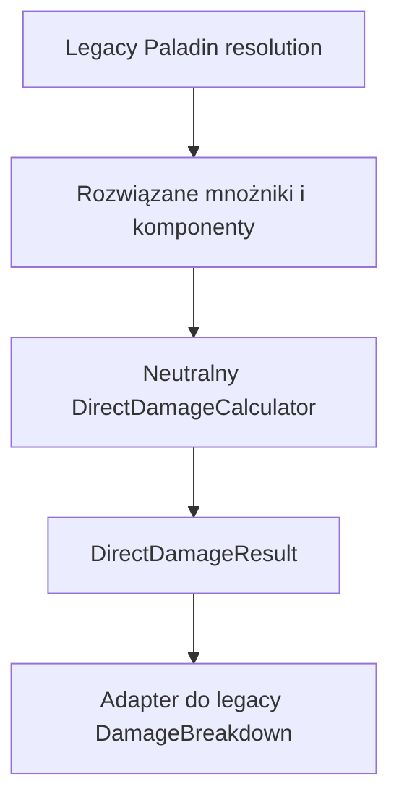
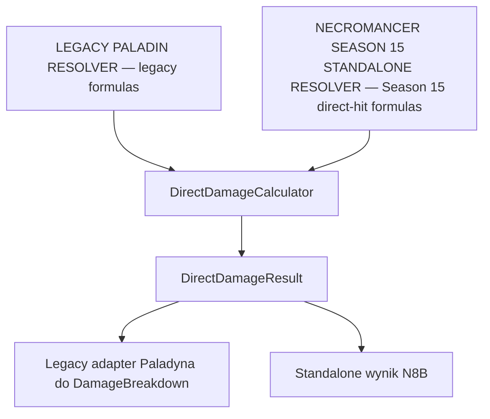
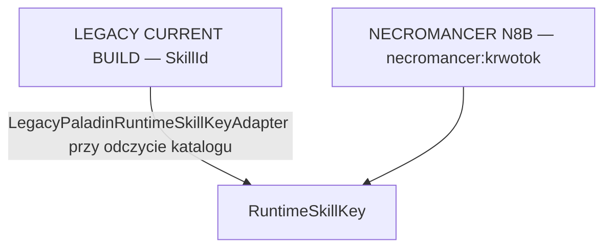
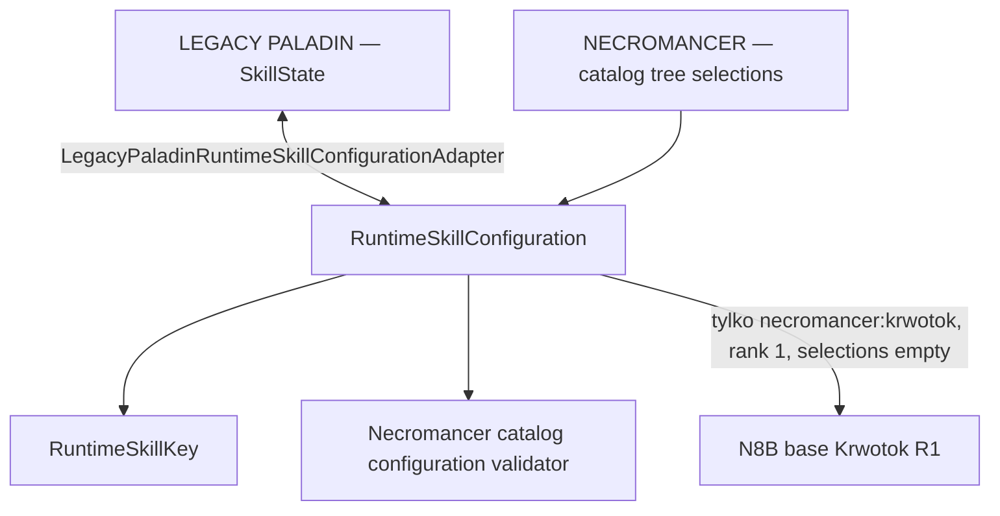
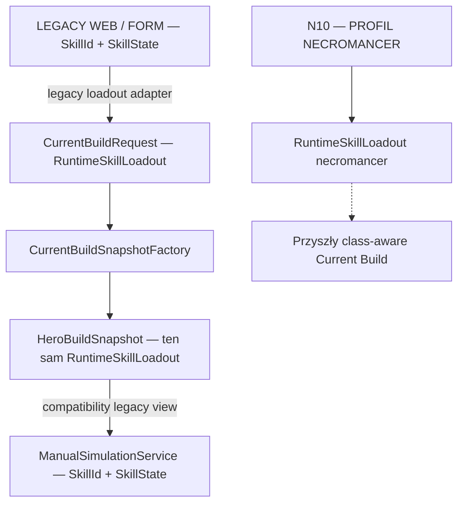
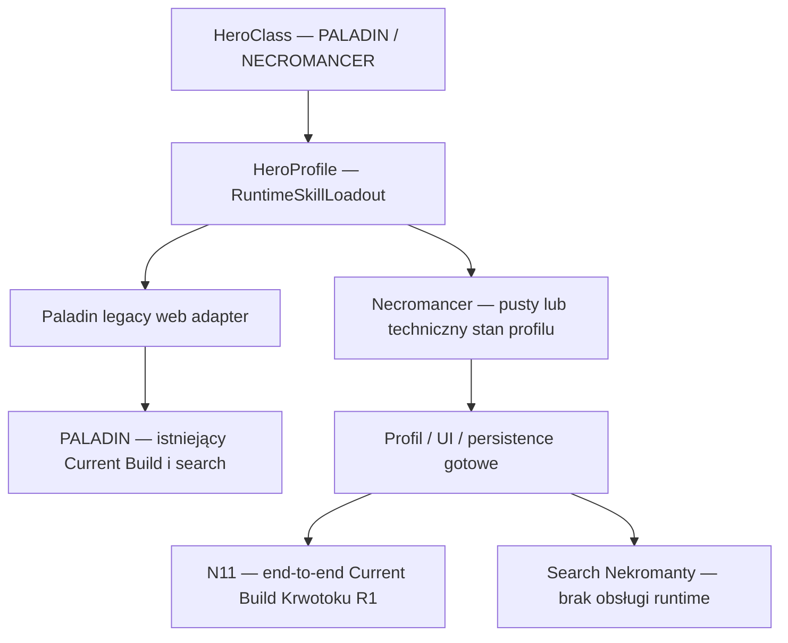
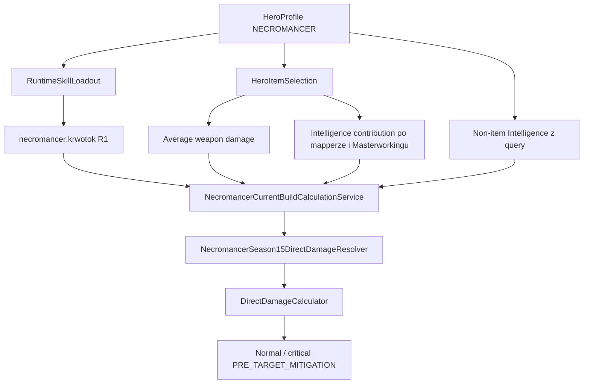

# Diablo 4 DPS Engine / Build WebApp

## Status dokumentu
Ten README opisuje wyłącznie aktualny stan projektu. Jest kontraktem wykonawczym dla implementacji od zera w pustym repo i nie zawiera historii decyzji, etykiet wersji ani logu zmian.

## Podsumowanie redakcyjne
- Scalono logicznie jeden wspólny kontrakt runtime dla `Damage Engine`, manual simulation i build search, jeden model statusów i targetowania single target, jeden kontrakt debugowania wyników oraz jeden kontrakt testów i golden values.
- Celowo pominięto historię wersji, tymczasowe poprawki techniczne, log błędów UI/CRUD, duplikaty tych samych reguł, komentarze typu "po tej rundzie testów" oraz zapisy później zastąpione nowszą regułą.
- Rozstrzygnięte konflikty źródeł: dokumentacja i UI używają nazwy `Vulnerable`, a historyczne `Exposed` pozostaje wyłącznie aliasem technicznym; search ocenia `build + skill bar`, a kolejność paska pozostaje semantyczna przez `LRU`; modyfikatory typu `replace` podmieniają bazowy hit tam, gdzie finalna reguła tak stanowi; czas trwania statusów wynika z definicji konkretnego efektu, a nie z niespójnych ogólnych zapisów historycznych.

## Spis treści
- [1. Cel projektu](#1-cel-projektu)
- [2. Kontrakty wykonawcze](#2-kontrakty-wykonawcze)
- [3. Architektura systemu](#3-architektura-systemu)
- [4. Model domeny](#4-model-domeny)
- [5. Damage Engine](#5-damage-engine)
- [6. Statusy i zasady targetowania](#6-statusy-i-zasady-targetowania)
- [7. Single hit / delayed hit / reactive damage](#7-single-hit--delayed-hit--reactive-damage)
- [8. Rotacja symulacji](#8-rotacja-symulacji)
- [9. Build search](#9-build-search)
- [10. UI, debug i prezentacja wyników](#10-ui-debug-i-prezentacja-wyników)
- [11. Testy i golden values](#11-testy-i-golden-values)
- [12. Zasady dostarczania](#12-zasady-dostarczania)

## 1. Cel projektu
Projekt `Diablo 4 DPS Engine / Build WebApp` nie jest definiowany produktowo jako narzędzie dla jednej klasy postaci. Docelowo architektura aplikacji ma wspierać wiele klas, ale aktualny zaimplementowany foundation domenowy i referencyjny runtime koncentrują się na obecnym zakresie klasowym repo.

Pełna tickowa symulacja i search pozostają foundation Paladyna. Nekromanta ma pełny profil aplikacji oraz pierwszy end-to-end Current Build: bazowy direct hit Krwotoku R1, normalny i krytyczny, przed redukcją celu. To aktualny zakres wykonania, opisany w sekcji 5.11.

Docelowo system ma wspierać dwa tryby pracy:
- `Policz aktualny build` - manual simulation Paladyna albo pojedynczy direct hit Krwotoku R1 Nekromanty.
- `Znajdź najlepszy build` - build search oceniający legalne buildy i legalne konfiguracje paska skilli.

Aktualny stan repo obejmuje foundation backendowego searcha, minimalne GUI SSR oraz realny foundation importu pojedynczego itemu ze screena:
- minimalny wspólny silnik pojedynczego uderzenia dla `Brandish` i `Holy Bolt`,
- pierwszy pełny use case cooldownowego direct-hit runtime dla `Advance`,
- pełny pierwszy use case reactive foundation dla `Clash`,
- delayed hit `Judgement` dla bazowego rozszerzenia `Holy Bolt`,
- foundation reactive damage dla `Thorns` i `Retribution`,
- ograniczony kontrakt `Resolve`, `Crusader's March` i `Punishment` potrzebny do use case `Clash`,
- tickową manual simulation dla trybu `Policz aktualny build`,
- realny model wejścia użytkownika oparty o `CurrentBuildRequest`,
- `CurrentBuildSnapshotFactory` budujący `HeroBuildSnapshot` z realnych danych wejściowych użytkownika,
- wspólną usługę aplikacyjną `CurrentBuildCalculationService` nad istniejącym runtime,
- osobną warstwę aplikacyjną backendowego searcha opartą o `BuildSearchRequest`,
- generator legalnych kandydatów searcha obejmujący aktualny foundation skilli i action bara,
- ranking kandydatów po `total damage` i `DPS` liczonych przez ten sam runtime,
- warstwę prezentacyjną normalizującą wyniki searcha po zakończonej ocenie kandydatów,
- nowy pierwszorzędny byt produktu `bohater` z własnym kontekstem buildu, aktywnymi slotami, przypisanymi umiejętnościami i paskiem akcji,
- moduł `Bohaterowie` z profilami Paladyna i Nekromanty, tworzeniem, edycją nazwy/poziomu, wyborem aktywnego bohatera, usuwaniem i odczytem po restarcie; search wykonuje wyłącznie Paladyna,
- N11 — pierwszy grywalny Current Build Nekromanty: Krwotok R1 bez upgrade'ów, aktywna broń, efektywna Intelligence z itemów i jawna non-item Intelligence, opcjonalny Vulnerable, zapis i odtworzenie po restarcie,
- minimalne webowe GUI SSR dla trybu `Policz aktualny build`,
- hero-centryczny ekran `Policz aktualny build`, który pracuje jawnie w kontekście aktywnego bohatera,
- inline zmianę aktywnego bohatera bez opuszczania ekranu `Policz aktualny build`,
- czytelną edycję poziomu aktywnego bohatera wyłącznie w sekcji `Punkty umiejętności` na ekranie `Policz aktualny build`,
- sekcję `Ekwipunek aktualnego buildu` pokazującą pełny układ slotów bohatera jako stały layout SSR z aktywnym itemem albo pustym slotem,
- bezpośrednią zmianę aktywnego itemu per slot z poziomu current build w kontekście aktywnego bohatera bez budowania osobnego runtime ekwipunku,
- czytelne rozdzielenie operacji slotu na `Wybierz z biblioteki`, `Importuj nowy item`, `Zmień item` i `Wyczyść slot`,
- jawny model przypisanych umiejętności bohatera z trwałym zapisem rangi, bazowego ulepszenia i dodatkowego modyfikatora,
- render current build ograniczony do umiejętności przypisanych aktywnemu bohaterowi oraz pasek akcji wybierający wyłącznie spośród przypisanych i nauczonych umiejętności,
- zwinięte szczegóły użytych itemów pokazujące, które aktywne itemy rzeczywiście składają się na bieżący build i jaki mają wkład,
- prawdziwy ekran główny `/` działający jako hub aplikacji z grupami modułów i statusami,
- globalną nawigację SSR wspólną dla głównych ekranów aplikacji,
- wspólny renderer app shell oraz wspólny zestaw tokenów wizualnych dla głównych ekranów SSR, z czytelnym wyróżnianiem aktywnego modułu, akcji i statusów,
- centralny rejestr modułów aplikacji z opisem, grupą, statusem i URL,
- placeholder pages dla przyszłych sekcji dodatku i sezonu bez implementacji ich mechaniki,
- SSR flow `Importuj item ze screena` dla importu obrazu po `StructuredItemParts`, z neutralnym odczytem PART_1 oraz OCR pojedynczych `PropertyBlock` z PART_2/PART_3,
- Etap 1 importu obrazu: `1..N` screenshotów jednego itemu składane przez `OpenCvItemImageAssembler` do `AssembledItemImage`,
- Etap 2A importu obrazu: strukturalna detekcja separatorów przez `HorizontalDividerDetector` i podział na surowe `ItemImagePart[]`,
- Etap 3A importu obrazu: deterministyczna normalizacja surowych części do `StructuredItemParts` przez `ItemPartStructureNormalizer`,
- produkcyjne UI importu pokazujące domyślnie czysty upload i edytowalny draft `ItemImportEditableForm` pod nagłówkiem `Weryfikacja itemu przed zapisem`, z pełną diagnostyką Etapów 1/2A/3A, PART_1, `PropertyBlockSemanticResult` i `PropertyBlockValueReadResult` dostępną po ręcznym `?diagnostics=true`,
- usunięty legacy Windows OCR z runtime importu obrazu; aktywny OCR diagnostyczny używa Tess4J, a mapowanie do draftu nie zapisuje itemu automatycznie i kończy się dopiero na istniejącym formularzu weryfikacji,
- walidowany formularz zapisanych/ręcznie edytowanych itemów z edytowalną listą affixów oraz osobnym mapowaniem do aktualnego modelu buildu,
- minimalną trwałą bibliotekę zapisanych itemów z wieloma itemami tego samego slotu, zapisywaną lokalnie w stabilnym katalogu użytkownika,
- osobną bazę wiedzy itemów uczącą się wyłącznie z ręcznie zatwierdzonych itemów, z aktywną epoką wiedzy, obserwowanymi typami affixów, obserwowanymi aspektami i resetem sezonowym,
- wspólną bibliotekę zapisanych itemów oraz niezależny wybór aktywnego itemu per slot dla każdego bohatera,
- wyraźny wynik zapisu importowanego itemu do biblioteki z nazwą, slotem, identyfikatorem i akcjami `Załóż bohaterowi`, `Zmień w slocie` oraz `Wróć do aktualnego buildu`,
- nowy tryb searcha po bibliotece itemów, który generuje kombinacje zapisanych itemów per slot w kontekście aktywnego bohatera i nadal składa je do effective current build przed tym samym runtime,
- uproszczony i bardziej produktowy formularz GUI searcha z wyeksponowanym trybem biblioteki itemów,
- ujednolicony polski język głównych ekranów SSR, helperów, sekcji wynikowych i akcji użytkownika,
- empty state sekcji `Wstępnie rozpoznane pola` w imporcie pojedynczego itemu,
- pierwsze minimalne webowe GUI SSR dla trybu `Znajdź najlepszy build`,
- pierwszy drill-down SSR z wyniku searcha do pełnej analizy reprezentanta znormalizowanego wyniku na tym samym runtime co manual simulation,
- ogólny opisowy ekran SSR `/ranking-obrazen` z parametrem `character=paladin`, pokazujący wszystkie 24 wpisy z `PaladinSkillTreeRegistry`, ich status policzalności, źródła opisowe i blokadę DPS dla niezweryfikowanych mechanik,
- edytowalne źródła Markdown Paladyna w `docs/paladin/source-md/` oraz pomocniczy ekstrakt JSON tabel rang z lokalnej paczki HTML Fextralife,
- foundation audytu/preflightu searcha z liczbą legalnych kandydatów i rozmiarem search space,
- minimalny progress CLI searcha dla etapu oceny kandydatów,
- CLI dla manual simulation oraz osobne CLI backendowego searcha jako równoległe smoke testy tego samego runtime.

Pełny system zasobów, pełny system defensywnych statusów, pełne feature'y `Fervor`, pełny ogólny system `Resolve`, `Fala Zealot`, live progress searcha w GUI, eksport CSV, wielowątkowość, pełny wielo-itemowy flow, pełna sesja ekwipunku, pełny OCR całej postaci oraz pełna docelowa warstwa UX/UI pozostają poza bieżącym zakresem kodu.

Kontrakt architektoniczny jest wspólny dla obu trybów:
- oba tryby muszą używać tego samego `Damage Engine`,
- oba tryby muszą używać tej samej logiki ticków, statusów, targetowania i wyboru skilla,
- wynik searcha musi dać się odtworzyć manualnie po zastosowaniu tego samego buildu i tego samego paska skilli.

## 2. Kontrakty wykonawcze
- README jest źródłem prawdy dla architektury, logiki runtime, zasad testowych i kontraktu UI/debug.
- Każda zmiana logiki wymaga równoczesnej aktualizacji kodu, testów i README.
- Nie wolno zgadywać wartości liczbowych w kodzie ani w testach.
- Wszystkie nowe liczby w testach muszą wynikać z istniejących golden values albo z aktualnego outputu engine dla tego samego buildu.
- Dokumentacja projektowa oraz komentarze w kodzie muszą być prowadzone po polsku.
- Silnik, symulacja i search muszą być deterministyczne.
- RNG nie należy do logiki kontraktowej; dla efektów probabilistycznych używany jest `expected value`.
- Domyślnym modelem projektu jest single target.
- Każde dostarczenie projektu musi być pełną paczką projektu; nie wolno dostarczać niepełnych paczek ani placeholderów zamiast realnej logiki.
- Paczka projektu nie może być generowana z failing testami; wymagane jest `100%` przechodzących testów.

## 3. Architektura systemu
### 3.1. Główne założenia
- Architektura jest data-driven.
- Aktualny kod implementuje jeden wspólny foundation `Damage Engine` dla single hit i komponentów obrażeń.
- Ten sam foundation ma pozostać bazą dla przyszłej manual simulation i build search.
- Search nie może docelowo używać skróconej lub alternatywnej logiki względem manual simulation.

### 3.1.1. App shell i moduły
Aktualny frontend SSR posiada produktową warstwę app shell nad istniejącymi flow obliczeń.

Kontrakt app shell:
- root `/` jest prawdziwym ekranem głównym aplikacji, a nie technicznym przekierowaniem do innego formularza,
- ekran główny grupuje moduły w obszary `Narzędzia builda`, `Itemy i import` oraz `Systemy dodatku i przyszłe sekcje`,
- istnieje centralny rejestr modułów opisujący `id`, nazwę, opis, grupę, status, URL oraz to, czy moduł jest aktywny czy placeholderowy,
- moduł `Bohaterowie` jest częścią aktywnej nawigacji produktu i stanowi punkt wejścia do pracy na aktywnym bohaterze,
- globalna nawigacja SSR jest renderowana z tego samego rejestru modułów, a nie z rozproszonych ręcznych linków w wielu ekranach,
- główne ekrany SSR korzystają z tego samego renderera app shell i tego samego zestawu tokenów wizualnych dla tła, paneli, przycisków, statusów i aktywnej zakładki,
- główne ekrany SSR korzystają też z szerszego wspólnego kontenera layoutu, żeby current build, search i biblioteka lepiej wykorzystywały szerokie monitory bez łamania mobilnego SSR,
- aktywny moduł `Ranking obrażeń` jest ogólnym ekranem nad `DamageRankingService` i providerem rejestrów klas; dla `character=paladin` używa `PaladinSkillTreeRegistry` i nie implementuje nowych formuł DPS,
- istniejące flow `Policz aktualny build`, `Importuj item ze screena`, `Biblioteka itemów`, `Znajdź najlepszy build` i drill-down searcha pozostają cienkimi warstwami nad tym samym runtime,
- placeholder pages są świadomą warstwą produktową przygotowującą architekturę aplikacji pod przyszłe sekcje, a nie atrapą zastępującą istniejącą logikę runtime.

### 3.2. Wspólne wejście runtime
Produktowy model wejścia użytkownika dla manual simulation ma postać `CurrentBuildRequest`.

Od N9C jego kanoniczny payload skilli to immutable `RuntimeSkillLoadout`, przenoszony bezpośrednio przez `CurrentBuildSnapshotFactory` do tego samego pola `HeroBuildSnapshot`. Publiczne konstruktory requestu nadal przyjmują SkillId/SkillState, a istniejące gettery requestu i snapshotu udostępniają widok legacy przez adapter. ManualSimulationService, CLI, search, web i persistence zachowują dotychczasowe API. Neutralny jest tylko transport skilli; pozostałe pola requestu/snapshotu nadal opisują Paladyna. Szczegóły: sekcja 5.9.

Kontrakt aktualnej warstwy aplikacyjnej:
- GUI mapuje formularz do `CurrentBuildRequest` przez `CurrentBuildFormMapper`,
- CLI mapuje argumenty do `CurrentBuildRequest` przez `CurrentBuildCliRequestParser`,
- `CurrentBuildSnapshotFactory` buduje z requestu runtime `HeroBuildSnapshot`,
- `CurrentBuildCalculationService` uruchamia ten sam runtime dla GUI i CLI,
- GUI importu itemu mapuje upload obrazu do `List<ItemImageImportRequest>`,
- `OpenCvItemImageAssembler` składa jeden lub wiele screenshotów jednego tooltipa do `AssembledItemImage`,
- `HorizontalDividerDetector` analizuje finalny obraz i zwraca strukturalne separatory oraz surowe `ItemImagePart[]`,
- `ItemPartStructureNormalizer` normalizuje uporządkowane raw parts do `StructuredItemParts`,
- aktywny pipeline importu obrazu po `StructuredItemParts` uruchamia odczyt PART_1: ROI, raw Tess4J OCR per ROI, obrazowy detektor gwiazdek i neutralny `Part1ReadResult`, a dla zamkniętej segmentacji PART_2/PART_3 uruchamia raw Tess4J OCR per `PropertyBlock` do neutralnego `PropertyBlockReadResult`, zamkniętą klasyfikację semantyczną do `PropertyBlockSemanticResult` oraz neutralny odczyt wartości do `PropertyBlockValueReadResult`; ten sam pojedynczy przebieg read resultów może zbudować draft `ItemImportEditableForm`, ale nie zapisuje itemu do biblioteki,
- legacy Windows OCR, preprocessing OCR, merger OCR, parser OCR i debug trace starego importu obrazu zostały usunięte; obecne OCR PART_1 i PropertyBlock są nowymi etapami diagnostycznymi opartymi o Tess4J,
- `AspectRegistry` jest katalogiem znanych aspektów dostępnych w imporcie i waliduje zgodność wybranego aspektu ze slotem itemu,
- `AffixRegistry` / `ApplicationAffixRegistry` jest osobnym katalogiem affixów, analogicznym koncepcyjnie do katalogu aspektów, ale niezależnym od niego; służy do ręcznej korekty, pracy na zapisanych odczytach itemów i przyszłego tworzenia idealnych itemów na bazie katalogu,
- `ImportedItemDisplayedValueReverseResolver` jest ogólnym etapem importu dla wartości widocznych po Doskonaleniu; może uzupełnić `referenceValue` tylko wtedy, gdy model Doskonalenia daje jednoznaczny wynik dla widocznej wartości, typu affixu i jakości itemu,
- `ItemImportFormMapper` waliduje ręcznie poprawiony item do `ValidatedImportedItem`,
- `ValidatedImportedItemToItemMapper` mapuje zatwierdzony item do aktualnego modelu `Item`,
- `ImportedItemCurrentBuildContributionMapper` mapuje zatwierdzony item do aktualnego agregowanego modelu buildu używanego przez `CurrentBuildRequest`,
- `ImportedItemCurrentBuildApplicationService` stosuje zatwierdzony item do istniejących statów current build w trybie `nadpisz` albo `dodaj wkład`,
- `HeroProfileRepository` trwale zapisuje bohaterów aplikacji oraz identyfikator aktywnego bohatera bez systemu kont użytkowników,
- `HeroService` zarządza listą bohaterów, aktywnym bohaterem, jego kontekstem buildu, poziomem, aktywnymi slotami oraz przypisanymi umiejętnościami,
- `ItemLibraryRepository` trwale zapisuje minimalną wspólną bibliotekę zatwierdzonych itemów bez duplikowania jej per bohater,
- `ItemLibraryService` zapisuje zatwierdzony item do biblioteki, udostępnia listę zapisanych itemów, waliduje zgodność itemu z hero slotem i składa aktywne itemy wybranego bohatera do effective current build,
- SSR current build pokazuje selekcję aktywnych slotów aktywnego bohatera jako `Ekwipunek aktualnego buildu` i zmienia aktywny item per slot bez budowania bocznego modelu equipment runtime,
- SSR current build pozwala zmienić aktywnego bohatera bez opuszczania ekranu buildu; poziom Paladyna można edytować w sekcji `Punkty umiejętności`, a nazwę/poziom obu klas w `/bohaterowie`,
- bohater ma własny trwały canonical `RuntimeSkillLoadout`; `HeroSkillLoadout` jest odtwarzanym legacy widokiem Paladyna. Current Build renderuje i zapisuje jego przypisane umiejętności; dla Nekromanty używa osobnego formularza i usługi direct hit N11, bez obliczeń Paladyna,
- przypisywanie umiejętności bohatera odbywa się bezpośrednio na ekranie `Policz aktualny build` przez sekcję `Umiejętności bohatera` i operacje `Dodaj umiejętność` oraz `Usuń umiejętność`,
- `/bohaterowie` pozostaje modułem zarządzania profilami, a `/policz-aktualny-build` jest istniejącym miejscem edycji przypisanych umiejętności aktywnego bohatera,
- karty przypisanych umiejętności mogą pokazywać opisowy blok aktualnej konfiguracji z tego samego `PaladinSkillTreeRegistry`, którego używa `/ranking-obrazen`; pierwszy most prezentacyjny mapuje legacy `SkillId.CLASH` na wpis registry `starcie`, bez zmiany enumu runtime,
- `SkillId.CLASH` jest legacy runtime ID użytkowego `Starcie`; bazowy direct damage Starcia w runtime używa pierwszych pięciu rang z `PaladinSkillTreeRegistry`: `115 / 126 / 138 / 149 / 167`,
- `/policz-aktualny-build` pokazuje dane przypisanej umiejętności na aktualnej randze kupionej punktami: ranga `0` oznacza umiejętność przypisaną, ale bez aktywnych danych bojowych, a procent obrażeń jest pokazywany tylko wtedy, gdy istnieje jawna wartość dla tej rangi; ekran nie interpoluje między R1 i max drzewa,
- przypisanie umiejętności nie aktywuje automatycznie wszystkich modyfikatorów katalogowych z drzewa Paladyna; aktywne modyfikatory prezentacyjne wynikają z aktualnej konfiguracji formularza, są renderowane jako nazwy z tooltipami źródłowymi i nie odblokowują runtime DPS ani nie sumują komponentów bez jawnej obsługi,
- bazowe generowanie Wiary pokazywane przy przypisanej umiejętności jest bazową wartością umiejętności, a nie aktywnym modyfikatorem konfiguracji; modyfikator `Generowanie Wiary` może pojawić się w aktywnych modyfikatorach tylko wtedy, gdy istnieje jawne mapowanie aktualnej konfiguracji,
- current build waliduje budżet punktów umiejętności: poziom bohatera `1..70` daje `max(0, poziom - 1)` punktów, dodatkowe punkty z zadań mają zakres `0..14`, więc poziom `70` z kompletem zadań daje maksymalnie `83` punkty,
- koszt konfiguracji umiejętności to suma rang kupionych punktami, aktywnych bazowych ulepszeń i wybranych dodatkowych modyfikatorów innych niż `Brak`; ranga kupiona punktami ma zakres `0..15`, ranga `0` bez ulepszeń kosztuje `0`, ranga `15` kosztuje `15`, a przekroczenie dostępnego budżetu oznacza nielegalną konfigurację bez automatycznego usuwania wyborów użytkownika,
- itemowe bonusy do poziomu/rangi umiejętności są osobną przyszłą warstwą względem rangi kupionej punktami, nie kosztują punktów umiejętności i w tym etapie nie implementują `effectiveRank`,
- `/policz-aktualny-build` używa szerokiego wariantu layoutu i zwijanych sekcji dla edycji aktualnego builda; duży widoczny hero nagłówek strony został usunięty, poziom bohatera edytuje się tylko w sekcji `Punkty umiejętności`, a zwinięty panel `Aktywny bohater` pokazuje poziom wyłącznie informacyjnie,
- wszystkie główne sekcje `/policz-aktualny-build` są domyślnie zwinięte; sekcja punktów nie pokazuje stałego komunikatu poprawności, a błędy budżetu pojawiają się dopiero wtedy, gdy wystąpią,
- sticky pasek `/policz-aktualny-build` rozdziela `Oblicz aktualny build`, `Zapisz zmiany` i `Wycofaj zmiany`; błędnego przydziału punktów albo nielegalnego paska akcji nie da się zapisać do profilu, a link `Wycofaj zmiany` przeładowuje `/policz-aktualny-build` z ostatnio zapisanym stanem i nie usuwa bohatera, przypisanych umiejętności ani itemów,
- pasek akcji current build ma `6` miejsc i jest ograniczony do przypisanych oraz nauczonych umiejętności aktywnego bohatera; nielegalne wpisy blokują zapis zamiast cichego czyszczenia profilu,
- `ItemLibraryDataDirectoryResolver` rozwiązuje katalog trwałych danych biblioteki itemów przez `dstats.dataDir` albo domyślny katalog użytkownika `~/.dstats/item-library/` i wykonuje bezpieczną migrację z legacy `target/item-library-runtime/`,
- biblioteka itemów pozostaje warstwą aplikacyjną przed `CurrentBuildRequest`, a aktywny wybór slotów należy do konkretnego bohatera,
- effective current build jest składany jako `bohater + jego ręczne nadpisanie statów + jego aktywne itemy per slot -> finalne effective current build stats -> CurrentBuildRequest -> CurrentBuildSnapshotFactory -> runtime`,
- `CurrentBuildRequest` niesie finalne effective stats dla current build i searcha, natomiast `CurrentBuildSnapshotFactory` mapuje `strength` i `intelligence` do itemowego wkładu snapshotu przez odjęcie baseline klasy/poziomu; dzięki temu `DamageEngine` nadal sam dolicza baseline klasy/poziomu i nie podwaja siły Paladyna poziomu `70` z `79` do `158`,
- ekran `Policz aktualny build` jest roboczym ekranem konfiguracji bohatera i pokazuje hierarchię `punkty umiejętności -> umiejętności -> pasek akcji -> podstawowe statystyki bohatera -> ekwipunek -> efektywne staty -> wynik/debug`; efektywne staty do obliczeń są podsumowaniem wejścia do runtime na końcu, `Szczegóły użytych itemów` i `Zaawansowane ręczne nadpisanie statów` nie są głównymi sekcjami UI, a debugi symulacji są w końcowej zwiniętej sekcji,
- pusty slot w current build rozdziela dwie ścieżki operacyjne: `Wybierz z biblioteki` dla istniejących itemów oraz `Importuj nowy item` dla dopisania nowego zapisu do wspólnej biblioteki,
- slot z aktywnym itemem pokazuje operacje `Zmień item` i `Wyczyść slot`, a import pozostaje ścieżką pomocniczą do dopisania nowego itemu,
- tryb searcha po bibliotece itemów używa analogicznego kontraktu `aktywny bohater + jego ręczna baza searcha + kandydacka kombinacja zapisanych itemów z biblioteki -> finalne effective current build stats -> CurrentBuildRequest -> CurrentBuildSnapshotFactory -> runtime`,
- walidacja wejścia current build dotyczy finalnych effective stats mapowanych do `CurrentBuildRequest`, a nie wyłącznie surowej ręcznej bazy formularza,
- GUI importu itemu pozostaje cienką warstwą wejściową nad obecnym modelem current build w kontekście aktywnego bohatera i nie implementuje alternatywnego runtime,
- CLI searcha mapuje argumenty do `BuildSearchRequest` przez `BuildSearchCliRequestParser`,
- GUI searcha mapuje formularz do `BuildSearchRequest` przez `SearchBuildFormMapper`,
- GUI searcha dziedziczy domyślne wartości z aktywnego bohatera i ogranicza przestrzeń skilli do umiejętności przypisanych temu bohaterowi,
- `BuildSearchCalculationService` generuje legalnych kandydatów przez `BuildSearchCandidateGenerator`,
- przy włączonym trybie biblioteki itemów `BuildSearchCandidateGenerator` pobiera deterministyczne kombinacje `0..1 zapisany item per slot`, składa ich wkład do effective current build i dopiero wtedy buduje `CurrentBuildRequest`,
- każdy kandydat searcha jest adaptowany do `CurrentBuildRequest`, a następnie do `HeroBuildSnapshot` przez ten sam `CurrentBuildSnapshotFactory`,
- `BuildSearchEvaluationService` ocenia kandydatów przez ten sam `ManualSimulationService`,
- `BuildSearchCandidateGenerator` liczy także preflight/audit dokładnie dla tej samej legalnej przestrzeni kandydatów, którą później generuje do oceny,
- `BuildSearchPresentationNormalizer` działa dopiero po zakończeniu surowej oceny i normalizuje wyłącznie warstwę prezentacji wyników,
- `BuildSearchProgressListener` raportuje wyłącznie postęp warstwy aplikacyjnej searcha i nie zmienia logiki oceny,
- GUI searcha jest cienkim SSR nad `BuildSearchCalculationService` i nie implementuje bocznej logiki searcha,
- GUI searcha pokazuje audit/preflight obok wyniku, ale nie implementuje live progressu,
- drill-down GUI searcha mapuje wybranego reprezentanta wyniku po normalizacji do `CurrentBuildRequest` i uruchamia ten sam `CurrentBuildCalculationService` co flow `Policz aktualny build`,
- drill-down searcha nie przywraca bocznie nieprzypisanych umiejętności, tylko odtwarza request z tym samym ograniczeniem skilli co wynik searcha,
- `AppModuleRegistry` jest centralnym rejestrem modułów aplikacji używanym przez ekran główny, placeholder pages i globalną nawigację,
- `HomeController` oraz `HomePageRenderer` budują SSR hub aplikacji na `/`,
- `PlaceholderPageController` oraz `PlaceholderPageRenderer` obsługują przyszłe sekcje dodatku i sezonu bez implementacji ich mechaniki,
- scenariusze referencyjne pozostają wyłącznie trybem pomocniczym budowanym już na `CurrentBuildRequest`,
- `SampleBuildFactory` nie jest główną ścieżką flow użytkownika; pozostaje pomocą testową niższego poziomu.

Wspólne wejście runtime dla manual simulation i dalszego rozwoju searcha ma postać `HeroBuildSnapshot`. Ten model musi zachowywać pełny stan buildu używany przez runtime:
- tożsamość i klasę bohatera,
- poziom bohatera,
- bonusowe punkty skilli,
- średnie obrażenia broni używane przez engine,
- globalny bonus procentowy do obrażeń, jeśli wynika z buildu,
- bazowe `Thorns` z buildu,
- `block chance`,
- `retribution chance`,
- ekwipunek per slot,
- nauczone skille z rangami,
- stan bazowego rozszerzenia i dodatkowego modyfikatora dla każdego skilla,
- aktualnie wybrany pasek aktywnych skilli.

Snapshot nie może gubić:
- equipment,
- rang skilli,
- rozszerzeń,
- konfiguracji paska,
- innych danych wpływających na runtime.

### 3.3. Wspólne wyjście runtime
Aktualne wspólne wyjście foundation ma postać:
- `DamageBreakdown`
- `DamageComponentBreakdown`
- `DelayedHitBreakdown`
- `ReactiveHitBreakdown`
- `SkillHitDebugSnapshot`
- `SimulationStepTrace`
- `SkillBarStateTrace`
- `SimulationResult`

Na tym etapie te modele są źródłem prawdy dla:
- wyniku pojedynczego uderzenia,
- wyniku krytycznego,
- listy komponentów obrażeń,
- informacji o wliczeniu albo pominięciu komponentu w single target,
- reprezentatywnego debug bezpośredniego hita dla każdego skilla użytego w symulacji,
- listy delayed hitów w manual simulation,
- listy reactive hitów w manual simulation,
- tickowego `stepTrace` dla dokładnie tej samej symulacji, która liczy wynik końcowy,
- zwykłego i krytycznego wariantu bezpośredniego trafienia oraz deterministycznej decyzji, który wariant został zastosowany w danym ticku,
- total reactive damage dla trybu `Policz aktualny build`,
- total damage i DPS dla trybu `Policz aktualny build`.

Docelowe bogatsze modele wyników dla manual simulation, searcha i UI pozostają poza aktualnym zakresem implementacji.

## 4. Model domeny
### 4.1. Build
Build bohatera to:
- bohater,
- wyposażone itemy,
- nauczone skille,
- wariant każdego skilla,
- aktualny pasek aktywnych skilli.

Reguły legalności buildu:
- equipment jest zapisany per slot,
- item nie może być użyty równocześnie w więcej niż jednym slocie,
- reguła dotyczy także ringów,
- założenie broni 2H czyści off-hand,
- `Item Power` i `Required Level` są metadanymi i nie wpływają na damage engine.

### 4.2. Model skilla
Stan pojedynczego skilla obejmuje:
- `OFF` albo `rank 1..5`,
- `bazowe rozszerzenie` jako osobny stan,
- maksymalnie jeden `dodatkowy modyfikator`.

Reguły legalności stanu skilla:
- dodatkowy modyfikator nie może istnieć bez bazowego rozszerzenia,
- skill z upgradem przy `rank 0` jest nielegalny,
- skill może mieć maksymalnie jeden dodatkowy modyfikator.

### 4.3. Rejestr drzewa Paladyna
Model drzewa Paladyna w nowych funkcjach korzysta z lokalnych materiałów źródłowych w `docs/paladin/`. Rejestr `krys.paladin.PaladinSkillTreeRegistry` rozróżnia wpisy umiejętności w drzewie, grupy ulepszeń, pojedyncze ulepszenia, `sourcePdf`, `skillGroup`, typ skilla oraz status obsługi.

`docs/paladin/source-md/` jest nowym edytowalnym źródłem opisowego drzewa Paladyna. Zawiera wersje Markdown rejestrów umiejętności oraz materiały pomocnicze, które można rozwijać bez edycji PDF-ów.

`docs/paladin/source-pdfs/` jest nadal utrzymywane jako archiwum i źródło porównawcze dla wcześniejszych PDF-ów. PDF-y nie są już opisywane jako jedyne źródło prawdy, ale pozostają użyteczne do audytu pochodzenia danych i regresji SHA istniejących materiałów.

Aktualny rejestr drzewa Paladyna pozostaje pełnym rejestrem opisowym wpisów umiejętności w drzewie ze wszystkich lokalnych materiałów przeniesionych z PDF-ów źródłowych:
- `paladin_basic_skill_registry_final.pdf`,
- `paladin_core_skill_registry_final.pdf`,
- `paladin_aura_skill_registry_final.pdf`,
- `diablo4_paladyn_odwaga_umiejetnosci.pdf`,
- `diablo4_paladyn_sprawiedliwosc_umiejetnosci.pdf`,
- `moce_specjalne_diablo4.pdf`.

Wymagane edytowalne materiały Markdown w `docs/paladin/source-md/`:
- `paladin_basic_skill_registry_final.md`,
- `paladin_core_skill_registry_final.md`,
- `paladin_aura_skill_registry_final.md`,
- `diablo4_paladyn_odwaga_umiejetnosci.md`,
- `diablo4_paladyn_sprawiedliwosc_umiejetnosci.md`,
- `moce_specjalne_diablo4.md`,
- `paladin_fextralife_rank_tables.md`,
- `paladin_fextralife_html_manifest.md`.

`docs/paladin/source-md/paladin_fextralife_rank_tables.json` jest maszynowym ekstraktem tabel rang z lokalnej paczki HTML Fextralife. JSON jest pomocniczym źródłem danych dla modeli `DamagePercentRankTable` i `DamagePercentComponentRankTable`, ale sam nie przełącza `PaladinSkillTreeRegistry` automatycznie na pełne tabele rang i nie oznacza implementacji realnego DPS.

Przed masowym importem wartości obrażeń z JSON-a obowiązuje audyt w `docs/paladin/source-md/paladin_damage_rank_table_audit.md`. Audyt klasyfikuje każdy wpis do jednej z kategorii:
- `SIMPLE_SINGLE_COMPONENT` - jedna jednoznaczna tabela obrażeń, kandydat do `DamagePercentRankTable`,
- `MULTI_COMPONENT` - więcej niż jeden komponent obrażeń, kandydat do przyszłego modelu komponentowego,
- `NON_DAMAGE` - brak bezpośredniej tabeli obrażeń albo wpis utility/support/status/cooldown,
- `NEEDS_MANUAL_REVIEW` - dane niejednoznaczne, podejrzane albo wymagające ręcznej weryfikacji.

Audyt jest dokumentem źródłowym procesu importu. Sam dokument audytu nie odblokowuje runtime DPS i nie zastępuje testów mechaniki single target.

`DamagePercentRankTable` jest domenowym modelem pełnej tabeli bazowych procentów obrażeń per ranga. Tabela przechowuje wartości `rank -> damagePercent` dla dopuszczalnych rang `1..15`, gdzie liczba całkowita `115` oznacza `115%`. Model odrzuca rangi poza zakresem `1..15`, odrzuca `null` rank/value przy tworzeniu, przy odczycie brakującej poprawnej rangi zwraca `null` i pozostaje niemutowalny po utworzeniu.

`DamagePercentComponent` nazywa komponent obrażeń w skillach wielokomponentowych, np. `PRIMARY_DAMAGE`, `ADDITIONAL_STRIKE_DAMAGE`, `PASSIVE_DAMAGE`, `ACTIVE_DAMAGE`, `JUMP_DAMAGE`, `LANDING_DAMAGE`, `BURST_DAMAGE`, `DAMAGE_PER_SECOND`, `FIRST_STRIKE_DAMAGE` i `SECOND_STRIKE_DAMAGE`. `DamagePercentComponentRankTable` przechowuje mapę `DamagePercentComponent -> DamagePercentRankTable`. Ten model jest źródłowym opisem komponentów, a nie gotowym DPS.

Po audycie do `PaladinSkillTreeRegistry` zaimportowano proste tabele `DamagePercentRankTable` tylko dla skilli sklasyfikowanych jako `SIMPLE_SINGLE_COMPONENT` i `recommendedModel = DamagePercentRankTable`: `wymach`, `swiety_pocisk`, `starcie`, `natarcie`, `blogoslawiona_tarcza`, `blogoslawiony_mlot`, `boska_lanca`, `uderzenie_tarcza`, `szarza_z_tarcza`, `skazanie` i `konsekracja`. Każda z tych tabel ma komplet rang `1..15` przepisany z lokalnego JSON-a. `blogoslawiony_mlot` zachowuje dotychczasową tabelę `1=115 ... 15=293`.

Skille `MULTI_COMPONENT` nie są importowane do prostych tabel rang, nawet jeśli lokalny JSON zawiera dla nich dane. Dla `zapal`, `aura_swietej_swiatlosci`, `spadajaca_gwiazda`, `wlocznia_niebios` i `zenit` zaimportowano tylko komponentowe tabele rang do `DamagePercentComponentRankTable`. Komponenty nie są sumowane, nie są spłaszczane do jednej wartości procentowej i nie wpływają na `baseDamagePercentAtRank1`, `baseDamagePercentAtTreeMaxRank`, sortowanie po bazowych procentach ani runtime DPS. `spadajaca_gwiazda` ma zaimportowany `LANDING_DAMAGE`; `JUMP_DAMAGE` nie został wpisany, bo lokalny JSON nie podaje go jednoznacznie dla wszystkich rang 1..15. Skille `NON_DAMAGE` i `NEEDS_MANUAL_REVIEW` nie dostały prostych ani komponentowych tabel rang.

Po imporcie prostych i komponentowych tabel rang obowiązuje osobny audyt obecności obrażeń w `docs/paladin/source-md/paladin_damage_presence_audit.md`. Audyt sprawdza, czy każdy z 24 skilli ma obrażenia w bazowej umiejętności, prostej tabeli rang, komponentowej tabeli rang albo wyłącznie przez ulepszenia z `grupa_1`, `grupa_2` lub `grupa_3`. Wynik audytu używa klasyfikacji: `HAS_BASE_DAMAGE` dla skilli z prostą bazową tabelą obrażeń, `HAS_COMPONENT_DAMAGE` dla skilli z rozdzielonymi komponentami obrażeń, `HAS_UPGRADE_DAMAGE_ONLY` dla skilli bez obrażeń bazowych, ale z ulepszeniem sugerującym obrażenia albo zmianę obrażeń, `NON_DAMAGE` dla skilli bez wykrytego źródła obrażeń oraz `NEEDS_MANUAL_REVIEW` dla wpisów niejednoznacznych. Audyt obecności obrażeń nie importuje nowych wartości liczbowych, nie zmienia `PaladinSkillTreeRegistry`, nie zmienia UI i nie odblokowuje runtime DPS.

Osobny audyt modyfikatorów obrażeń z ulepszeń znajduje się w `docs/paladin/source-md/paladin_upgrade_damage_modifier_audit.md`. Model `UpgradeDamageModifier` opisuje pojedyncze ulepszenie przez grupę, nazwę, typ modyfikatora, wartość źródłową, rodzaj wartości, warunek, informację o nowym komponencie, komponent docelowy, skalowanie rangą oraz decyzje `safeForRankingDisplay` i `safeForRuntimeDps`. Typy `UpgradeDamageModifierType` i `UpgradeDamageValueKind` rozdzielają bazowy damage skilla, komponentowy damage skilla, modyfikator damage z ulepszenia oraz pośrednie efekty typu status, szybkość użycia, cooldown, koszt, zasób, utility i defensywa. Modyfikatory ulepszeń są danymi źródłowymi do prezentacji i audytu: nie są sumowane, nie zmieniają bazowych tabel, nie zmieniają sortowania, nie odblokowują runtime DPS i `DamageEngine` nadal ich nie używa.

Nie są wymagane pliki `docs/paladin/source-md/README.md` ani `docs/paladin/source-md/SHASUMS.txt`. Nawigacja źródeł Paladyna może być prowadzona przez `docs/paladin/README.md` oraz ten główny README.

Rejestr zawiera 24 wpisy umiejętności w drzewie. Dla każdego z nich modelowana jest relacja:
- umiejętność bazowa w grupie,
- `grupa_1`, `grupa_2`, `grupa_3`,
- pojedyncze ulepszenia w grupie,
- status ulepszenia i `sourceNote`.

To nie jest jeszcze pełny DPS runtime. Rejestr, Markdown i JSON mogą opisywać umiejętność, jej modyfikatory oraz wartości damage/rank, ale dopóki mechanika single target nie jest zweryfikowana i zaimplementowana w `DamageEngine`, nie wolno liczyć dla niej `damagePerUse`, `effectiveCycleSeconds` ani `theoreticalDps`.

Poprawka Mocy Specjalnych: `Forteca` jest wpisem umiejętności w drzewie z PDF `moce_specjalne_diablo4.pdf`, ma `skillGroup=moce_specjalne` i opisowe tagi z PDF `Specjalne`, `Defensywa`, `Moloch`. Nie jest oznaczana jako kategoria `Główne` / `Core`. `Cierniowa Reduta` jest ulepszeniem `Fortecy` w `grupa_3`, a nie osobną umiejętnością bazową w grupie.

`Furia Niebios` w Mocy Specjalnych ma układ grup `2 / 2 / 3`: `grupa_1` zawiera `Czas Działania` i `Spowolnienie`, `grupa_2` zawiera `Osąd` i `Premia do Obrażeń`, a `grupa_3` zawiera `Ostateczna Sprawiedliwość`, `Krok w Światłości` i `Potrojenie`.

Testy regresyjne Mocy Specjalnych zabezpieczają dokładny układ `Zenitu`: `grupa_1` zawiera `Szansa na Trafienie Krytyczne` i `Osłabienie`, `grupa_2` zawiera `Nieustępliwość` i `Osłabienie`, a `grupa_3` zawiera `Empirejska Klinga`, `Rozdarcie` i `Homilia Stali`.

`Skazanie` ma opis obrażeń w PDF `diablo4_paladyn_sprawiedliwosc_umiejetnosci.pdf`, więc w rejestrze ma typ `DAMAGE` i status `NEEDS_VERIFICATION`. DPS Skazania nie jest liczony.

Różnica kontraktowa:
- `skill exists in tree` oznacza, że umiejętność istnieje w rejestrze PDF i może być pokazywana w analizie,
- `skill can be calculated by DPS engine` oznacza, że istnieje bezpieczny, zaimplementowany model obrażeń w `DamageEngine`.

Statusy rejestru:
- `SUPPORTED` - skill ma bezpieczny model runtime i może wpływać na DPS,
- `NEEDS_VERIFICATION` - skill albo mechanika istnieje w PDF, ale wymaga empirycznej weryfikacji przed wpływem na DPS,
- `UNSUPPORTED` - skill istnieje w PDF, ale nie ma jeszcze modelu runtime ani wystarczająco pewnego odwzorowania do kalkulacji,
- `NON_DAMAGE` - skill jest znany jako niezadający obrażeń i nie trafia do rankingu obrażeń jako osobne źródło DPS.

Obecnie żaden nowy skill z pełnego rejestru PDF nie jest jeszcze `SUPPORTED`, ponieważ nie został zaimplementowany bezpieczny model DPS na podstawie zweryfikowanych mechanik. Nie wolno uzupełniać `damagePerUse`, cooldownów ani DPS na podstawie intuicji albo niepełnego tooltipa.

Stary `PaladinSkillDefs` z `Brandish`, `Holy Bolt`, `Clash` i `Advance` został zdegradowany do warstwy legacy runtime. Pozostaje w repo, ponieważ istniejące testy `DamageEngine`, manual simulation i search nadal regresyjnie chronią stary foundation. `SkillId.CLASH` pozostaje legacy ID runtime dla użytkowego `Starcie` i pobiera bazowe direct damage ranków `1..5` z wpisu `starcie` w `PaladinSkillTreeRegistry`: `115 / 126 / 138 / 149 / 167`. `Starcie` jest legalnym kandydatem runtime tylko przy aktywnej broni i aktywnej tarczy; brak któregokolwiek slotu pomija skill i nie generuje bezpośredniego trafienia. Efekty opisowe Starcia, Lucky Hit, upgrade'y z drzewa i `effectiveRank` nadal nie są podłączone do runtime DPS.

Warstwa `krys.verification` dodaje `Verification Matrix` dla mechanik z pełnego drzewa Paladyna, które wymagają osobnej weryfikacji przed użyciem w kalkulacjach. Wpisy `requiresVerification` są metadanymi procesu i nie mogą wpływać na DPS; próba ich użycia ma zostać pominięta albo zablokowana zgodnie z `default engine behavior`.

Warstwa `krys.ranking` dodaje aplikacyjny ranking obrażeń nad rejestrem drzewa wybranej klasy. `PlayableClass`, `CharacterSkillTreeRegistry` i `SkillTreeRegistryProvider` są warstwą wyboru katalogu. Produkcyjny provider udostępnia `paladin` z dotychczasowymi 24 umiejętnościami oraz `necromancer` z 23 umiejętnościami: 4 `Podstawowe / Basic`, 6 `Główne / Core`, 3 `Zwłoki / Corpse`, 4 `Makabra / Macabre`, 2 `Klątwy / Curse` i 4 `Moce Specjalne / Ultimate`. Obie klasy używają tego samego serwisu, kontrolera i renderera. `PlayableClass` nie jest runtime `HeroClass`.

Wspólny kontrakt drzewa i rankingu jest neutralny klasowo:
- pakiet `krys.skilltree` zawiera niemutowalny `CharacterTreeSkill`, `SkillTreeType`, `SkillTreeStatus`, `SkillUpgrade` i `SkillUpgradeGroup` oraz współdzielone tabele rang/komponentów i opisowe modele wpływu oraz modyfikatorów obrażeń,
- `CharacterTreeSkill` przyjmuje jawne kategorie, tagi, zasób, Lucky Hit oraz interpretację modyfikatorów z rejestru klasy; wspólny model nie rozpoznaje nazw skilli ani ulepszeń Paladyna. Neutralne pole `sourceReference` i getter `getSourceReference()` wskazują źródło WWW albo lokalny dokument; używają ich również `SkillDamageRankingEntry` i `DamageRankingService`. Legacy `PaladinTreeSkill.getSourcePdf()` pozostaje źródłem mapowanym przez adapter, a `VerificationMatrix` zachowuje własny kontrakt PDF,
- `SourceSkillCategory` jest wartością `id + displayName + displayOrder`, a mechaniczne tagi są identyfikatorami tekstowymi; własna kategoria albo tag kolejnej klasy nie wymaga rozszerzania enumu Paladyna,
- `SkillResourceData` ma pola `BigDecimal cost`, `generationMin`, `generationMax`, `generationBonusKnown` oraz `SkillResourceGenerationFrequency generationFrequency` (`PER_USE`, `PER_SECOND` albo `PER_EVENT`). Równe granice reprezentują wartość dokładną, obie puste brak danych; niepełny, odwrócony albo ujemny zakres jest odrzucany. Konstruktor trzech `Integer` zachowuje dotychczasowe dokładne wartości Paladyna i ustawia `PER_USE`. `SkillResourceType` dostarcza etykiety zasobu. Rejestr dostarcza też nazwy grup, słowniki filtrów i przykład wyszukiwania. Dla Paladyna prezentacja Wiary pozostaje taka sama,
- `CharacterSkillTreeRegistry` przechowuje wyłącznie `CharacterTreeSkill`; `SkillTreeRegistryProvider.production()` zestawia oba istniejące rejestry. `paladinOnly()` pozostaje dostępną konfiguracją izolowaną; jawne żądanie niezarejestrowanej klasy zgłasza błąd i nie przechodzi na Paladyna,
- `DamageRankingService` zwraca `SkillDamageRankingEntry` z neutralnymi `SkillDamageModelType`, `SkillDamageVerificationStatus`, `DamageRankingMetric` i `DamageTargetMode`; kontroler, wiersz, model strony, renderer, filtry i wyszukiwanie korzystają wyłącznie ze wspólnych modeli,
- `PaladinSkillTreeRegistry.asCharacterRegistry()` przez `PaladinSkillTreeAdapter` udostępnia te same 24 wpisy, kolejność, tabele, grupy ulepszeń, statusy, tagi, Lucky Hit i dane Wiary. `PaladinUpgradeDamageModifiers` oraz `PaladinUpgradeDamageImpacts` zachowują interpretację lokalnych opisów Paladyna; współdzielone modele metadanych nie zawierają tych reguł,
- `PaladinTreeSkill`, `PaladinSkillTreeType`, `PaladinSkillTreeStatus`, `PaladinSkillUpgrade`, `PaladinSkillUpgradeGroup`, `SkillCategory` i `SkillTag` w `krys.paladin` pozostają kompatybilnym modelem Paladyna dla legacy runtime i current build. Wspólny ranking nie wymaga tych typów. Przysięgi i ich modele pozostają paladynowe,
- `LegacyFoundationDamageRankingService` izoluje dotychczasowe pomocnicze obliczenia rankingu legacy; nie zmienia wywołań ani formuł `DamageEngine`. `SkillId`, `PaladinSkillDefs`, `HeroSkillLoadout`, wejście current build, `ManualSimulationService` i runtime DPS zachowują dotychczasowy kontrakt.

Parametry URL `hasFaithCost`, `faithCost`, `faithGeneratedBase` i `faithGeneratedMaxKnown` pozostają kompatybilne. Backend przyjmuje również neutralne aliasy `hasResourceCost`, `resourceCost`, `resourceGeneratedBase` i `resourceGeneratedMaxKnown`; oba zestawy używają tych samych danych zasobu i reguł sortowania. Kategorie i tagi są walidowane względem słownika wybranego rejestru, z zachowaniem ignorowania nieznanych filtrów. `/ranking-obrazen?character=paladin` i alias `/ranking-obrazen-paladyna` korzystają z tego samego kontrolera oraz renderera.

Regresje `CharacterSkillTreeRegistryTest` i `NeutralDamageRankingWebServerTest` budują sztuczny rejestr z neutralnych modeli, własną kategorią, tagiem, grupą i nazwą zasobu, przeprowadzają go przez provider, ranking oraz istniejący SSR i sprawdzają filtrowanie, sortowanie i blokadę DPS. Fixture nadal używa testowego klucza `PlayableClass.PALADIN`, a liczby pochodzą z audytowanych danych istniejącego rejestru. Test architektoniczny sprawdza brak zależności wspólnych klas od domeny Paladyna. `PaladinSkillTreeAdapterTest` chroni odwzorowanie wszystkich 24 wpisów, a dotychczasowe audyty i regresje runtime pozostają wymagane.

Etap N1 dodaje `krys.necromancer.NecromancerSkillTreeRegistry` wyłącznie jako źródłowy katalog czterech umiejętności Basic: Kościane Odłamki, Żniwa, Rozkład i Krwotok. Każda ma siedem ulepszeń w grupach `2 + 2 + 3`, typ `DAMAGE` i status `NEEDS_VERIFICATION`. Źródła, golden values, wszystkie 28 ulepszeń oraz rozbieżności są opisane w [danych Basic Nekromanty](docs/necromancer/basic-source-data.md). Baseline to Sezon 15 / patch 3.2.1; oficjalny patch 3.2.2 z 30.09.2026 nie wymienia zmian Nekromanty. Bazowe tabele zawierają tylko rangi 1 i 15. Wartości zapisane pod 15 pochodzą z bieżącego widoku max D4Builds, który nie podaje jawnej etykiety Rank 15; to oznaczenie projektu wymagające weryfikacji, bez interpolacji rang 2..14.

Rozkład strukturalnie przechowuje zakres `12–16` Esencji z częstotliwością `PER_SECOND`, a SSR pokazuje `12–16 / sek.`. Facet `hasResourceGeneration` rozpoznaje zakres. Sortowanie `resourceGeneratedBase` porównuje dolną granicę; `resourceGeneratedMaxKnown` górną granicę z uwzględnieniem znanego możliwego dodatku z wybranego ulepszenia. Porównywane są wartości źródłowe bez przeliczania pomiędzy `PER_USE`, `PER_SECOND` i `PER_EVENT`; częstotliwość pozostaje widoczna. Kościane Odłamki mają znany opcjonalny dodatek +5 po wyborze ulepszenia, natomiast +2 za wroga i 7.5 z drugiego zamachu Żniw pozostają warunkowymi modyfikatorami, bez stałego dodatku do bazowego generowania. N2 koryguje opis `generationMaxKnown()`, bez zmiany obliczenia ani modelu zasobu.

Parser procentów modyfikatorów obsługuje kropkę i przecinek dziesiętny, a metryki maksimum i porównanie sortowania używają `BigDecimal`. Z kilku procentów w polu `value` wybiera największy; nie parsuje wartości max-view z `notes`. `7.5%` pozostaje 7.5, a `62.5%` pozostaje 62.5. Bazowe `DamagePercentRankTable` nadal używają `Integer`. Rozkład / Szansa na Szczęśliwy Traf zachowuje +30% i ma `safeForRankingDisplay = NEEDS_MANUAL_REVIEW` z opisem konfliktu PL/EN, widocznym w tooltipie `Manual review`. Wszystkie modyfikatory Nekromanty mają `safeForRuntimeDps = NO`.

Regresje N1 to `NecromancerSkillTreeRegistryTest`, `SkillResourceDataTest`, `DamageRankingRowDecimalTest` i `NecromancerDamageRankingWebServerTest`: sprawdzają źródłowe liczby, brak rang pośrednich, strukturę ulepszeń, konflikty, rozdzielenie klas, rzeczywisty HTTP, wszystkie polskie nazwy ulepszeń w searchu, zakres/częstotliwość oraz sortowanie dziesiętne. Testy czterech Basic pozostają osobnym zakresem po rozszerzeniu katalogu. Ranking wszystkich 23 umiejętności Nekromanty przechodzi też z pustą referencją engine, więc nie wywołuje `DamageEngine`. `HeroClass` od N10 obejmuje Paladyna i Nekromantę; N1/N2/N2.1/N3/N4/N5/N6 nie zmieniały `DamageEngine`, `ManualSimulationService`, `SkillId`, `PaladinSkillDefs` ani funkcji current build. Katalog aktywnych skilli Nekromanty jest kompletny: Basic, Core, Corpse, Macabre, Curse i Ultimate. N8B dostarcza standalone bazowego Krwotoku R1 opisany w sekcji 5.6, N9C/N10 kanoniczny loadout i profil, a N11 Current Build direct hit opisany w sekcji 5.11; pełna symulacja i zasoby Nekromanty pozostają niewdrożone.

Etap N2 rozszerza ten sam `NecromancerSkillTreeRegistry` o sześć Core, kategorię `CORE / Główne` z `displayOrder=1` oraz grupę `core / Główne / Core`, po grupie Basic. Każdy Core ma typ `DAMAGE`, status `NEEDS_VERIFICATION` i siedem ulepszeń `2 + 2 + 3`. Zakres Basic + Core zachowuje 70 ulepszeń: 28 Basic i 42 Core; N3 dodaje osobno 21 Corpse, a N4 28 Macabre. Źródła, wszystkie nazwy i warunki są opisane w [danych Core](docs/necromancer/core-source-data.md), a zakres zmian i walidacja w [raporcie N2](docs/necromancer/n2-implementation-report.md).

Korekta N2.1 naprawia członkostwo 42 istniejących ulepszeń Core w grupach, bez zmiany ich wartości, polskich nazw, opisów i źródeł. Pierwotne N2 błędnie wywnioskowało grupy z kolejności wpisów D4Guides; układ liczbowy `2 + 2 + 3` nie wykrywał tego błędu. Rozstrzygającym źródłem struktury jest [Icy Veins — Necromancer Skills](https://www.icy-veins.com/d4/guides/necromancer-skills/): jawne `Group 1`, `Group 2` i `T`. Grupy 1 i 2 to po dwie alternatywne Enhancements, grupa 3 to trzy alternatywne Transformation variants. Semantyka katalogu oznacza dokładnie jeden wybór z każdej grupy; nie dodaje UI wyboru builda ani runtime. Każdy node ma spójne członkostwo w `SkillUpgradeGroup`, we wszystkich swoich `UpgradeDamageModifier.upgradeGroup` oraz w `UpgradeDamageImpact.groupId`. Bazowy efekt nowy Napływu Krwi pozostaje poza wyborami jako `efekt_bazowy`.

`NecromancerUpgradeGroupMembershipTest` zawiera niezależne golden zbiory członków każdej grupy dla wszystkich 23 skilli: czterech Basic, sześciu Core, trzech Corpse, czterech Macabre, dwóch Curse i czterech Ultimate, sprawdza wszystkie modyfikatory i impact każdego node'a oraz rozłączność alternatyw i wszystkie kombinacje wyborów `1 + 1 + 1` w całym katalogu. Dotychczasowe regresje liczb, konfliktów, komponentów, HTTP i Paladyna pozostają wymagane. Dokładne mapowanie znajduje się w [danych Core](docs/necromancer/core-source-data.md), a przyczyna błędu i walidacja w [raporcie N2.1](docs/necromancer/n2.1-implementation-report.md). [Raport N2](docs/necromancer/n2-implementation-report.md) pozostaje historycznym zapisem pierwotnego wdrożenia.

| Core | Bazowe R1 / max-view zapisany pod 15 | Koszt Esencji | Lucky Hit |
|---|---|---:|---:|
| Włócznia z Kości | 160% / 408% | 25 | 50% |
| Mór | `PRIMARY_DAMAGE` 40% / 102%; `DAMAGE_OVER_DURATION` 210% / 536% łącznie w ciągu 6 s | 20 | 40% |
| Rozdarcie | `FIRST_STRIKE_DAMAGE` 60% / 153%; `SECOND_STRIKE_DAMAGE` 100% / 255% | 20 | 40% |
| Napływ Krwi | `PRIMARY_DAMAGE` 20% / 51%; `BURST_DAMAGE` 125% / 319% | 30 | 12% |
| Krwawa Lanca | 160% / 408% | 15 | 50% |
| Szkieletowy Mag | 80% / 204% za atak jednego maga | 30 | 20% |

Mór, Rozdarcie i Napływ Krwi używają `DamagePercentComponentRankTable`; ich prosta tabela jest pusta, a oba główne procenty pozostają `null`. Neutralny komponent `DAMAGE_OVER_DURATION` przechowuje łączny procent za okres wraz z dodatnim `durationSecondsFor(component)`. Dla Moru czas to 6 s, jawny również w notes. SSR wyświetla `210% w ciągu 6 s` i `536% w ciągu 6 s`; search zachowuje tę jednostkę. Brak czasu dla tego komponentu albo czas przypisany do nieobecnego komponentu jest błędem danych. `DAMAGE_PER_SECOND` nadal oznacza procent na sekundę; dotychczasowe tabele i prezentacja Paladyna pozostają bez zmian. Nie wyliczamy DPS ani sum komponentów, dodatkowych odłamków czy ataków magów. Wszystkie tabele Core mają wyłącznie punkty 1 i 15, na zasadach max-view z N1.

Mór / Szansa na Szczęśliwy Traf zachowuje node +20%: PL D4Guides i bieżący D4Builds pokazują tę premię, a changelog EN D4Guides 3.2.1 pokazuje jej usunięcie. Modyfikator i bezpieczeństwo wyświetlania to `NEEDS_MANUAL_REVIEW`, impact to `NEEDS_VERIFICATION`; tooltip ujawnia konflikt, analogicznie do Rozkładu. Szkieletowy Mag ma wyłącznie tagi `CORE`, `SUMMON`, `MINION`; notes zachowują konflikt Physical z D4Guides i Shadow z D4Builds oraz zależność od Book of the Dead. Procent za pojedynczy atak pozostaje dostępny.

Modyfikatory Core opisują warunki liczby wrogów, sług i kumulacji statusów bez ich automatycznego stosowania. Bazowa premia nowy Napływu Krwi `5%[x]` za wroga, do `50%[x]`, jest osobnym opisem `efekt_bazowy`, bez dodatkowego node. Dodatkowe lance `50%`, `100%` i `125% normalnych obrażeń` są względnymi opisami `ADDITIONAL_HIT_OR_STRIKE / TEXT_ONLY`, bez absolutnej tabeli procentów broni. Ropiejąca Rana zachowuje R1 100% / max 255% na sekundę oraz limit pięciu kumulacji w notes. Dar Śmierci ma warunkowy modyfikator regeneracji 50%[x] / max 128%[x], bez `generationMin`; Osobliwość opisuje zużycie całej pozostałej Esencji. Redukcje kosztu i warianty nie zastępują bazowych kosztów z tabeli. Każdy modyfikator Core ma `safeForRuntimeDps=NO`.

Regresje N2 w `NecromancerCoreSkillTreeRegistryTest`, `NecromancerCoreDamageRankingWebServerTest` i testach komponentów chronią niezmienione 10 = 4 + 6 skilli i 70 ulepszeń Basic/Core oraz aktualną liczebność całego katalogu, golden values, jednostkę czasu, konflikty oraz HTTP/search. Filtry `skillGroup=core` i `sourceCategory=CORE` zwracają dokładnie sześć Core przez wspólny pipeline.

Etap N3 rozszerza istniejący katalog o trzy Corpse: Wybuch Zwłok, Trupie Macki i Szkieletowego Wojownika. Po N3 katalog obejmował 13 skilli (4 Basic + 6 Core + 3 Corpse) i 91 ulepszeń (28 + 42 + 21). Corpse ma kategorię `CORPSE / Zwłoki / displayOrder=2`, grupę `corpse / Zwłoki / Corpse`, typ `DAMAGE` i status `NEEDS_VERIFICATION`. Nazwy, liczby i membership 10 wcześniejszych skilli pozostają bez zmian. Dane i rozstrzygnięcia są w [danych Corpse](docs/necromancer/corpse-source-data.md), a lista plików i walidacja w [raporcie N3](docs/necromancer/n3-implementation-report.md).

`CharacterTreeSkill.cooldownSeconds` to opcjonalne źródłowe zwykłe odnowienie: `null` oznacza brak zapisanej wartości, liczby dodatnie są dozwolone, zero i liczby ujemne są błędem. Dotychczasowe konstruktory zachowują `null`; adapter Paladyna nie odczytuje odnowień z notes ani legacy ulepszeń. `DamageRankingService` przekazuje to pole do `SkillDamageRankingEntry.cooldownSeconds`, pozostawiając `damagePerUse`, `effectiveCycleSeconds` i `theoreticalDps` puste. SSR pokazuje `Odnowienie` jako `11 s`, `10 s` albo `-`; N4 w tej samej kolumnie dodaje odrębny profil ładunków. Search uwzględnia znaną wartość.

`SkillActivationRequirement(id, displayName, amount, consumptionMode)` jest neutralnym, niemutowalnym wymaganiem aktywacji, oddzielnym od `SkillResourceData`. Id i nazwa są niepuste, ilość dodatnia, tryb wymagany (`CONSUMED_ON_USE` albo `REQUIRED_NOT_CONSUMED`). Lista w `CharacterTreeSkill` jest kopiowana i domyślnie pusta. Wybuch Zwłok i Trupie Macki bazowo mają `corpse / Zwłoki / 1 / CONSUMED_ON_USE`, prezentowane jako `1 × Zwłoki (zużywane)` w kolumnie `Wymaganie użycia`. Aktywny rozkaz Wojownika ma pustą listę; pasywne wskrzeszanie z pobliskich Zwłok co 2 s, limit 4 i procent za atak jednego wojownika pozostają w notes. +15/+35 Esencji z ulepszeń pozostają modyfikatorami, bez bazowego generowania. Gorzkie Żniwa jawnie opisują wymagane, niezużywane Zwłoki; Chodź Tu! usuwa wymaganie tylko w wariancie. Te opisy nie wykonują override runtime i nie zmieniają bazowej listy.

| Corpse | Bazowe R1 / max-view | Lucky Hit | Odnowienie | Wymaganie aktywne |
|---|---:|---:|---|---|
| Wybuch Zwłok | 180% / 459% | 25% | brak wartości | 1 Zwłoki, zużywane |
| Trupie Macki | 20% / 98% | 30% | 11 s | 1 Zwłoki, zużywane |
| Szkieletowy Wojownik | 65% / 166% za atak jednego wojownika | 20% | 10 s | brak |

N3 dodaje opcjonalną `UpgradeDamageModifier.componentDamagePercentRanks`, domyślnie pustą, z istniejącego modelu tabel komponentów. Miazmaty mają `DAMAGE_OVER_DURATION` 350% / 893% łącznie przez 6 s, Szrapnel `PRIMARY_DAMAGE` 180% / 459% na każdy z 8 odłamków, Szczęki Śmierci `PRIMARY_DAMAGE` 100% / 255%. To warianty zastępujące bazowe trafienie, opisane warunkiem i notes. Służba i Ofiara mają odrębny nowy `BURST_DAMAGE` 150% / 383% na śmierć jednego wojownika; utrata 25% zdrowia na sekundę i wskrzeszanie co 0.5 s są metadanymi. Wszystkie tabele zawierają tylko rangi 1 i 15; tooltipy pokazują źródłowe punkty i czas bez obliczeń. Litania Śmierci zachowuje R1 +15%[+] i max-view +21%[+] szansy krytycznej w notes modyfikatora statusu, bez tabeli obrażeń.

Krwawa Miazga ma +75%[x] obrażeń i +50% rozmiaru: oficjalny patch 3.1 rozstrzyga nieaktualne 50%[x] D4Guides, a Icy Veins i D4Builds potwierdzają 75%. Nie wymaga manual review. Trupie Macki / Szansa na Szczęśliwy Traf zachowują +40%, `NEEDS_MANUAL_REVIEW` w typie i bezpieczeństwie modyfikatora oraz `NEEDS_VERIFICATION` w impact z opisem konfliktu PL/Icy Veins/D4Builds kontra changelog EN 3.2.1. Bazowy Lucky Hit pozostaje 30%. Wojownik ma tylko tagi `CORPSE`, `MINION`, `SUMMON`; notes zachowują konflikt Physical/Shadow i warianty Book of the Dead. Każdy nowy modyfikator ma `safeForRuntimeDps=NO`. Nie sumujemy obrażeń bazowych i wariantów, minionów, odłamków ani dodatkowych detonacji, nie interpolujemy rang, nie wyliczamy cyklu ani DPS i nie dodajemy runtime/current build Nekromanty.

Regresje N3: `SkillActivationRequirementTest`, `CharacterTreeSkillMetadataTest`, `NecromancerCorpseSkillTreeRegistryTest` i `NecromancerCorpseDamageRankingWebServerTest`. Istniejący `NecromancerUpgradeGroupMembershipTest` obejmuje wszystkie 23 skille, dokładne zbiory członków każdej grupy, wszystkie modyfikatory i impact oraz 12 kombinacji wyboru po jednej alternatywie z każdej grupy. HTTP chroni aktualne 23/161, filtry Corpse, odnowienie i wymagania, wszystkie polskie nazwy w searchu i 24 niezmienione skille Paladyna.

Etap N4 dodaje cztery Macabre do tego samego rejestru: Krwawą Mgłę, Więzienie z Kości, Kościane Widmo i Golema. Po N4 katalog Nekromanty obejmował **17 aktywnych skilli i 119 ulepszeń**: Basic 4/28, Core 6/42, Corpse 3/21, Macabre 4/28. Kategoria `MACABRE / Makabra / displayOrder=3` i grupa `macabre / Makabra / Macabre` następują po Corpse. Wszystkie cztery mają status `NEEDS_VERIFICATION`; Więzienie ma typ `DEFENSIVE`, pozostałe `DAMAGE`. Baseline to Sezon 15 / patch 3.2.1. Dane 13 wcześniejszych skilli i 24 skilli Paladyna są zachowane. Pełne źródła, nazwy i warianty są w [danych Macabre](docs/necromancer/macabre-source-data.md), a pliki i walidacja w [raporcie N4](docs/necromancer/n4-implementation-report.md).

`SkillChargeData(int baseCharges, int chargeCooldownSeconds)` jest neutralnym niemutowalnym recordem; obie wartości muszą być dodatnie. `CharacterTreeSkill.chargeData` jest opcjonalne, starsze konstruktory ustawiają `null`. Zwykłe `cooldownSeconds` i `chargeData` nie mogą być jednocześnie obecne. Kościane Widmo ma wyłącznie 2 ładunki / 12 s, zwykłe odnowienie jest `null`. `DamageRankingRow` przenosi metadane ze skilla; istniejąca kolumna Odnowienie pokazuje `2 ładunki; 12 s / ładunek`, a tooltip opisuje alternatywne ulepszenia Ładunki (3 / 10 s) i Umiejętność Główna (bez odnowienia w wariancie). Search indeksuje ładunki, ich liczbę i czas odzyskania. Te dane nie trafiają do obliczeń engine ani metryk cyklu/DPS.

| Macabre | Bazowe R1 / max-view zapisany pod 15 | Lucky Hit | Zwykłe odnowienie / ładunki | Bazowe wymagania |
|---|---|---|---|---|
| Krwawa Mgła | `DAMAGE_OVER_DURATION` 420% / 1071% łącznie w ciągu 3 s; prosta tabela pusta | 9% | 24 s / brak ładunków | brak |
| Więzienie z Kości | brak współczynnika i obu tabel bazowych | brak | 15 s / brak ładunków | brak |
| Kościane Widmo | 150% / 383% za eksplozję ducha | 33% | brak zwykłego odnowienia / 2 ładunki, 12 s za ładunek | brak |
| Golem | 125% / 319% za atak jednego Golema | 20% | 16 s aktywnego rozkazu / brak ładunków | brak |

Każdy Macabre ma dokładne grupy `2 + 2 + 3` z Icy Veins i polskie nazwy D4Guides. Mgła: G1 Szybkość Ruchu / Trafienie Krytyczne, G2 Przytłoczenie / Odsłonięcie i Spowolnienie, G3 Transfuzja Krwi / Przypływ Krwi / Pochłaniająca Mgła. Więzienie: G1 Generowanie Esencji / Redukcja Czasu Odnowienia, G2 Animusz / Odsłonięcie, G3 Cierń / Bezdenna Ciemność / Uwięzienie Życia. Widmo: G1 Ładunki / Umiejętność Główna, G2 Maksymalna Esencja / Premia do Obrażeń, G3 Poltergeisty / Niedokończone Porachunki / Projekcja Astralna. Golem: G1 Nieustępliwość / Premia do Obrażeń, G2 Osłabienie / Animusz, Przytłoczenie lub Zajadłość, G3 Grobowy Kwiat / Plugawa Żarłoczność / Gigantyczność. Umiejętność Główna Widma należy do grupy 1. Golden membership chroni wszystkie trzy reprezentacje node'a, rozłączność i dokładnie 12 kombinacji na każdy z 19 skilli.

Krwawa Mgła nie ma pojedynczego hitu 420%: tabela komponentu zachowuje łączne obrażenia za 3 s; leczenie R1 6.0% / max-view 15.3% maksymalnego zdrowia jest w notes. Przypływ Krwi ma `RESOURCE_OR_COST` „Zużywa 1 pobliskie Zwłoki” i `CAST_SPEED_OR_COOLDOWN` „Odnowienie wariantu: 8 s”; Mobility, teleportacja i Unstoppable R1 3 s / max-view 4.2 s dotyczą tylko wariantu. Bazowe odnowienie 24 s i puste wymagania nie zmieniają się. Przytłoczenie po teleportacji wymaga tego wariantu. Pochłaniająca Mgła ma odrębne `DAMAGE_OVER_DURATION` 600/1530 przez 3 s, zastępujące 420/1071.

Bazowe Więzienie jest nieobrażeniowe, SSR pokazuje „nie dotyczy” i brak Lucky Hit. Czas więzienia R1 6 s / max-view 8.4 s jest w notes, bez sztucznej tabeli Life. +50 Esencji / dodatkowe +25 za Bossa to ulepszenie. Redukcja 0.5 s za wroga do 5 s dotyczy aktywnych cooldownów gracza. Cierń to `THORNS_DAMAGE_MODIFIER`, 100% własnych Cierni i X zależne od poziomu, bez współczynnika broni; bieżąca prezentacja Cierni wymaga ręcznej weryfikacji. Bezdenna Ciemność ma nowy komponent Zbezczeszczonej Ziemi 450/1148, zgodny z [oficjalnym Blizzard 3.2.1, 300 -> 450](https://news.blizzard.com/en-us/article/24295394/celebrate-30-years-of-diablo-in-season-of-hell-s-legacy). Używa `DAMAGE_OVER_TIME` i neutralnego `PRIMARY_DAMAGE` w tabeli wariantu, bez potwierdzonego duration. Uwięzienie Życia zachowuje generowanie i Cast Speed R1 +20% / max-view +51% oraz stratę zdrowia 5%/sek., bez bazowej generacji zasobu.

Umiejętność Główna Widma opisuje oddzielnie koszt wariantu 30 Esencji, zużycie całej pozostałej Esencji, usunięcie cooldownu/ładunków w wariancie i warunkowe +3%[x] za zużyty punkt. Nie mutuje bazowych 2/12, kategorii MACABRE ani zasobu. Premia do Obrażeń +10%[x] co sekundę do +30%[x] pozostaje warunkowa. Poltergeisty przechowują `ADDITIONAL_STRIKE_DAMAGE` 30/77 za małego ducha i osobno liczbę 3. Niedokończone Porachunki pozostawiają bazowe uderzenie i dodają `PRIMARY_DAMAGE` 250/638 Zbezczeszczonej Ziemi, bez potwierdzonego duration. Projekcja Astralna ma `PRIMARY_DAMAGE` 100/255 zastępujące 150/383. Nie sumujemy wariantów ani wielu duchów.

Golem przechowuje pasywny atak jednego sługi i aktywny rozkaz osobno w notes; respawn 10 s nie jest odnowieniem rozkazu 16 s. Tagi to wyłącznie MACABRE/MINION/SUMMON; Physical lub Shadow oraz Bone/Blood/Darkness zależą od Book of the Dead i wariantu. Grobowy Kwiat ma osobno liczbę 3, `TEXT_ONLY` „60% normalnych obrażeń” i Attack Speed +30%[+], bez tabeli 60% Weapon Damage. Plugawa Żarłoczność dodaje `BURST_DAMAGE` 300/765 erupcji; pasywne zużywanie Zwłok i redukcja 2 s za zużyte Zwłoki są modyfikatorami wariantu, bez bazowego wymagania ani wyliczonego efektywnego cooldownu. Gigantyczność zachowuje aurę innych sług R1 +20%[x] / max-view +51%[x], bez zmiany 125/319.

Wszystkie nowe tabele są sparse: tylko rangi 1 i 15, bez interpolacji 2..14. Pierwszeństwo źródeł: oficjalny Blizzard, jawny aktualny tekst D4Guides/Icy Veins, główna domena D4Builds dla max-view, nierozstrzygnięty konflikt opisany i oznaczony do ręcznej weryfikacji. Wszystkie nowe modyfikatory mają `safeForRuntimeDps=NO`. Aktualne HTTP daje 23 wiersze i po 4 dla obu filtrów Macabre; search znajduje wszystkie 161 nazw ulepszeń. Regresje N4 to `SkillChargeDataTest`, `NecromancerMacabreSkillTreeRegistryTest`, `NecromancerMacabreDamageRankingWebServerTest` oraz rozszerzony golden membership i dotychczasowe testy. Runtime/current build pozostaje paladynowy; N4 nie tworzy ZIP-a.

Etap N5 dodaje grupę `curse / Klątwy / Curse` oraz kategorię `CURSE / Klątwy / displayOrder=4`. Katalog po zamkniętym N5 obejmował **19 aktywnych skilli i 133 ulepszenia**: Basic 4/28, Core 6/42, Corpse 3/21, Macabre 4/28, Curse 2/14. Filtry grup i kategorii zachowują źródłową kolejność Basic → Core → Corpse → Macabre → Curse przez neutralne `displayOrder`, wspólne dla klas. Dane wcześniejszych 17 skilli, ich 119 ulepszeń i 24 skilli Paladyna pozostają bez zmian. Baseline: Sezon 15 / patch 3.2.1; źródła i interpretacje są w [danych Curse](docs/necromancer/curse-source-data.md), a zakres i walidacja w [raporcie N5](docs/necromancer/n5-implementation-report.md).

| Curse | Typ / tagi bazowe | Bazowe obrażenia R1 / max-view zapisany pod 15 | Esencja | Lucky Hit |
| --- | --- | --- | --- | --- |
| Żelazna Dziewica | `DAMAGE`; CURSE, PROFANE, PHYSICAL | `PERIODIC_DAMAGE` 30/77% co 2 s; `EVENT_TRIGGERED_DAMAGE` 30/77% na zdarzenie | koszt 10; brak generowania | 5% |
| Zniedołężnienie | `SUPPORT`; CURSE, PROFANE | brak, SSR „nie dotyczy”; Weaken i Slow 40% / 56% są utility | koszt 10; brak generowania | brak źródłowej wartości |

Oba skille mają status `NEEDS_VERIFICATION`, puste proste tabele bazowe, oba główne procenty `null`, zwykły cooldown `null`, charge data `null` i puste wymagania aktywacji. Obie klątwy trwają źródłowo 30 s, zapisane w notes. Żelazna Dziewica ma dokładnie dwa komponenty, każdy z tabelą `{1:30, 15:77}`. `PERIODIC_DAMAGE` oznacza pojedynczy dyskretny impuls, `EVENT_TRIGGERED_DAMAGE` pojedyncze zdarzenie: przeklęty wróg zadaje bezpośrednie obrażenia. Nie sumujemy komponentów, impulsów przez czas klątwy ani zdarzeń.

Neutralny `DamagePercentComponentRankTable.of(tables, durations, intervals)` kopiuje opcjonalną mapę dodatnich interwałów. `intervalSecondsFor(component)` zwraca odstęp między impulsami albo `null`; interwał może dotyczyć tylko obecnego komponentu. Jest niezależny od `durationSecondsFor`, nie zastępuje wymaganego duration dla `DAMAGE_OVER_DURATION` i nie uruchamia DPS. Brak interwału jest poprawny również dla nowych komponentów. W Żelaznej Dziewicy interwał 2 s dotyczy wyłącznie periodic; event nie ma zadanej częstotliwości. Oba komponenty mają duration `null`: 30 s to czas klątwy, a 30% wartość pojedynczego impulsu/zdarzenia. SSR bazowych i wariantowych tabel oraz wspólny search zachowują „co 2 s” i „na zdarzenie”, bez „/ sek.”. Search indeksuje również notes każdego skilla, w tym źródłowe 30 s, bez wyjątku dla Curse.

Dokładne grupy `2 + 2 + 3` z Icy Veins:

| Skill | Grupa 1: Enhancements | Grupa 2: Enhancements | Grupa 3: Transformation |
| --- | --- | --- | --- |
| Żelazna Dziewica | Generowanie Esencji; Egzekucja i Umocnienie | Zajadłość i Przytłoczenie; Odsłonięcie | Złośliwa Radość; Mistrz Małodobry; Krwawa Pannica |
| Zniedołężnienie | Szansa na Trafienie Krytyczne; Redukcja Czasu Odnowienia | Szybkość Ruchu; Animusz | Oszałamiająca Klątwa; Upuszczanie Zdrowia; Świętokradczy Amok |

Generowanie Esencji Żelaznej Dziewicy ma dwa `RESOURCE_OR_COST`: koszt wariantu 0 i +5 Esencji za nowo przeklętego wroga, który nie był już objęty klątwą. Bazowy koszt 10 i brak bazowego generowania pozostają. Egzekucja nie otrzymuje wymyślonego progu; śmierć przeklętego wroga daje Umocnienie 5% maksymalnego zdrowia. Lucky Hit ulepszenia do 15% na losowo 1 Ferocity albo Overpower nie zmienia bazowego Lucky Hit 5%.

Złośliwa Radość zachowuje dynamiczne X Cierni i zwiększenie obrażeń o 100% własnych Cierni jako `THORNS_DAMAGE_MODIFIER / TEXT_ONLY`, z `safeForRankingDisplay=NEEDS_MANUAL_REVIEW` i impact bez procentu broni. Mistrz Małodobry dodaje Darkness/Shadow wyłącznie wariantowi, zachowuje oba współczynniki 30/77 i dodaje 30% szansy na Stun 2 s. Oficjalna poprawka 3.2.1 dotycząca Aspect of Crippling Darkness potwierdza brak tej konwersji w bazowych tagach. Krwawa Pannica dodaje Blood i 5% szansy na Krwawą Kulę; jej osobna tabela `BURST_DAMAGE {1:150, 15:383}` nie trafia do bazowych obrażeń. Zebranie 4 Blood Orbs jest oddzielną metadaną utility, bez mnożenia burstu przez 4 i założenia dostępności kul.

Zniedołężnienie zachowuje Slow 40/56 w notes, +5%[+] crit przeciw przeklętym, warunkową do 15% redukcję losowego aktywnego cooldownu o 1 s, +2%[x] ruchu za wroga bez założenia ich liczby i do 25% szansy Lucky Hit na 1 Resolve. Oszałamiająca Klątwa ma Daze R1 3.0 s / max-view 4.2 s przy pierwszym objęciu klątwą. Upuszczanie Zdrowia dodaje Blood tylko wariantowi i leczy R1 10% / max-view 25.5% maksymalnego zdrowia, maksymalnie raz na sekundę; śmierć daje 20% szansy na Blood Orb. Świętokradczy Amok **zastępuje cel i efekt**: zamiast klątwy wrogów buff własnych Minions, Cast Speed i Movement Speed R1 +20%[x] / max-view +51%[x]; bazowe Weaken i Slow nie są przenoszone na wrogów. Utility nie używa tabel obrażeń ani interpolacji 2..14.

W momencie zamknięcia N5 regresje obejmowały neutralne testy komponentów/interwałów, `NecromancerCurseSkillTreeRegistryTest`, `NecromancerCurseDamageRankingWebServerTest` oraz fikcyjny rejestr w `NeutralDamageRankingWebServerTest`. Golden membership obejmuje wszystkie 19 skilli, spójność trzech reprezentacji i 12 rozłącznych kombinacji per skill. HTTP zwraca 200, 19 wierszy i po 2 dla filtrów grupy/kategorii/tagu Curse; współdzielony search znajduje wszystkie 133 nazwy ulepszeń, nazwy skilli/transformacji, 2 s i 30 s. Ranking działa z pustą referencją engine, pozostawiając damage per use/cycle/DPS puste. Wszystkie nowe modyfikatory mają `safeForRuntimeDps=NO`; `SkillChargeData`, `SkillActivationRequirement`, cooldown model i runtime/current build pozostają bez zmian. N5 nie tworzy ZIP-a.

Etap N6 kończy aktywny katalog Nekromanty: **23 skille i 161 ulepszeń**, podział Basic 4/28, Core 6/42, Corpse 3/21, Macabre 4/28, Curse 2/14, Ultimate 4/28. Kategoria `ULTIMATE / Moce Specjalne / displayOrder=5` i grupa `ultimate / Moce Specjalne / Ultimate` używają nazwy z gry; label D4Guides „Specjalne” służy jedynie jako źródło. Kolejność filtrów to Basic → Core → Corpse → Macabre → Curse → Ultimate. Dane wcześniejszych 19 skilli / 133 ulepszeń, ich dokładne grupy i dane 24 skilli Paladyna pozostają bez zmian. Baseline: Sezon 15 / patch 3.2.1, bez zmian tych danych w 3.2.2. Źródła oraz pełne metadane: [dane Ultimate](docs/necromancer/ultimate-source-data.md), [raport N6](docs/necromancer/n6-implementation-report.md).

| Ultimate | Tagi bazowe | Obrażenia R1 / max-view | Cooldown | Lucky Hit | Generowanie |
| --- | --- | --- | --- | --- | --- |
| Armia Umarłych | ULTIMATE, SUMMON, PHYSICAL | 120/306% na pojedynczą eksplozję Volatile Skeleton | 60 s | 64% | brak |
| Fala Krwi | ULTIMATE, BLOOD, PHYSICAL | 500/1275% | 50 s | 50% | brak |
| Nawałnica Kości | ULTIMATE, BONE, PHYSICAL | `DAMAGE_OVER_DURATION` 400/1020% w ciągu 10 s | 60 s | 40% | brak |
| Spętanie Dusz | ULTIMATE, DARKNESS, SHADOW | `DAMAGE_OVER_DURATION` 350/893% w ciągu 8 s | 40 s | 20% | 2 Esencji / zdarzenie |

Wszystkie cztery mają `DAMAGE / NEEDS_VERIFICATION`, brak kosztu, ładunków i bazowych wymagań aktywacji. Armia i Fala mają proste sparse tabele `{1:R1, 15:max-view}`; Nawałnica i Spętanie mają wyłącznie komponentowe tabele z duration i oba proste procenty `null`. Rangi 2..14 pozostają nieznane.

| Skill | Grupa 1: Enhancements | Grupa 2: Enhancements | Grupa 3: Transformation |
| --- | --- | --- | --- |
| Armia Umarłych | Redukcja Czasu Odnowienia; Premia do Obrażeń | Pasywna Premia; Generowanie Zwłok | Niezłomne Dowództwo; Piętrzenie Ciał; Martwe Zimno |
| Fala Krwi | Premia do Obrażeń; Redukcja Obrażeń | Przytłoczenie; Krwawa Kula | Krwawy Przypływ; Ścieżka Ciemności; Hematolagnia |
| Nawałnica Kości | Bariera; Odsłonięcie | Redukcja Obrażeń; Wydłużenie Czasu Działania | Rzucone Kości; Cień i Kość; Wygłodniały Cyklon |
| Spętanie Dusz | Szybkość Ruchu; Bariera | Zajadłość; Odsłonięcie i Ograniczanie Kontroli | Destylacja Duszy; Wir Dusz; Zamarznięte Pustkowia |

Neutralny `PER_EVENT` oznacza ilość zasobu na jedno zdarzenie opisane w notes. Spętanie Dusz ma `generationMin=2`, `generationMax=2`, bonus `null`, `frequency=PER_EVENT`; zdarzeniem jest pochłonięcie jednej duszy przeciwnika. Źródłowe sprawdzanie / absorpcja co `0.25 s`, dusze 3 przeciwników i 3 dusze jednocześnie z Bossów pozostają metadanymi. SSR pokazuje `2 / zdarzenie`, bez resource rate, agregacji przez 8 s ani stałej liczby przeciwników. Facet rozpoznaje generowanie; zachowuje też dotychczasową regułę obejmującą `RESOURCE_OR_COST` ulepszeń. Oba sortowania porównują źródłową wartość 2, bez przeliczania częstotliwości; braki liczb pozostają na końcu.

Armia zachowuje „per explosion; liczba eksplozji nie jest stała”, pojawianie się szkieletów przez 7 s i Stun 2 s. Patch 3.2.1 dopuszcza ponowne użycie podczas działania i do 5 stosów; nie sumujemy eksplozji ani nie zakładamy 5 stosów. Pasywna Premia (1 szkielet co 4 s) jest utility bez `PERIODIC_DAMAGE` i DPS. Premia +2%[x] za posiadanego Miniona i Piętrzenie Ciał +10%[x] za eksplozję, do 300%, pozostają warunkowe. Martwe Zimno zastępuje coefficient tabelą 150/383%, Cold i Freeze zamiast Stun. Niezłomne Dowództwo ma R1 +30%[x] sług, `scalesWithSkillRank=true`, osobno 90% Damage Reduction i `safeForRankingDisplay=NEEDS_MANUAL_REVIEW`: Blizzard/Icy Veins potwierdzają scaling, główny D4Builds nadal pokazuje 30%, brak potwierdzonego R15. Nie interpolujemy ani nie wpisujemy 30 pod 15.

Krwawy Przypływ ma oddzielne `ADDITIONAL_STRIKE_DAMAGE` 500/1275 i liczbę +1 fali. Ścieżka Ciemności ma oddzielny wariant Corrupting 800/2040, `DAMAGE_OVER_TIME` z tabelą `PRIMARY_DAMAGE` bez nieznanego duration. Hematolagnia zastępuje falę tabelą 300/765, staje się Core, usuwa cooldown i Knock Back oraz kosztuje 70 Esencji; bazowe 50 s i brak kosztu pozostają. Przytłoczenie zachowuje 1 Overpower i Maximum Overpower +2 według aktualnego opisu Icy Veins / rozstrzygnięcia Blizzard 3.2.1 (oficjalna zmiana dotyczy Hematolagnii).

Wydłużenie Czasu Działania Nawałnicy to `RESOURCE_OR_COST` do 4 Zwłok oraz duration +2 s za faktycznie zużyte Zwłoki; bez bazowego wymagania, automatycznych 18 s i dodatkowych ticków. Cień i Kość dodaje osobne `DAMAGE_OVER_DURATION` 40/102% w ciągu 2 s, poza bazowym 400/1020 przez 10 s. Rzucone Kości zachowuje Crit Chance i Cast Speed 15/38%, a Wygłodniały Cyklon redukcję cooldownu 20/28 s jako source scaling utility, bez tabel obrażeń i interpolacji; bazowy cooldown 60 s pozostaje.

Destylacja Duszy zachowuje globalny warunkowy multiplier Darkness R1 +30%[x] / max-view +77%[x], scaling z rangą, bez component table Soulrift. Wir Dusz ma `EVENT_TRIGGERED_DAMAGE` 25/64% za jedną pochłoniętą duszę, bez interwału lub duration i mnożenia przez 3/cykle; cooldown modifier -15 s poza bazowymi 40 s. Zamarznięte Pustkowia ma warunkowy `BURST_DAMAGE` 75/191% tylko za pochłonięcie duszy Frozen enemy. Frostbite i Chill 30% co sekundę są metadanymi statusu, bez wymyślonego damage coefficient lub częstotliwości eksplozji.

Wspólny renderer pokazuje notes źródłowe w tooltipie nazwy skilla każdej klasy; Armia wyjaśnia w nim jednostkę per explosion, a Spętanie zdarzenie i absorpcję. Wspólny search indeksuje te notes i neutralne jednostki, bez wyjątków Ultimate w serwisie/searchu. HTTP 200: 23 wiersze; `skillGroup=ultimate`, `sourceCategory=ULTIMATE` i `tag=ULTIMATE` po cztery. Search znajduje wszystkie 161 nazw upgrade'ów, Moce Specjalne, nazwy skilli/transformacji, `0.25 s` i `zdarzenie`. Regresje N6 obejmują `SkillResourceDataTest`, niezależny fixture w `NeutralDamageRankingWebServerTest`, `NecromancerUltimateSkillTreeRegistryTest`, `NecromancerUltimateDamageRankingWebServerTest` i golden membership 23/23 (trzy reprezentacje, rozłączność i 12 kombinacji per skill). Wszystkie nowe modifier mają `safeForRuntimeDps=NO`. Modele charge/activation/cooldown i periodic/event damage pozostają bez zmian. Runtime/current build nie obsługuje Nekromanty; N6 nie tworzy ZIP-a.

### N7 — Księga Umarłych / Book of the Dead

Pakiet `krys.necromancer.bookofthedead` zawiera osobny, kompletny katalog mechaniki klasowej Nekromanty dla Season 15 / patch 3.2.1: **3 rodziny, 9 specjalizacji, 27 choice definitions**. Każda specjalizacja ma pasyw / zdolność bazową oraz dokładnie `UPGRADE_1`, `UPGRADE_2`, `SACRIFICE`, polską i angielską nazwę, poziom odblokowania, theme, źródło i `NOT_RUNTIME_ENABLED`. Rodziny mają kolejność Warriors → Mages → Golems, a specjalizacje wewnątrz rodziny kolejność poziomu odblokowania / źródła. `NecromancerBookOfDeadRegistry.sourceCatalog()` udostępnia niezmienne `all()`, `byId()`, `byFamily(...)`, `find(...)` i `findByRawId(...)`; konstruktor odrzuca duplikaty i niekompletną paczkę. Własne modele Book nie używają modeli skill-tree ani wspólnego `ClassMechanicRegistry`. `PaladinOathRegistry` pozostaje osobną domeną.

| Rodzina | Specjalizacja / id | Unlock | Theme |
| --- | --- | --- | --- |
| Szkieletowi Wojownicy | Harcownicy / `skirmisher` | 5 | BONE |
| Szkieletowi Wojownicy | Obrońcy / `defender` | 8 | BLOOD |
| Szkieletowi Wojownicy | Żniwiarze / `reaper` | 12 | DARKNESS |
| Szkieletowi Magowie | Magowie Cienia / `shadow_mage` | 5 | DARKNESS |
| Szkieletowi Magowie | Magowie Zimna / `cold_mage` | 18 | DARKNESS |
| Szkieletowi Magowie | Magowie Kości / `bone_mage` | 22 | BONE |
| Golemy | Golem Kościany / `bone_golem` | 8 | BONE |
| Golemy | Golem Krwawy / `blood_golem` | 28 + Call of the Underworld | BLOOD |
| Golemy | Golem Żelazny / `iron_golem` | 32 + Call of the Underworld | DARKNESS |

Sacrifice po Lord of Hatred ma oddzielne `playerBonuses` i `summonPenalty`: Warriors / Mages zmniejszają możliwą liczbę przywołań o 50%, Golem zadaje o 50%[x] mniej obrażeń. Sługi nadal można przywoływać, jeśli odpowiedni skill jest wykupiony i znajduje się na pasku. Model nie zawiera flagi wyłączającej miniony. Jest to opis źródłowy, bez wykonywania bonusu, kary, liczenia summonów lub zapisu wyboru Book na bohaterze.

`BookOfDeadSourceFact` przechowuje jawne jednostki faktów: Bone Mage ma `75 / PERCENT_OF_NORMAL_DAMAGE` dla każdego z dwóch dodatkowych pocisków; Defender ma `SOURCE_DEPENDENT_AMOUNT` i brak liczby Cierni, a odłamki `50 / PERCENT_OF_THORNS`. Corrupting 100% / 6 s, Blizzard 200% / 6 s, Bone Spikes 250% oraz Shockwave 125%[x] pozostają coefficient mechaniki Book poza tabelami obrażeń skilli. Blizzard nie ma określonej częstotliwości; fork nie zakłada trzech trafień single target. Blood Golem zachowuje premie per faktycznie wyssany Minion, limity 50/50 i Fortify per enemy, bez założonej liczby minionów lub wrogów. Sacrifice Bone Golema ma Attack Speed +10%[+].

Bone Mage Upgrade #2 ma katalogowe Fortify **0.1% Maximum Life**. Metadane `SourceConflict` zachowują Icy Veins 3%, oficjalny Blizzard patch 2.5: 0.1%, oba źródła oraz `OFFICIAL_SOURCE_RESOLVED`; to rozstrzygnięty konflikt danych. `NecromancerMinionRules` opisuje bazowe Lucky Hit 20%, dziedziczenie 100% użytecznych statystyk / buffów oraz warunek summon po Sacrifice, bez engine dziedziczenia.

Golden testy sprawdzają wszystkie dziewięć specjalizacji i liczby z kontraktu N7, typy jednostek, warunki efektów, oddzielne części Sacrifice, konflikt Fortify, brak absolutnych Cierni, immutability / kopie wejść, walidację duplikatów / kompletności oraz granicę zależności pakietu Book. Regresja zachowuje **23 skille / 161 upgrade'ów Nekromanty, 24 skille Paladyna i cztery legacy SkillId**. HeroClass obejmuje obecnie PALADIN i NECROMANCER zgodnie z N10; Book nadal nie rozszerza wykonania runtime. N7 nie zmienił current build, formatów HeroProfile ani danych, notes i damage types skilli; nie utworzył ZIP-a. Pełne dane i wyniki walidacji: [book-of-the-dead-source-data.md](docs/necromancer/book-of-the-dead-source-data.md), [n7-implementation-report.md](docs/necromancer/n7-implementation-report.md).

Ranking domyślnie działa w trybie `SINGLE_TARGET`, zwraca metadane źródłowe oraz status weryfikacji danych. Ranking może też pokazywać bazowe procenty obrażeń z opisu, Markdown, JSON albo PDF, ale te wartości są wyłącznie źródłowym opisem siły umiejętności i nie są runtime DPS.

Pola bazowych procentów obrażeń:
- `baseDamagePercentAtRank1` - źródłowy procent obrażeń dla rangi 1 z opisu, WWW, Markdown, JSON albo PDF; R1 oznacza minimalny wyklikany poziom / rangę umiejętności w drzewie,
- `baseDamagePercentAtTreeMaxRank` - źródłowy procent obrażeń dla maksymalnej rangi drzewa bez bonusów z przedmiotów; w N1–N6 Nekromanty jest to bieżący max-view D4Builds z opisanym zastrzeżeniem interpretacji rangi 15.

`treeMaxRank` obecnie oznacza `15`, czyli maksymalną rangę możliwą do wyklikania w drzewie bez bonusów z itemów. Nie jest to absolutne maksimum umiejętności w całym buildzie. Bonusy z itemów, affixów, aspektów albo innych mechanik mogą w przyszłości zwiększać rzeczywistą rangę używaną przez build ponad `treeMaxRank`. Pojęcie `effectiveRank` po itemach jest zostawione na przyszłość i nie jest teraz implementowane.

Wartości `baseDamagePercentAtRank1` i `baseDamagePercentAtTreeMaxRank` są wartościami pochodnymi z `DamagePercentRankTable`, jeśli dany skill ma tabelę rang. Jeżeli tabela nie istnieje, gettery zachowują kompatybilny fallback do ręcznie wpisanych wartości źródłowych. Te wartości nie są normalizowane względem najlepszej umiejętności, nie są DPS, nie odblokowują runtime i nie mogą być zgadywane. Brak wartości źródłowej oznacza `null`; SSR renderuje wtedy `nie dotyczy` albo `wymaga weryfikacji`. W N1–N6 wartość max Nekromanty jest zachowanym widokiem max źródła, którego przypisanie do rangi 15 pozostaje opisanym założeniem wymagającym weryfikacji. Poziomy pośrednie nie są wyliczane przez interpolację; albo istnieją jawnie w tabeli, albo pozostają brakiem danych.

Rejestr Paladyna uzupełnia proste tabele rang dla wartości jednoznacznie przeniesionych z lokalnego JSON-a dla skilli `SIMPLE_SINGLE_COMPONENT`. `Błogosławiony Młot` ma `baseDamagePercentAtRank1 = 115` i `baseDamagePercentAtTreeMaxRank = 293`, bo są to wartości pochodne z tabeli rang `1..15`. Skille `MULTI_COMPONENT` mogą mieć komponentowe tabele źródłowe, ale ich główne `baseDamagePercentAtRank1` i `baseDamagePercentAtTreeMaxRank` pozostają `null`, żeby nie spłaszczać ani nie sumować komponentów. N1 Nekromanty dodaje częściowe tabele z dwoma punktami źródłowymi; Kościane Odłamki zachowują procent na pojedynczy odłamek, a Rozkład procent na sekundę. Wartości wielohitowe, tickowe i warunkowe nie są sumowane ani zamieniane na całkowite obrażenia użycia bez osobnej weryfikacji interpretacji.

Lokalny JSON jest pomocniczym źródłem tabel rang, ale implementacja realnego runtime wymaga osobnych testów mechaniki single target. Prosta ani komponentowa tabela rang nie zmienia statusu `NEEDS_VERIFICATION`, nie wypełnia `damagePerUse`, `theoreticalDps` ani `singleTargetDps` i nie odblokowuje runtime DPS hurtowo. Jedyny obecnie jawny most runtime z tabeli drzewa do legacy engine to bazowe direct damage `Starcie`/`CLASH` dla rang `1..5`.

Pola `damagePerUse`, `effectiveCycleSeconds` i `theoreticalDps` pozostają puste dla skilli `NEEDS_VERIFICATION` albo `UNSUPPORTED`. Runtime metryki `DAMAGE_PER_USE`, `THEORETICAL_DPS` i `SINGLE_TARGET_DPS` pozostają w domenie na potrzeby przyszłego debug/runtime widoku, ale nie są pokazywane w głównej tabeli `/ranking-obrazen` i nie są dostępne jako filtr użytkownika.

Ekran SSR `/ranking-obrazen` jest na obecnym etapie widocznym dla użytkownika porównaniem bazowej siły umiejętności i opisowego wpływu ulepszeń, a nie ekranem realnego DPS. `character=paladin` wybiera wszystkie 24 wpisy Paladyna, a `character=necromancer` 23 wpisy Nekromanty (4 Basic, 6 Core, 3 Corpse, 4 Macabre, 2 Curse i 4 Ultimate) z etykietami Esencji. Bez parametru `character` ekran nadal domyślnie wybiera Paladyna.

Główna tabela używa szerokiego wariantu layoutu i zawiera tylko kolumny decyzyjne: `skillName`, `Kategorie z gry`, `Obrażenia % R1`, `Obrażenia % max drzewo`, koszt i generowanie zasobu, `Lucky Hit`, `Dmg multiplier`, `Dmg bonus`, `Extra hit / component`, `Damage over time`, `Status / debuff`, `Defense / utility`, `Manual review`, `Odnowienie` i `Wymaganie użycia`. Etykiety zasobu pochodzą z rejestru: Paladyn zachowuje `Koszt Wiary` i `Generowanie Wiary`, a Nekromanta pokazuje `Koszt Esencji` i `Generowanie Esencji`. Kolumny `Grupa drzewa`, `tags`, `type` oraz `Speed / cooldown` nie są już renderowane w głównej tabeli.

Ranking rozdziela trzy pojęcia. `Grupa drzewa` / `skillGroup` oznacza techniczne miejsce skilla w drzewie, np. `basic`, `core`, `aura`, `odwaga`, `moce_specjalne`; pozostaje filtrem i atrybutem `data-skill-group`, ale nie jest osobną kolumną głównej tabeli. `Kategorie z gry` / `sourceCategories` / `skillCategories` są kategoriami potwierdzonymi przez źródła WWW, PDF albo lokalny Markdown; dla `Wymach` lokalny Markdown `paladin_basic_skill_registry_final.md` potwierdza `Podstawowe, Adept`, a Nekromanta ma `BASIC / Podstawowe`, `CORE / Główne`, `CORPSE / Zwłoki`, `MACABRE / Makabra`, `CURSE / Klątwy` oraz `ULTIMATE / Moce Specjalne`. Neutralne `tags` są identyfikatorami tekstowymi. Adapter Paladyna zachowuje wartości jego enumu `SkillTag`, np. `HOLY_DAMAGE` i `FAITH_GENERATION`, a rejestr Nekromanty dostarcza m.in. `BONE`, `DARKNESS`, `BLOOD` i `CHANNELED`. Tagi pozostają w modelu i atrybucie `data-mechanic-tags`, bez osobnej kolumny głównej tabeli.

Skill może mieć więcej niż jedną kategorię źródłową. Potwierdzone przykłady z lokalnej paczki Basic: `Wymach` ma `Podstawowe, Adept`, `Święty Pocisk` ma `Podstawowe, Sędzia`, `Starcie` ma `Podstawowe, Moloch`, a `Natarcie` ma `Podstawowe, Mobilność, Zeloty`. Kategorie nadawane dopiero przez ulepszenia, np. wariant „staje się umiejętnością Adepta”, nie są bazowymi kategoriami skilla i pozostają informacją ulepszenia. W lokalnej dokumentacji Paladyna obowiązuje korekta terminologiczna `Fanatyk/Fanatyka` na `Zeloty`; dotyczy to opisów kategorii i modyfikatorów z drzewa Paladyna, bez zmiany PDF-ów ani JSON-a rang.

Kolumny R1/treeMax renderują jedną wartość dla `SIMPLE_SINGLE_COMPONENT`, krótką listę komponentów dla `MULTI_COMPONENT`, `nie dotyczy` dla wpisów nieobrażeniowych oraz `wymaga weryfikacji` dla wpisów bez bezpiecznej kompletnej tabeli. Kolumny `grupa_1`, `grupa_2` i `grupa_3` pozostają w danych źródłowych ulepszeń, ale nie są już trzema szerokimi kolumnami głównej tabeli.

Tabela jest sortowalna kliknięciem w nagłówki kolumn. Widok używa parametrów `sort=<columnKey>` i `direction=asc|desc`; aktualnie sortowany nagłówek ma `aria-sort` i tylko ten nagłówek dostaje atrybut. Obsługiwane klucze sortowania dla głównej tabeli to `skillName`, `sourceCategories`, `baseDamageRank1`, `baseDamageTreeMax`, `faithCost`, `faithGeneratedBase`, `faithGeneratedMaxKnown`, `maxDamageMultiplierPercent`, `maxDamageBonusPercent`, `maxExtraHitOrComponentPercent`, `maxDamageOverTimePercent`, `hasStatusDamageEnabler`, `hasDefenseOrUtility` i `hasManualReviewUpgrade`. Backend nadal toleruje historyczne parametry `type`, `tag`, `skillGroup` i `hasCooldownOrCastSpeed`, ale UI nie renderuje już filtrów `Typ umiejętności`, `tag` ani `Speed / cooldown`. Sortowanie zachowuje aktywny filtr tekstowy `q`, tak samo jak pozostałe filtry. Sortowanie `sourceCategories` używa tekstu wyświetlanego dla całego zbioru kategorii, bez sprowadzania skilla do jednej kategorii. `faithCost` sortuje po potwierdzonym koszcie użycia, `faithGeneratedBase` po bazowej generacji, a `faithGeneratedMaxKnown` po bazowej generacji powiększonej o potwierdzony dodatek z ulepszenia; brak danych trafia za wartościami liczbowymi. Numeryczne sort keys dla modyfikatorów używają największej wartości procentowej w danej kategorii, bez sumowania wielu wpisów. Domyślne sortowanie to `baseDamageTreeMax desc`; wpisy bez prostej wartości liczbowej trafiają za wpisami liczbowymi, a remisy są rozstrzygane przez `skillName asc`. Dotychczasowy filtr `Metryka rankingu` został zastąpiony sortowaniem po nagłówkach.

Tagi mechaniczne są opisowymi etykietami z enumu `SkillTag`, wyprowadzanymi z lokalnych danych skilla, typu, grupy i modyfikatorów ulepszeń. Każdy skill Paladyna ma niepusty zestaw tagów mechanicznych, np. `DAMAGE`, `BASIC`, `HOLY_DAMAGE`, `FAITH_GENERATION`, `CAST_SPEED`, `EXPOSED`, `VULNERABLE`, `SHIELD` albo `AURA`, jeżeli lokalne dane to potwierdzają. Widok udostępnia filtr `sourceCategory` po źródłowych `skillCategories` oraz filtry faceted `hasDirectUpgradeDamage`, `hasNewDamageComponent`, `hasStatusDamageEnabler`, `hasFaithCost`, `hasResourceGeneration`, `hasDefenseOrUtility` i `hasManualReviewUpgrade` z wartościami `ALL`, `YES`, `NO`. Mechaniczne tagi nie są pokazywane w UI pod nazwą `tagi`.

Kolumny `Koszt Wiary`, `Generowanie Wiary` i `Lucky Hit` są rozdzielone. `Koszt Wiary` pokazuje potwierdzony koszt użycia, np. `Błogosławiony Młot` ma `10`; jeżeli lokalne źródła nie podają kosztu, komórka pokazuje `-`. `Generowanie Wiary` pokazuje bazową generację, a nazwę modyfikatora pokazuje bez jego wartości liczbowej, np. `Wymach` ma `14; Generowanie Wiary`, `Święty Pocisk` ma `16; Generowanie Wiary`, `Starcie` ma `20; Generowanie Wiary`, a `Natarcie` ma `18`. Jeżeli dodatek pochodzi z ulepszenia, jego wartość i pełny opis pozostają w tooltipie oraz `data-search-text`, np. tooltip Starcia zawiera `Starcie generuje dodatkowe 10 pkt. wiary`. `Lucky Hit` jest opisową wartością źródłową z lokalnych materiałów i zaakceptowanych korekt widoku rankingu, np. Basic pokazuje `Wymach = 26%`, `Święty Pocisk = 57%`, `Starcie = 63%`, `Natarcie = 18%`; brak danych renderuje `-`, nigdy `0%`. Jeżeli lokalny source-md nadal zawiera starszą wartość Lucky Hit Starcia, `63%` pozostaje zaakceptowaną korektą prezentacyjną rankingu bez zmiany source-md. Te wartości są danymi opisowymi UI i sortowania/filtrowania, nie są używane przez `DamageEngine`.

Kolumny faceted renderują skrócone, opisowe dane z `UpgradeDamageModifier`, jeżeli `safeForRankingDisplay = YES`, albo wpisy wymagające ręcznej weryfikacji w `Manual review`. Główna treść list modyfikatorów pokazuje tylko nazwy modyfikatorów albo cech, bez wartości, warunków i dopisków opisowych. Każda widoczna pozycja modyfikatora ma tooltip użytkowy z prefiksem źródła cechy: `Umiejętność:`, `Modyfikator:` albo `Manual review:`. Tooltipy biorą pełną treść z lokalnych opisów modelu i dokumentacji source-md, zawierają szczegóły wartości i pozostają także w `aria-label`; nie są kontraktem runtime DPS i nie odblokowują mechanik w `DamageEngine`. `Dmg multiplier` oznacza mnożnik obrażeń, np. `20%[X]`; `Dmg bonus` oznacza addytywny bonus obrażeń, np. `20%[+]`; `Extra hit / component` oznacza osobne źródło obrażeń, dodatkowy hit, powrót pocisku albo dodatkowy łuk; `Damage over time` jest zarezerwowane dla DOT/tick/periodic damage. `Status / debuff`, `Defense / utility` i `Manual review` również pokazują w głównej treści tylko nazwy wpisów, a wartości typu `15%[X]`, `25%[X]`, `30%[+]`, `20%[X]`, warunki, blok, kryt, Odwet i ciernie trafiają do tooltipów. Brak danych w komórkach jest renderowany jako `-`. `Speed / cooldown` nie jest już kolumną głównej tabeli, chociaż dane tego typu mogą pozostać w modelu audytowym.

Wartości liczbowe w komórkach modyfikatorów nie są głównym tekstem list. Przykładowo Wymach pokazuje w `Extra hit / component` nazwy `Powracająca Światłość`, `Miecz Mistrzostwa` i `Krzyżowe Uderzenie`, a wartości `52%`, `128%` i `120%` pozostają w tooltipach, `aria-label` i `data-search-text`. Komponent `Potyczka` pokazuje nazwę `Potyczka`, a wartość `155%` pozostaje szczegółem tooltipa. Puste kategorie pokazują neutralny placeholder `-` z opisem w `title`/`aria-label`; tekst `brak wpływu na obrażenia` nie jest pokazywany w głównej tabeli. Listy komponentów i modyfikatorów są prezentacyjne: nie są sumowane, nie tworzą wartości `razem`/`total`, nie zmieniają prostych tabel `baseDamagePercentRanks`, nie wpływają na runtime DPS i nie odblokowują `DamageEngine`.

Starcie ma w rankingu opisowo pokazane potwierdzone dane z lokalnego Markdown Basic: `Generowanie Wiary` pokazuje `20; Generowanie Wiary`; `Defense / utility` pokazuje nazwy `Marsz Krzyżowca`, `Animusz` i `Skuteczność Marszu Krzyżowca`; `Dmg multiplier` pokazuje nazwy `Zwiększenie Obrażeń` i `Brać Ich`; `Extra hit / component` pokazuje `Potyczka`; `Manual review` pokazuje `Kara`. Bazowe direct damage Starcia jest podłączone do legacy runtime tylko dla `CLASH` rang `1..5` i tylko po spełnieniu wymagania aktywnej broni oraz aktywnej tarczy; wartości i warunki wpisów opisowych, w tym `+10`, `15%[X]`, `2 kumulacje`, `25%[X]`, `20%[X]`, `8%[X]`, `155%`, informacja o przejściu Potyczki w umiejętność `Zeloty`, Odwet i ciernie, pozostają w tooltipach oraz `data-search-text`. Te wpisy nie zmieniają `baseDamagePercentAtRank1 = 115`, `baseDamagePercentAtTreeMaxRank = 293` i nie są sumowane ze sobą ani z bazą; wyjątkiem runtime jest wybór `choiceGroup1_CLASH=animusz`, który generuje ładunki Animuszu po trafieniu, ale nie jest mnożnikiem damage. Stary parametr `choiceModifier_CLASH=ANIMUS` pozostaje kompatybilny i jest mapowany do `choiceGroup1_CLASH=animusz`.

Techniczny `skillId` nie jest osobną kolumną domyślnej tabeli, ale pozostaje w danych i w atrybucie `data-skill-id` wiersza. `verificationStatus` również nie jest osobną kolumną głównej tabeli; status pozostaje w modelach, filtrze `Status weryfikacji`, atrybucie `data-verification-status`, `title`/`aria-label` oraz klasach wiersza typu `verification-needs-verification`, `verification-non-damage`, `verification-unsupported` i `verification-supported`. Kolor nie jest jedynym nośnikiem informacji o statusie, bo status jest dostępny tekstowo w atrybutach HTML i krótkiej legendzie nad tabelą. Kolumny runtime `damagePerUse`, `theoreticalDps` i `singleTargetDps` nie są renderowane w domyślnej tabeli, dopóki runtime DPS nowych umiejętności pozostaje zablokowany. Pola diagnostyczne `reason / notes` i `sourceReference` również pozostają poza domyślną tabelą.

Dane runtime, diagnostyczne i komponenty obrażeń pozostają w modelach oraz testach jako materiał pomocniczy dla przyszłego widoku szczegółowego skilla, panelu debug albo rozwijanego wiersza. Opisowy wpływ ulepszeń jest klasyfikowany bez liczenia DPS i bez wpisywania wartości liczbowych, jeśli lokalne źródła nie podają ich jednoznacznie. Wpływ ulepszeń nie jest sumowany z bazowym procentem skilla, nie zmienia `baseDamagePercentAtRank1`, nie zmienia `baseDamagePercentAtTreeMaxRank`, nie wpływa na sortowanie po bazowych procentach i nie odblokowuje `DamageEngine`.

Endpoint `/ranking-obrazen-paladyna` pozostaje wyłącznie aliasem kompatybilności wstecznej do tego samego widoku Paladyna. Nie jest docelowym wzorcem dla kolejnych klas i nie jest osobnym widocznym modułem w głównej nawigacji.

Filtry ekranu:
- postać (`character`, obecnie `paladin`),
- szybki filtr tekstowy `Szukaj` (`q`),
- grupa drzewa (`skillGroup`),
- kategoria z gry (`sourceCategory`),
- status weryfikacji (`verificationStatus`),
- filtry faceted opisujące wpływ ulepszeń (`hasDirectUpgradeDamage`, `hasNewDamageComponent`, `hasStatusDamageEnabler`, `hasFaithCost`, `hasResourceGeneration`, `hasDefenseOrUtility`, `hasManualReviewUpgrade`).

Pole `Szukaj` / `q` filtruje nazwę umiejętności, `skillId`, grupę drzewa, kategorie z gry, wartości Wiary, Lucky Hit, wartości obrażeń, nazwy modyfikatorów oraz treści tooltipów/opisów wiersza. Backend stosuje `q` jako odtwarzalny parametr URL, np. `/ranking-obrazen?character=paladin&skillGroup=basic&q=star` renderuje pasujące wiersze po stronie serwera. Search może więc znaleźć dane, które nie są widoczne jako główny tekst komórki, np. `120`, `155`, `Odwet`, `cierni` albo `blok`, jeżeli występują w tooltipie lub `data-search-text`. Frontend dodaje progressive enhancement: wpisywanie w `type="search"` filtruje bieżącą tabelę bez klikania `Filtruj`, aktualizuje licznik `Widoczne po filtrach` w regionie `aria-live` i pokazuje komunikat `Brak umiejętności pasujących do filtrów.`, gdy żaden wiersz nie pasuje. Pole `Szukaj` jest częścią standardowej siatki filtrów, używa tych samych klas kontrolek co selecty i jest objęte wspólnym stylem `input[type="search"]`; ma pomoc dostępną przez `aria-describedby` w elemencie ukrytym wizualnie, żeby nie rozpychać układu. Wyszukiwanie ignoruje wielkość liter i polskie znaki, więc `swiety`, `mlot` i `blogoslawiony` trafiają odpowiednio w nazwy z `Ś`, `ł` i znakami diakrytycznymi. Przycisk `Filtruj` wysyła `q` razem z pozostałymi filtrami, linki sortowania zachowują `q`, a `Wyczyść` wraca do `/ranking-obrazen` bez parametru `q`. To jest wyłącznie zmiana UI/accessibility/filtering i metadanych opisowych rankingu: nie wpływa na runtime DPS, nie zmienia `DamageEngine`, nie sumuje komponentów i nie odblokowuje nowych mechanik runtime.

Ograniczenia rankingu:
- ranking używa opisowego rejestru drzewa Paladyna, a nie legacy `PaladinSkillDefs`,
- bazowe procenty obrażeń pochodzą wyłącznie z jawnych danych źródłowych opisu, Markdown, JSON albo PDF; brak jawnej wartości oznacza `null` i `brak danych` w SSR,
- umiejętności niepoliczalne są widoczne jako `NEEDS_VERIFICATION`, `UNSUPPORTED` albo `NON_DAMAGE`,
- node'y czysto użytkowe oznaczone jako `NON_DAMAGE` nie są traktowane jako damage skill; opisowy ekran nadal pokazuje je jawnie z pustymi wartościami DPS,
- mechaniki z `Verification Matrix` pozostają `NEEDS_VERIFICATION` i nie są oznaczane jako `SUPPORTED`,
- obecność plików MD albo JSON nie odblokowuje runtime DPS i nie implementuje `effectiveRank`,
- efekty wielocelowe nie mogą zwiększać wyniku single target bez jawnego, zweryfikowanego modelu.

Obecnie ekran jest rankingiem opisowym z blokadą niezweryfikowanych mechanik. Kolejne etapy mogą odblokowywać konkretne umiejętności dopiero po osobnej weryfikacji single target i dopiero wtedy wolno wypełniać `damagePerUse`, `theoreticalDps` oraz `singleTargetDps` dla tych wpisów.

### 4.4. Model efektów runtime
Aktualny foundation wspiera następujące typy efektów runtime:
- `REPLACE_BASE_DAMAGE`,
- `DAMAGE`,
- `APPLY_STATUS`,
- `APPLY_DELAYED_HIT`,
- `SET_COOLDOWN`

Efekt może:
- podmienić bazowy procent obrażeń głównego komponentu,
- dodać osobny komponent obrażeń,
- nałożyć status na cel,
- zaplanować delayed hit z określonym trigger time,
- ustawić efektywny cooldown skilla po castcie.

Pozostałe typy efektów opisane w szerszej dokumentacji projektu nie są jeszcze częścią aktualnego foundation kodowego.

### 4.5. Model importu itemu ze screena
Aktualny foundation importu obrazu obejmuje warstwę obrazu zamkniętą po Etapie 3A oraz neutralne odczyty po `StructuredItemParts`. Kontroler przyjmuje `1..N` screenshotów tego samego tooltipa, uruchamia `OpenCvItemImageAssembler`, `HorizontalDividerDetector`, `ItemPartStructureNormalizer`, odczyt PART_1 oraz OCR pojedynczych `PropertyBlock` z PART_2/PART_3, ale nadal nie zapisuje itemu.

Kontrakt aktywnego pipeline'u obrazu:
- wejściem jest `ItemImageImportRequest` z jednym albo wieloma screenshotami w kolejności od góry tooltipa do dołu,
- Etap 1 składa screenshoty przez `OpenCvItemImageAssembler` do `AssembledItemImage`, zachowując diagnostykę panelu, contentu, overlapu, confidence i ewentualnego obrazu debug,
- Etap 2A dzieli złożony obraz przez `HorizontalDividerDetector` na surowe `ItemImagePart[]`, zachowując diagnostykę dividerów, overlayu oraz wycinków części,
- Etap 3A normalizuje wyłącznie kolejność i liczbę surowych części przez `ItemPartStructureNormalizer` do `StructuredItemParts`,
- bieżący pipeline po `StructuredItemParts` ma diagnostyczny odczyt PART_1: raw Tess4J OCR per ROI, obrazowy detektor gwiazdek i neutralny `Part1ReadResult`; po zamkniętej segmentacji PART_2/PART_3 wykonuje też raw Tess4J OCR per `PropertyBlock` do neutralnego `PropertyBlockReadResult`, klasyfikację do `PropertyBlockSemanticResult` oraz neutralny odczyt wartości do `PropertyBlockValueReadResult`; po tym punkcie `ImageItemImportDraftMapper` może zbudować edytowalny draft `ItemImportEditableForm`, ale nie tworzy `ValidatedImportedItem` ani nie zapisuje itemu,
- GUI importu działa domyślnie w trybie produkcyjnym: przed uploadem pokazuje czysty formularz `Importuj item ze screena`, a po udanym odczycie przede wszystkim formularz `Weryfikacja itemu przed zapisem`; formularz używa istniejących kontrolek edycji itemu i wysyła `action=saveImportedItem` do `/biblioteka-itemow` dopiero po kliknięciu `Zapisz item`,
- formularz `Weryfikacja itemu przed zapisem` dla uploadu obrazu działa w trybie `GAME_DISPLAYED_VALUE`: użytkownik edytuje wartości widoczne w grze na tooltipie, a backend przy submit przelicza je przez `DisplayedItemValueSourceNormalizer` do source values wymaganych przez zapis biblioteki i runtime Doskonalenia; dropdowny Przeistoczenia wskazujące istniejące ordinary affixy zachowują stabilny `affixRef`, ale etykiety w tym trybie pokazują te same displayed values co główny edytor affixów; zwykły edytor zapisanych itemów pozostaje w trybie `SOURCE_VALUE`,
- przy submit w trybie `GAME_DISPLAYED_VALUE` jawnie przesłany przez użytkownika `perfectedAffix` ma pierwszeństwo przed auto-detekcją, o ile forward resolver odtwarza wartości widoczne w grze; dla `mythicUnique=true` ten forward-check ordinary affixów używa kontraktu `displayedValueAlreadyCurrent=true`, a auto-detekcja służy tylko do uzupełnienia braku wyboru,
- niejednoznaczny `NUMERIC_OCR_AMBIGUOUS` w semantycznie rozpoznanym bloku nie usuwa danych z verification: jeśli jedna z alternatyw liczbowych literalnie występuje w raw OCR, importer zachowuje ją jako displayed candidate, dodaje review warning i pozwala użytkownikowi poprawić wartość przed zapisem; dotyczy to zwykłych affixów i affixów Przeistoczenia, np. mityczny `CRITICAL_STRIKE_CHANCE` bez pewnego `referenceValue` oraz `ALL_STATS`,
- pełna diagnostyka Etapów 1/2A/3A, błędów etapów obrazu, raw OCR PART_1, neutralnego wyniku odczytu PART_1, raw OCR obok każdego `PropertyBlock`, klasyfikacji semantycznej, neutralnego odczytu wartości, technicznych warningów i obrazów debug jest renderowana tylko po ręcznym `?diagnostics=true`; ta flaga jest zachowywana w `action` formularza uploadu, żeby po POST nadal widzieć diagnostykę,
- failure isolation pozostaje jawne: błąd Etapu 2A albo 3A nie usuwa diagnostyki wcześniejszego Etapu 1, a błąd Etapu 3A nie usuwa diagnostyki Etapu 2A.

Usunięty kontrakt legacy:
- stary runtime Windows OCR nie jest częścią aktywnego importu obrazu,
- repo nie ma aktywnego `Windows.Media.Ocr`, mergera wariantów OCR, parsera tekstu starego importu, kandydatów OCR ani debug trace starego importu,
- `ItemImportPageModel` nie przechowuje martwych pól starego OCR ani statusów OCR; przechowuje aktualną diagnostykę PART_1, neutralną diagnostykę `PropertyBlockReadResult` / `PropertyBlockSemanticResult` / `PropertyBlockValueReadResult` oraz opcjonalny draft formularza weryfikacji z listą pól wymagających sprawdzenia,
- dalszy OCR może rozwijać tylko nową ścieżkę po `StructuredItemParts`; nie może reaktywować usuniętej ścieżki Windows OCR.

Modele zapisanych itemów pozostają osobnym, ręcznym i kompatybilnym obszarem aplikacji:
- `FullItemRead` jest utrwalanym opisem linii itemu używanym przez bibliotekę, edycję i starsze zapisane dane; aktywny upload obrazu buduje jego draft z odczytów neutralnych, zachowując raw linie `BASE_STAT`, `IMPLICIT`, `AFFIX`, `TEMPERING`, `ASPECT`, `SOCKET` oraz `OTHER` dla `TRANSFIGURATION` / `UNKNOWN` / `AMBIGUOUS`,
- `ItemImportDetails` reprezentuje strukturalne dane itemu używane przez bibliotekę i edycję: `itemName`, `itemType`, `itemRarity`, `isAncient`, `equipmentSlot`, `itemPower`, pola broni, pancerz tarczy oraz opisowy `uniqueEffectText`,
- `ImportedItemAffix` reprezentuje edytowalny affix zapisanego itemu jako strukturę: typ z katalogu, nazwa / etykieta, wartość, jednostka, `greaterAffix`, kolejność prezentacji, zachowaną linię źródłową, źródło `OCR`, `MANUAL` albo `CORRECTED`, kotwicę wizualną oraz stan wymagania potwierdzenia GA,
- `ImportedItemAffixSource.OCR` pozostaje wartością pochodzenia danych dla starych zapisów i testów modelu; nie oznacza aktywnego runtime OCR w imporcie obrazu,
- `AspectDefinition` i `AspectRegistry` reprezentują znane aspekty przez stabilne `id`, nazwę prezentacyjną, typ aspektu, status runtime, opis efektu, dozwolone sloty, opcjonalne klasy i tagi,
- `ApplicationAspectRegistry` jest wspólnym punktem dostępu do katalogu aspektów dla ręcznej edycji, biblioteki i prezentacji zapisanych itemów,
- finalnym źródłem prawdy aspektu zapisanego itemu jest `selectedAspectId`; zachowany tekst efektu pozostaje opisowy i nie aktywuje mnożnika DPS bez osobnego kontraktu runtime,
- dane socketingu, hartowania, doskonalenia i przeistoczenia są przechowywane strukturalnie przy zapisanym itemie i pozostają runtime inactive, o ile README nie wskazuje osobnego aktywnego mostu runtime,
- `mythicUnique=true` oznacza, że ordinary affixy i armor zapisane z tooltipa są traktowane jako wartości już aktualne niezależnie od tego, czy OCR dostarczył `referenceValue`; dla zwykłych legendary/non-mythic armor i ordinary affixy nadal są source values i przechodzą przez `MasterworkingResolvedItemValueResolver`.

Minimalny zakres pól foundation mapowanych do runtime z zapisanych i zatwierdzonych itemów:
- `slot / typ itemu`,
- `weapon damage`, jeżeli dotyczy,
- `strength`,
- `intelligence`,
- `thorns`,
- `block chance`,
- `retribution chance`.

`weapon damage` w tej sekcji jest polem legacy / foundation i nie oznacza DPS broni. Draft importu obrazu dla `MAIN_HAND` ustawia legacy `weaponDamage` jako średnią z `weaponDamageMin/Max`, a nie jako `weaponDps`; dla innych slotów legacy `weaponDamage` pozostaje `0`. Dane broni zapisane w `ItemImportDetails` mogą być używane przez istniejące przepływy biblioteki/current build zgodnie z ich testami, ale aktywny upload obrazu sam nie tworzy zatwierdzonego itemu.

Jawne ograniczenia aktualnego foundation importu obrazu:
- flow nie obiecuje pełnej bezbłędności vision,
- flow mapuje neutralne wyniki tylko do edytowalnego draftu `ItemImportEditableForm`; właściwy zapis nadal wymaga ręcznego potwierdzenia i przechodzi przez istniejącą ścieżkę `ItemImportEditableForm -> ItemImportFormMapper -> ValidatedImportedItem -> ItemLibraryService.saveImportedItem(...)`,
- flow nie importuje całego ekwipunku ani całej postaci,
- flow nie buduje pełnego wielo-itemowego workflow ani sesji inventory,
- flow nie omija obecnego modelu current build i nie buduje bocznego modelu runtime.
### 4.5.1. Hartowanie itemów
Hartowanie itemów jest modelem danych, walidacją formularza i prezentacją UI, z pierwszym jawnie podłączonym mostem runtime dla `Defensywa / do maksymalnej liczby kumulacji Animuszu`. Hartowane affixy są zapisywane przy itemie osobno od affixów zwykłych, Greater Affix, linii bazowych, aspektu i efektu unikatowego. Pozostałe hartowane affixy nadal nie wpływają na runtime DPS, effective stats, kolejność ticków ani `DamageEngine`; podłączenie kolejnych affixów będzie osobnym etapem.

Globalny katalog kategorii hartowania zawiera dokładnie:
- `Broń`,
- `Ofensywa`,
- `Defensywa`,
- `Funkcjonalność`,
- `Mobilność`,
- `Zasoby`.

Dostępność kategorii zależy od typu / slotu itemu. Repo ma wpisaną tylko potwierdzoną macierz:
- miecz / broń jednoręczna / main hand weapon: `Broń`, `Ofensywa`,
- tarcza / offhand shield: `Broń`, `Ofensywa`, `Defensywa`, `Funkcjonalność`.

Dla innych slotów i typów itemów UI pokazuje brak danych dostępności hartowania zamiast zgadywać wszystkie kategorie. Kategorie bez katalogu affixów pokazują komunikat `Katalog affixów tej kategorii nie został jeszcze uzupełniony.`.

Select affixu hartowania jest filtrowany po aktualnie wybranej kategorii. Kategorie bez uzupełnionego katalogu nie pokazują affixów z innych kategorii, mają pusty / nieaktywny select affixu i nie pozwalają dodać katalogowego affixu przez UI. Backend waliduje tę samą regułę niezależnie od UI: wybrana kategoria musi być dostępna dla typu itemu, definicja affixu musi należeć do wybranej kategorii, a roll musi mieścić się w zakresie definicji.

Obecnie dla obsługiwanych itemów obowiązuje `Limit hartowania: 1`. UI po wykorzystaniu limitu pokazuje komunikat limitu i nie renderuje formularza `Dodaj hartowanie`, pól `Kategoria`, `Affix`, `Wartość rolla`, `Greater Affix / Gwiazdka` ani przycisku dodawania, a backend odrzuca zapis więcej niż jednego `ItemTemperingAffix` na itemie.

Ekrany importu i edycji itemu używają szerokiego wariantu layoutu dla sekcji itemowych. Istniejące hartowanie jest prezentowane jako kompaktowa readonly karta z finalnym efektem, skróconym statusem runtime i akcją `Usuń`, np. `Defensywa · ★ +1875 maksymalnego zdrowia · Runtime nieaktywny` dla samego wpisu hartowania opisowego. Formularz `Dodaj hartowanie` jest dostępny tylko wtedy, gdy limit nie został wykorzystany. Zakres rolla i wartość GA są pokazywane w formularzu dodawania, ale nie są dublowane w zapisanym wpisie. UI nie pokazuje wartości technicznych typu `undefined`.

Hartowanie musi używać etykiet użytkowych z katalogu, kategorii użytkowej i wartości w precyzji odczytanej z tooltipa. Definicja `offense_critical_strike_chance` jest wewnętrznym identyfikatorem i nie może być główną etykietą w UI; wpis `+7,5% szansy na trafienie krytyczne` pozostaje `7,5`, nie jest zaokrąglany do `8`, i przy braku kontraktu DPS pokazuje `Runtime nieaktywny` bez komunikatu `Doskonalenie: brak reguły prezentacyjnej`.

Zapisany item może przechowywać potwierdzone hartowane affixy z katalogu hartowania w sekcji `Hartowanie`, a nie w zwykłych affixach ani w tekście aspektu. Dla zahartowanej tarczy obsługiwane dane to `Defensywa / +5 do maksymalnej liczby kumulacji Animuszu / Greater Affix`; ręczna edycja i zapis nie zmieniają runtime. Efekt `max Animusz` działa dopiero wtedy, gdy item z tym zapisanym hartowaniem jest aktywnie założony.

Dane regresyjne zahartowanej tarczy zachowują nazwę `Miażdżąca Tarcza Kościanych Łusek`, hartowanie w dedykowanej sekcji, limit `1/1` oraz oczyszczony zakres aspektu. Ten kontrakt dotyczy zapisanych struktur i nie oznacza aktywnego parsera OCR w imporcie obrazu.

Wieloscreenowy upload w aktywnym imporcie obrazu służy obecnie diagnostyce obrazu przewijanego tooltipa oraz neutralnym odczytom po `StructuredItemParts`. Formularz pozwala wybrać `1..N` screenshotów tego samego itemu w kolejności od góry do dołu, a bieżący kontroler składa obraz, wykrywa poziome dzielniki, normalizuje strukturę części, czyta PART_1, wykonuje raw OCR na gotowych `PropertyBlock` z PART_2/PART_3, klasyfikuje je semantycznie oraz odczytuje neutralne wartości. Usuwanie overlapu, linie UI-only, deduplikacja tekstu i domenowy import itemu nie są wykonywane przez aktywny runtime importu obrazu; mogą wrócić tylko jako osobne etapy po neutralnych read resultach.

Regresyjny przykład zapisanych danych wieloscreenowych to przeistoczona `Miażdżąca Tarcza Kościanych Łusek` z jakością `25/25`. Dla takiego itemu wartości zwykłych affixów i hartowania widoczne w tooltipie są wartościami finalnymi po Doskonaleniu, więc warstwa zapisu przechowuje source values: np. `+270 siły` trafia jako source `225` GA, odporności `+588/+945` jako `490/787` GA, `14,3% redukcji obrażeń` jako source `11,4`, a `+12 do maksymalnej liczby kumulacji Animuszu` jako source hartowania `defense_max_animus=5` GA z `perfectedAffix=TEMPERING_AFFIX:defense_max_animus`. Ten znany przypadek ma dokładnie 4 zwykłe affixy; warianty tekstowe typu `+388`, `+943`, `1181,3` albo `+1001 siły` są traktowane jako duplikaty/noise w regresjach danych, a nie dodatkowe affixy. Bonus `+96 do wszystkich współczynników` jest affixem Przeistoczenia `ALL_STATS` z `displayedValue=96` i `valueProvenance=GAME_DISPLAYED_VALUE`, nie zwykłym affixem itemu; wartość `96` jest brana lokalnie z frazy `+... do wszystkich współczynników`, więc wcześniejsze `14,3% redukcji obrażeń` ze sklejonej linii nie może nadpisać wartości Przeistoczenia. Przeistoczenie pozostaje runtime nieaktywne.

Drugi regresyjny przypadek wieloscreenowy to przeistoczona `Tarcza Burzy Księżycowego Szału`. Linia `29 (+25) jakości` oznacza `qualityCurrent=25`, `qualityMax=25` oraz wynik Przeistoczenia `BONUS_ITEM_QUALITY` z bonusem `+4`; importer nie zapisuje `qualityCurrent=29` i nie zostawia itemu jako `0/25`. Przy `25/25` wartości tooltipa są odtwarzane do source values: `+217 siły [150 - 180]` -> `173,6`, `+11,0% szansy na trafienie krytyczne [6,5 - 8,5]%` -> `8,8%`, `17,6% redukcji obrażeń [11,0 - 15,0]%` -> `14,08%`, a `12,3% redukcji czasu odnowienia [10 - 12]%` -> `10,25%` z flagą Greater Affix. Zakresy rolli pozostają prezentacyjne i nie zmieniają source values ani runtime DPS. `+12 do maksymalnej liczby kumulacji Animuszu` pozostaje hartowaniem `defense_max_animus=5` GA z `perfectedAffix=TEMPERING_AFFIX:defense_max_animus`, `Puste gniazdo` ustawia jedno puste gniazdo, a `Rynsztunek w Zbrojowni` jest ignorowany jako UI/noise. `+4 do jakości przedmiotu` nie jest zwykłym affixem, `+12 Animusz` nie jest zwykłym affixem, a aspekt `Naznaczenie` jest rozpoznawany jako aspekt opisowy `Runtime nieaktywny`.

### 4.5.1a. Gniazda / Gemy
Etap 1 socketingu dodaje model danych gniazd, katalog `GemCatalog v1`, UI importu/edycji, zapis/odczyt biblioteki oraz prezentację w bibliotece i current build. Item ma `socketCount=0..2`, a każde gniazdo może być `Puste`, zawierać gem wskazany stabilnym id katalogowym, np. `diamond_grand`, albo zawierać automatycznie wykryty stat socket/gem/rune zapisany jako `DETECTED_STAT`. Stare zapisy bez danych socketingu wczytują się jako `socketCount=0`. Runy nie mają jeszcze aktywnego katalogu runtime, ale ich widoczne statystyki mogą być zachowane jako data-only socket data.

Gemy nie są affixami, hartowaniem, Przeistoczeniem ani Doskonaleniem. Efekty gemów zależą od kontekstu itemu: `Broń`, `Pancerz`, `Biżuteria`; `Tarcza` używa kontekstu `Pancerz`. W tym etapie efekty są wyłącznie prezentacyjne i mają status `Runtime nieaktywny`: nie zmieniają DPS, pancerza runtime, statystyk runtime, odporności, redukcji obrażeń, max Animuszu ani technical runtime input. Source values itemu nie są nadpisywane wartościami prezentacyjnymi gemów.

Rodziny gemów:

| Rodzina | Broń | Pancerz | Biżuteria |
|---|---|---|---|
| Rubin | obrażenia od Ognia i Świętości | Siła | odporność na Ogień |
| Szafir | obrażenia od Zimna | Siła woli | odporność na Zimno |
| Szmaragd | obrażenia od Trucizny | Zręczność | odporność na Truciznę |
| Topaz | obrażenia od Błyskawic | Inteligencja | odporność na Błyskawice |
| Ametyst | obrażenia od Cienia | generowanie bariery | odporność na Cień |
| Czaszka | obrażenia Fizyczne | otrzymywane leczenie | odporność na obrażenia Fizyczne |
| Diament | wszystkie obrażenia | wszystkie współczynniki | odporność na wszystkie żywioły |

Wszystkie wartości `GemCatalog v1` mają status `VERIFIED_SCREENSHOT`. Pełny katalog zawiera 56 definicji: 7 rodzin × 8 tierów. Tiery to `CHIPPED / Surowy`, `CRUDE / Nadkruszony`, `STANDARD / nazwa bez prefiksu`, `FLAWLESS / Nieskazitelny`, `ROYAL / Królewski`, `GRAND / Wspaniały`, `HORADRIC / Horadryjski`, `FLAWLESS_HORADRIC / Nieskazitelny Horadryjski`. Dla Czaszki używane są formy żeńskie, np. `Wspaniała Czaszka` i `Nieskazitelna Horadryjska Czaszka`.

Wartości tierów dla Rubinu: `Surowy Rubin` x14% Ognia i Świętości / +10 siły / +50 Ogień; `Nadkruszony Rubin` x16% / +20 / +250; `Rubin` x18% / +30 / +450; `Nieskazitelny Rubin` x20% / +40 / +900; `Królewski Rubin` x22% / +60 / +1 750; `Wspaniały Rubin` x24% / +90 / +2 625; `Horadryjski Rubin` x28% / +120 / +3 500; `Nieskazitelny Horadryjski Rubin` x32% / +150 / +4 375. Potwierdzone wymagane poziomy Rubinu: `1`, `20`, `15`, `20`, `25`, `30`, `30`, `30`.

Pozostałe rodziny używają tych samych progów wartości broni dla rodzin żywiołowych/fizycznych: x14%, x16%, x18%, x20%, x22%, x24%, x28%, x32%. Pancerz dla Szafiru/Szmaragdu/Topazu daje odpowiednio siłę woli/zręczność/inteligencję w progach `+10/+20/+30/+40/+60/+90/+120/+150`; biżuteria daje odporności w progach `+50/+250/+450/+900/+1 750/+2 625/+3 500/+4 375`. Ametyst w pancerzu daje generowanie bariery `+2,0%/+4,0%/+6,0%/+8,0%/+12,0%/+18,0%/+24,0%/+30,0%`. Czaszka w pancerzu daje otrzymywane leczenie `+1,0%/+1,2%/+1,5%/+1,8%/+2,1%/+2,5%/+2,8%/+3,0%`. Diament ma osobne progi: broń x10%/x12%/x14%/x16%/x18%/x20%/x24%/x28% wszystkich obrażeń, pancerz `+3/+7/+10/+13/+20/+30/+40/+50 pkt. do wszystkich współczynników`, biżuteria `+7/+36/+64/+129/+250/+375/+500/+625 odporności na wszystkie żywioły`.

UI importu i edycji pokazuje sekcję `Gniazda` z wyborem `Liczba gniazd` (`0`, `1`, `2`) oraz wierszami `Gniazdo 1` i `Gniazdo 2`. Po wybraniu gema formularz pokazuje jego efekt dla kontekstu itemu; dla tarczy `Wspaniały Diament` pokazuje `+30 pkt. do wszystkich współczynników`. Dla `DETECTED_STAT` formularz nie pokazuje pustej widocznej kolumny `Gem`, tylko osobny czytelny wariant wiersza/karty z tekstem `Wykryty stat gema/runy: ...` oraz `Runtime nieaktywny`; select `socketContent_X` pozostaje dostępny, a hidden fields `socketDetected*` nadal przechodzą przez submit. Biblioteka i current build prezentują sockety jako osobne linie, np. `Gniazda · Liczba gniazd: 1 · 1: Wspaniały Diament · +30 pkt. do wszystkich współczynników · Runtime nieaktywny`. Zapisane dane mogą przechować linię `Puste gniazdo` jako jedno puste gniazdo oraz staty zajętych gniazd, np. `+150 siły` i `+120 siły`, jako dwa `DETECTED_STAT`. Takie staty są widoczne w UI i przechodzą przez import form, hidden fields, submit, repository, edit form i ponowny zapis, ale nie aktywują runtime gemów/run.

Normalny ekran importu oraz ekran edycji pokazują socket/gem/rune stats wyłącznie w sekcji `Gniazda`, np. `Liczba gniazd: 2`, `Gniazdo 1`, `Wykryty stat gema/runy: +150 siły`, `Gniazdo 2`, `Wykryty stat gema/runy: +120 siły` i `Runtime nieaktywny`. Te same linie nie mogą pojawić się drugi raz jako techniczny raw dump `Pełny zapis itemu` / `Socket / gniazdo`. Na ekranie edycji `Zapisz zmiany` jest osobną akcją formularza renderowaną po zamknięciu fieldsetu `Gniazda`; przycisk nie jest częścią `socketing-fieldset`, `socketing-row` ani `socketing-detected-row`, a zmiana layoutu nie zmienia modelu `ItemSocketing`, mappera formularza, repozytorium ani `CurrentBuildRuntimeInputResolver`. Legacy text/debug trace starego importu OCR został usunięty; aktualna diagnostyka importu obrazu pozostaje w UI Etapu 1/2A/3A oraz w artefaktach PNG OpenCV pod `target/item-import-debug/`.

### Aspekty ofensywne Paladyna — uzupełnienie z Kodeksu Potęgi
Katalog aspektów został uzupełniony o 15 aspektów ofensywnych z Kodeksu Potęgi. Wartości, rangi i zakresy są oznaczone jako `VERIFIED_SCREENSHOT`. W tym etapie są to dane katalogowe, wybór w UI, persistence i prezentacja; nowe aspekty nie zmieniają runtime DPS, effective stats ani technical runtime input. Podłączanie runtime będzie robione osobnymi etapami, bo wymagają warunków takich jak pełne zdrowie, Osąd, blok, trafienia krytyczne, bariera, powalenie, obezwładnienie, rotacja typów obrażeń, Ferwor albo koszt zdrowia.

Dodane aspekty:

| Id | Nazwa | Ranga | Wartości | Runtime |
|---|---|---:|---|---|
| `immortal_glory_aspect` | Aspekt Nieśmiertelnej Chwały | 21/21 | 35%[x], zakres 20 - 35% | Runtime nieaktywny |
| `watkins_law_aspect` | Aspekt Prawa Watkinsa | 21/21 | 65,0%[x], zakres 45,0 - 65,0% | Runtime nieaktywny |
| `proselytism_aspect` | Aspekt Prozelityzmu | 21/21 | 40% szansy; 150,0%[x], zakres 50,0 - 150% | Runtime nieaktywny |
| `redirected_power_aspect` | Aspekt Przekierowanej Mocy | 21/21 | 60%[x], zakres 40 - 60%; buff po bloku 10 sek. | Runtime nieaktywny |
| `sanctified_punishment_aspect` | Aspekt Uświęconej Kary | 21/21 | 60,0%[x], zakres 40,0 - 60,0% dla obrażeń Świętości i Ognia | Runtime nieaktywny |
| `crushing_aspect` | Miażdżący aspekt | 21/21 | 65%[x], zakres 45 - 65% przy umocnieniu | Runtime nieaktywny; ten sam efekt opisowy co dotychczasowe `Umocnienie: zwiększone obrażenia` |
| `accelerating_aspect` | Przyspieszający aspekt | 21/21 | 50,0%[+], zakres 30,0 - 50,0%; 5 sek. | Runtime nieaktywny |
| `golden_hour_aspect` | Aspekt Złotej Godziny | 21/21 | 100%[x], zakres 60 - 100% | Runtime nieaktywny |
| `elemental_fate_aspect` | Aspekt Żywiołowego Losu | 21/21 | 60%[x], zakres 40 - 60%; 7 sek.; maks. 6 kumulacji | Runtime nieaktywny |
| `bristling_aspect` | Najeżony aspekt | 21/21 | 300%, zakres 200 - 300% obrażeń od cierni | Runtime nieaktywny |
| `relentless_aspect` | Nieubłagany aspekt | 11/11 | 60%[x], zakres 50 - 60%; 6 sek. | Runtime nieaktywny |
| `revelatory_aspect` | Objawienny aspekt | 21/21 | 32,5%[x], zakres 12,5 - 32,5%; podwojenie przy 3 kumulacjach Ferworu | Runtime nieaktywny |
| `penitential_aspect` | Penitencki aspekt | 21/21 | 15,0% szansy krytycznej, zakres 5,0 - 15,0%; 55%[x] crit damage, zakres 35 - 55%; 4 sek. | Runtime nieaktywny |
| `smiting_aspect` | Pogromowy aspekt | 31/31 | 90%[x], zakres 60 - 90% przeciw obezwładnionym | Runtime nieaktywny |
| `conceited_aspect` | Pyszałkowaty aspekt | 21/21 | 60%[x], zakres 40 - 60% przy aktywnej barierze | Runtime nieaktywny |

Aspekty są widoczne w selectach edycji itemu dla ofensywnych slotów (`Broń`, `Tarcza`/off-hand, `Rękawice`, `Amulet`, `Pierścień`). Zapisywany jest stabilny `selectedAspectId`, a nie nazwa display. Biblioteka, szczegóły itemu i current build compact card pokazują polską nazwę, tekst efektu albo status `Runtime nieaktywny`. Przyszły osobny OCR może zasugerować aspekt po rozpoznanej polskiej nazwie, także po normalizacji znaków diakrytycznych; rozpoznawanie pełnej mechaniki efektów pozostaje poza tym etapem.

Katalog zawiera także rozpoznanie aspektu `Naznaczenie` dla importu realnej tarczy z przewijanego tooltipa. Efekt Wampirycznego Szału Krwi jest zapisywany jako opis aspektu i ma `VERIFIED_SCREENSHOT`, ale nie wpływa na DPS, szybkość ataku, szybkość ruchu ani technical runtime input.

Hartowane affixy mogą mieć flagę `Greater Affix / Gwiazdka` tylko dla itemów o mocy `900`. Zwykły roll jest walidowany normalnym zakresem definicji, a Greater Affix wymaga dokładnej wartości GA. Domyślna reguła projektu to `normalRangeMax × 1.25`, np. siła `150 - 180` daje GA `225`, a `+[1000 - 1500] maksymalnego zdrowia` daje GA `1875`. Definicja może mieć jawny override wartości GA; potwierdzony wyjątek Defensywy to `+[2 - 3] do maksymalnej liczby kumulacji Animuszu`, gdzie GA wynosi `5`, a nie `3,75`. Dla tego affixu zwykłe wartości `2` i `3` są poprawne, GA wymaga dokładnie `5`, a wartość `10` jest błędna niezależnie od zaznaczenia gwiazdki. Runtime czyta zapisaną wartość itemu, więc zwykły przyszły roll `+2` albo `+3` zwiększy maksymalny Animusz o tę wartość, a zapisany GA `+5` zwiększa go o `5`.

Katalog affixów jest na razie uzupełniony tylko dla kategorii `Defensywa` i zawiera 12 pozycji:
- `+[1000 - 1500] maksymalnego zdrowia`,
- `+[1250 - 2000] pancerza`,
- `+[60 - 70] do odporności na wszystkie żywioły`,
- `+[2 - 3] do maksymalnej liczby kumulacji Animuszu`,
- `+[440 - 490] do odporności na: Ogień`,
- `+[440 - 490] do odporności na: Błyskawice`,
- `+[440 - 490] do odporności na: Zimno`,
- `+[440 - 490] do odporności na: Trucizny`,
- `+[440 - 490] do odporności na: Cień`,
- `+[440 - 490] do odporności na: Fizyczne`,
- `+[2,5 - 5,0]% szansy na blok`,
- `+[7,0 - 10,0]% pancerza pod postacią Arbitra`.

Affix Defensywy `do maksymalnej liczby kumulacji Animuszu` jest pierwszym hartowanym affixem aktywnym w runtime. Działa tylko z aktywnie założonych itemów i zwiększa maksymalny Animusz z wartości bazowej formularza, np. `8 + 5 = 13` dla aktywnej tarczy z GA `+5` bez Doskonalenia; item zapisany w bibliotece, ale niezałożony, nie jest źródłem runtime. Od etapu Doskonalenia 2C aktywna tarcza może przekazać do runtime resolved value tego hartowania, np. `+7` albo `+12`. Nie zmienia minimum Molocha, kosztu aktywacji ani wzoru obrażeń. Pozostałe affixy Defensywy nadal mają status danych itemu / runtime nieaktywny, a affix pancerza pod postacią Arbitra pozostaje opisowy i nie aktywuje mechanik Przysięgi / Adepta / Arbitra.

### 4.5.2. Doskonalenie itemów
`Doskonalenie` jest osobną mechaniką itemu, niezależną od `Hartowania`. Etap 2A utrzymuje je jako model danych, zapis / odczyt biblioteki oraz UI importu, edycji, biblioteki i aktywnego buildu.

Potwierdzone ze screena kowala są tylko bezpieczne fakty:
- mechanika nazywa się `Doskonalenie`,
- ma pojęcie `Jakość`,
- widoczny stan jakości to `0/25`,
- item nie ma osobnego przełącznika aktywności Doskonalenia; źródłem prawdy jest jakość,
- opis gry mówi, że jakość zwiększa podstawowe współczynniki i wartości affixów itemu.

Model itemu przechowuje `qualityCurrent`, `qualityMax` oraz opcjonalny `perfectedAffix`. Domyślny stan dla nowych i starszych itemów bez danych Doskonalenia to `qualityCurrent=0`, `qualityMax=25`, `perfectedAffix=null`. Formularz importu i edycji pokazuje sekcję `Doskonalenie`, jedno user-facing pole `Jakość` jako select realnych progów gry w formacie `0/25`, `3/25`, ..., `25/25` oraz status `Runtime aktywny dla potwierdzonych wartości`. `qualityMax=25` pozostaje wartością techniczną modelu, persistence i kompatybilnych requestów backendu, ale normalny UI nie renderuje osobnego pola `Jakość maksymalna`. Checkbox `Doskonalenie aktywne / Item doskonalony` został usunięty z UI i nie jest źródłem logiki. Backend waliduje `qualityCurrent` wyłącznie jako jeden z progów `0, 3, 6, 9, 12, 15, 17, 20, 21, 25` i wymaga `qualityMax == 25`; brak `qualityMax` w nowym formularzu oznacza techniczne domyślne `25`. Inne maksima nie są obsługiwane. Screeny użytkownika przedstawiają wszystkie kroki Doskonalenia, więc w UI nie ma ręcznego inputu liczbowego i nie zakładamy doskonalenia co jeden punkt.

Znaczenie jakości:
- `qualityCurrent=0` oznacza `Jakość 0/25`; w imporcie i edycji jest to jawny stan itemu, a w bibliotece i current build sekcja Doskonalenia jest ukryta,
- `qualityCurrent>0` oznacza item doskonalony i biblioteka / current build pokazują `Doskonalenie · Jakość X/25 · Runtime aktywny dla potwierdzonych wartości`,
- `qualityCurrent=25`, `perfectedAffix=null` oznacza item 25/25 bez wskazanego aktualnego doskonalonego afiksu tylko wtedy, gdy importer nie wykrył żadnych markerów wskazujących na możliwy wybór. Jeżeli zachowane dane zawierają lokalne markery GA / doskonalenia, ale nie da się jednoznacznie ustalić wybranego affixu, UI edycji pokazuje `Wymaga potwierdzenia` zamiast udawać `Brak / nie wybrano`,
- `qualityCurrent=25`, `perfectedAffix!=null` oznacza item 25/25 z wybranym aktualnym doskonalonym afiksem, np. `Doskonalenie · Jakość 25/25 · Doskonalony afiks: Siła · Runtime aktywny dla potwierdzonych wartości`.

`perfectedAffix` jest dostępny tylko przy jakości `25/25`. Obsługiwane źródła wyboru to `ORDINARY_AFFIX` dla zwykłych affixów itemu oraz `TEMPERING_AFFIX` dla istniejącego hartowania itemu. `BASE_ARMOR` nie jest częścią modelu, bo potwierdzona akcja gry mówi o losowym afiksie. Walidacja odrzuca `perfectedAffix` dla jakości mniejszej niż `25`, nieznany typ, nieznany klucz oraz wybór affixu albo hartowania, którego item nie ma.

Stare zapisy z polem `enabled` są nadal wczytywane kompatybilnie. `enabled=false`, `qualityCurrent=0`, `qualityMax=25` zostaje `0/25`; `enabled=true`, `qualityCurrent=0`, `qualityMax=25` również zostaje `0/25`; `enabled=true`, `qualityCurrent` z listy realnych progów i `qualityMax=25` zachowuje `qualityCurrent`. Jeżeli starszy zapis ma wartość `0..25` spoza realnych progów, repozytorium wczytuje ją jako `0/25` zamiast zgadywać najbliższy próg. `perfectedAffix` jest zachowywany tylko przy bezpiecznie wczytanym `25/25`; po normalizacji jakości do `0/25` albo przy jakości poniżej `25/25` jest czyszczony do `null`. Nowy zapis nie używa `enabled`, a formularz odrzuca niedozwolone wartości czytelnym błędem walidacji z listą progów.

Golden references z obserwacji gry dla itemu `Miażdżąca Tarcza Kościanych Łusek`, moc przedmiotu `900`, pancerz bazowy `0/25 = 1202`, affixy `0/25`: `Siła 225` GA, `Odporność na wszystkie żywioły 490` GA, `Odporność na Ogień 787` GA, `Redukcja obrażeń 11,4%`, hartowanie GA `+5 do maksymalnej liczby kumulacji Animuszu`.

| Jakość | Pancerz | Siła | All res | Ogień | Redukcja | Max Animusz |
| --- | ---: | ---: | ---: | ---: | ---: | ---: |
| 0/25 | 1202 | 225 | 490 | 787 | 11,4% | +5 |
| 3/25 | 1238 | 230 | 501 | 806 | 11,8% | +5 |
| 6/25 | 1274 | 236 | 513 | 825 | 12,1% | +5 |
| 9/25 | 1310 | 241 | 525 | 844 | 12,5% | +5 |
| 12/25 | 1346 | 247 | 537 | 863 | 12,8% | +5 |
| 15/25 | 1382 | 252 | 548 | 882 | 13,2% | +5 |
| 17/25 | 1406 | 256 | 556 | 894 | 13,4% | +5 |
| 20/25 | 1442 | 261 | 568 | 913 | 13,7% | +5 |
| 21/25 | 1454 | 263 | 572 | 919 | 13,8% | +5 |
| 25/25 | 1502 | 270 | 588 | 945 | 14,3% | +7 |

Po 25/25 i akcji `Udoskonal losowy afiks` potwierdzono: doskonalony affix `Siła` zmienia `270 -> 360`, doskonalony affix `Odporność na Ogień` zmienia `945 -> 1260`, a doskonalony affix hartowania `maksymalna liczba kumulacji Animuszu` zmienia `+7 -> +12`. Dla zwykłych dużych affixów liczbowych drugi etap wygląda jak `+33,33%` względem wartości po `25/25`. Dla hartowania max Animusz potwierdzona wartość referencyjna to `+7 -> +12`; nie traktujemy jej jeszcze jako uniwersalnej formuły.

Etap `Doskonalenie 2B` dodaje wyłącznie prezentacyjne przeliczanie wartości itemu w UI importu, edycji, biblioteki i aktywnego itemu w current build. `MasterworkingPresentationValueResolver` wylicza wartość bazową oraz wartość po `qualityCurrent`, a przy potwierdzonym `perfectedAffix` również wartość po końcowym doskonalonym afiksie. User-facing UI pokazuje aktualną wartość itemu po Doskonaleniu tak jak gra, bez osobnego bloku `Podgląd wartości po Doskonaleniu`, bez formatu `source -> final` jako głównej treści i bez stałego tekstu `Aktualna wartość itemu:`.

Etap `Doskonalenie 2C` podłącza finalne wartości po Doskonaleniu do current build / effective stats / runtime dla potwierdzonych wartości. Wspólna logika liczenia jest w `MasterworkingResolvedItemValueResolver`; `MasterworkingPresentationValueResolver` używa tej samej matematyki do UI, a agregacja aktywnych itemów używa jej do runtime. Zakres 2C obejmuje pancerz, `Siła`, `Odporność na Ogień`, `Odporność na wszystkie żywioły`, `Redukcja obrażeń` oraz hartowanie `defense_max_animus`. Nieznane affixy nie są zgadywane i pozostają przy wartości bazowej.

W formularzu importu i edycji pole techniczne nadal przechowuje wartość źródłową itemu, np. `Siła = 225` albo hartowanie `defense_max_animus = +5`. Główna wartość widoczna przy affixie jest jednak finalną wartością po Doskonaleniu, np. `Siła 360`. Wartości źródłowe nie są pokazywane jako główne wartości w normalnym UI i nie nadpisują zapisu biblioteki. W bibliotece, current build, technical runtime input i kalkulacji główną wartością dla potwierdzonych statystyk jest aktualna wartość po Doskonaleniu. Normalny UI nie pokazuje też stale widocznego technicznego komunikatu `Runtime nadal używa zapisanej wartości +5` pod hartowaniem.

Formularz `Weryfikacja itemu przed zapisem` działa w trybie `GAME_DISPLAYED_VALUE`: użytkownik edytuje wartości widoczne w grze, a backend normalizuje je do source values dopiero przy submit. Dotyczy to również dodawanego ponownie hartowania, np. `defense_max_animus` przy `25/25` i perfected affixie użytkownik wpisuje jako `+12`, nie jako source `+5`. Gdy zwykłe affixy albo hartowanie osiągną limit, kontrolki dodawania i szablony wierszy pozostają w DOM jako ukryte/wyłączone; po usunięciu wpisu UI odblokowuje dodanie poprawki przed pierwszym zapisem itemu. Odblokowanie limitu nie znosi reguł semantycznych pól: checkbox `Greater Affix` dla dodawanego hartowania pozostaje wyłączony, dopóki item nie ma mocy `900` i użytkownik nie wybierze konkretnej definicji hartowania.

Szczegóły itemu, modal biblioteki, kompaktowa karta current build oraz summary wiersza biblioteki używają tych samych finalnych user-facing values. Normalny UI nie miesza chipów source contribution typu `+225 siły` albo `+5 max Animusz` z wartościami po Doskonaleniu. Source values mogą występować wyłącznie jako techniczne dane zapisu/edycji albo diagnostyka, a `Techniczne wejście runtime` pokazuje już resolved/effective values używane do obliczeń.

Stany wizualne wartości:
- normalny styl: wartość niezmieniona przez Doskonalenie,
- `masterworking-value masterworking-value--upgraded`: wartość zwiększona przez jakość Doskonalenia,
- `masterworking-value masterworking-value--perfected`: aktualny doskonalony affix po `25/25`; tylko ten affix może dostać badge `Doskonalony afiks`.

Kontrakt udoskonalonych zapisanych itemów: wartości widoczne w grze na itemie udoskonalonym są wartościami finalnymi po Doskonaleniu. Warstwa zapisu/edycji nie może traktować ich naiwnie jako source/base `0/25`, bo spowoduje to podwójne skalowanie. `referenceValue` może zostać uzupełnione przez `ImportedItemDisplayedValueReverseResolver` wyłącznie wtedy, gdy wynik jest jednoznaczny. Jeżeli reverse-resolve jest niejednoznaczny albo typ affixu nie ma obsługi, `referenceValue` pozostaje puste.

Te wartości nie są wpisywane do `ValidatedImportedItem` jako source stats. Są liczone przy odczycie aktywnych itemów do current build i trafiają dalej do `CurrentBuildRequest`, `HeroBuildSnapshot`, technical runtime input oraz search/effective stats tam, gdzie używana jest agregacja biblioteki itemów.

Reguły resolved values 2B/2C używają wspólnego resolvera dla prezentacji i effective/current build:
- pancerz bazowy itemu: `displayArmor = floor(baseArmor * (1 + qualityCurrent / 100))`, np. `1202 -> 1502` przy `25/25`,
- zwykły non-GA affix liczbowy: `display = source * (1 + qualityCurrent / 100)`, np. przy `25/25` `Siła 173,6 -> 217`, `Szansa na trafienie krytyczne 8,8% -> 11,0%` i `Redukcja obrażeń 14,08% -> 17,6%`; potwierdzona redukcja obrażeń `11,4% -> 14,3%` zachowuje dotychczasowy rounding do jednego miejsca,
- zwykły Greater Affix liczbowy bez perfected affixu: resolver odtwarza `normalMax = greaterAffixValue / 1,25`, liczy `normalMax * (1,25 + qualityCurrent / 100)` i stosuje rounding właściwy dla typu, np. przy `25/25` `Redukcja czasu odnowienia 10,25% GA -> 12,3%`, `Siła 225 GA -> 270`, `Odporność na Ogień 787 GA -> 945` i `Odporność na wszystkie żywioły 490 GA -> 588`,
- drugi etap `perfectedAffix` jest zaimplementowany tylko dla potwierdzonych ordinary affixów: `Siła 270 -> 360` i `Odporność na Ogień 945 -> 1260`; `Odporność na wszystkie żywioły` pozostaje `588`, bo nie ma potwierdzonego screena perfected all res,
- hartowanie `defense_max_animus` ma explicit golden rule prezentacji: do `24/25` pokazuje zapisaną wartość `+5`, przy `25/25` pokazuje `+7`, a przy `25/25` i `perfectedAffix=TEMPERING_AFFIX:defense_max_animus` pokazuje `+12`.

Presentation resolver i effective resolver muszą być spójne: import, edycja, biblioteka i current build compact card pokazują tę samą wartość finalną, a agregacja aktywnych itemów używa tej samej reguły dla typów, które wpływają na effective stats. Nieznane affixy nie są zgadywane. Jeżeli resolver nie ma reguły dla affixu, UI i runtime dla tego affixu używają wartości bazowej oraz UI pokazuje status `Doskonalenie: brak reguły prezentacyjnej dla tego affixu`; ten komunikat nie powinien pojawiać się dla obsługiwanych numeric affixów z katalogu.

Runtime dla potwierdzonych wartości używa resolved values po Doskonaleniu, a source values pozostają bazą zapisu i edycji. Hartowanie `defense_max_animus` działa runtime tak: source GA `+5` bez Doskonalenia daje `maxAnimus=13`, `qualityCurrent=25` bez doskonalonego hartowania daje `maxAnimus=15`, a `qualityCurrent=25` z `perfectedAffix=TEMPERING_AFFIX:defense_max_animus` daje `maxAnimus=20`. Większy max Animusz nie zmienia zasad Molocha: buff nie re-aktywuje się w trakcie trwania, nie pobiera drugiego kosztu `8` w trakcie buffa i nie resetuje/odświeża trwającego buffa. `DamageEngine` i `ManualSimulationService` nie zawierają osobnej logiki Doskonalenia; dostają już resolved runtime input.

### Przeistoczenie przedmiotu / Kostka Horadrimów
Pierwszy etap Kostki Horadrimów dodaje model danych, katalogi źródłowe, UI importu/edycji, zapis/odczyt i prezentację Przeistoczenia itemu. Źródło danych: screen z gry + lokalnie dostarczona kopia strony Maxroll Horadric Cube. Przeistoczenie w tym etapie jest runtime nieaktywne: nie zmienia current build, effective stats, DPS, source values ani logiki Doskonalenia 2C.

Receptura `Przeistoczenie przedmiotu / Transfigure Item` wymaga `1x` przedmiotu legendarnego, unikatowego albo mitycznego oraz `1x` `Niestabilny prastary pył / Volatile Primordial Dust`; `Pryzmat dostrojenia / Tuning Prism` jest opcjonalny. Normalny UI Przeistoczenia zapisuje stan gotowego itemu, a nie historię craftingu ani symulację losowania. Pryzmat jest częścią receptury przed wykonaniem losowania, więc nie jest pokazywany w normalnym formularzu gotowego itemu; model może nadal przechowywać `tuningPrism` dla kompatybilności, przyszłego osobnego etapu OCR albo trybu zaawansowanego. Obsługiwane wartości pryzmatu mają polskie etykiety w UI technicznym: `Brak`, `Entropiczny`, `Kulleana`, `Agresywny`, `Pragmatyczny`, `Protektora`, `Zasobny`, `Adeptowski`, `Chromatyczny`; enumy i internal ids mogą pozostać angielskie.

Model itemu przechowuje `transfigured`, `lockedAfterTransfiguration`, `tuningPrism`, `outcome`, referencje do affixów przy upgrade/replacement, affix bonusowy lub zastępujący z wartością widoczną na itemie, `bonusQuality`, `indestructible` i notatkę. Stare itemy bez tych pól wczytują się jako `transfigured=false`, `lockedAfterTransfiguration=false`, `outcome=null/Brak`. Dla `transfigured=true` domyślny status wewnętrzny to `lockedAfterTransfiguration=true`, a `tuningPrism` domyślnie jest `NONE`; dla `transfigured=false` status blokady jest `false`, pryzmat `NONE`, a pola dynamiczne są puste. `lockedAfterTransfiguration` może zostać zachowany wewnętrznie dla kompatybilności danych, ale normalny UI go nie edytuje. Status `niemodyfikowalny` z gry nie blokuje technicznej edycji w aplikacji; użytkownik nadal może ręcznie poprawić importowane dane.

Affix Przeistoczenia nie wymaga od użytkownika wpisywania source rolla `0/25`. Formularz używa pola `Wartość widoczna na itemie`, bo użytkownik zwykle przepisuje wartość z gry po Doskonaleniu. UI opisuje pochodzenie wartości jako `Wartość widoczna w grze`, `Wartość bazowa/source roll` albo `Nieznane pochodzenie`. Warstwa edycji dobiera definicję przeistoczenia po tekście / semantyce z `TransfigurationAffixCatalog`, nie po tym, czy displayed value mieści się w katalogowym zakresie. `displayedValue` przeistoczenia musi być wyciągany lokalnie przy kotwicy tekstowej definicji, np. przy fragmencie `pkt. do wszystkich współczynników`, a nie z pierwszej albo ostatniej liczby całego sklejonego bloku OCR. Parser nie może brać wartości przeistoczenia z poprzedniego ordinary affixu, bracketu poprzedniego affixu ani wcześniejszej kotwicy. Jeżeli zachowany tekst ma lokalny flat token typu `4115 pkt.`, przyszły osobny parser może odzyskać wartość z końcówki tokenu tylko wtedy, gdy token leży bezpośrednio przy kotwicy przeistoczenia i lokalne okno zawiera ślad sklejenia z poprzednim bracketem/segmentem; przykład `4115 pkt. do wszystkich współczynników` z poprzedzającym artefaktem bracketu jest odzyskiwany jako `+115 pkt. do wszystkich współczynników`. Jeżeli lokalna wartość nie jest bezpieczna do ustalenia, dane przeistoczenia zostają niepełne/nieznane zamiast tworzyć błędne `displayedValue` z poprzedniego affixu. Model `TransfigurationAffixRoll` zapisuje `displayedValue`, `valueProvenance` oraz opcjonalne `sourceRangeMin/sourceRangeMax` zachowane w danych:
- `SOURCE_ROLL` — wpisana wartość jest bazowym/source rollem z katalogu,
- `GAME_DISPLAYED_VALUE` — wpisana wartość jest widoczna w grze na itemie,
- `UNKNOWN` — wartość jest znana, ale nie wiadomo, czy to source roll czy wartość widoczna.

Domyślne pochodzenie w UI to `GAME_DISPLAYED_VALUE`. Stare zapisy Stage 1 z pojedynczym `rollValue` są migrowane do `displayedValue` z `valueProvenance=UNKNOWN`, bo nie da się bezpiecznie stwierdzić, co użytkownik wpisał. Dla `SOURCE_ROLL` walidacja używa zakresu katalogowego. Dla `GAME_DISPLAYED_VALUE` i `UNKNOWN` walidacja używa zakresu widocznego przy aktualnym `qualityCurrent`, czyli `sourceMin/sourceMax * (1 + qualityCurrent / 100)` z małą tolerancją na rounding. Przykład: `ALL_STATS 75..100` przy `qualityCurrent=25` akceptuje widoczne wartości około `93,75..125`, więc `+96` jest poprawne. Nie wolno później drugi raz nakładać Doskonalenia na wartość wpisaną jako `GAME_DISPLAYED_VALUE`.

Realny fixture po weryfikacji UI: przeistoczona `Miażdżąca Tarcza Kościanych Łusek`, `qualityCurrent=25`, doskonalone hartowanie `maksymalna liczba kumulacji Animuszu`, `outcome=BONUS_TRANSFIGURATION_AFFIX`, `addedTransfigurationAffix=ALL_STATS`, `displayedValue=96`, `valueProvenance=GAME_DISPLAYED_VALUE`, `lockedAfterTransfiguration=true`. Workflow formularza dla tej tarczy: `Stan: Przeistoczony`, `Wynik: Bonusowy affix Przeistoczenia`, `Bonusowy affix: do wszystkich współczynników`, `Wartość widoczna na itemie: 96`, `Pochodzenie wartości: Wartość widoczna w grze`. UI pokazuje summary jako `Przeistoczenie · Bonusowy affix: +96 do wszystkich współczynników · Runtime nieaktywny`.

Regularne wyniki Przeistoczenia zapisane w katalogu:

| Wynik | Znaczenie | Szansa z próbek |
| --- | --- | ---: |
| `INDESTRUCTIBLE` | item nie traci wytrzymałości | `~20%` |
| `UPGRADE_TO_GREATER_AFFIX` | jeden zwykły non-GA affix zostaje ulepszony do Greater Affix | `~15%` |
| `BONUS_TRANSFIGURATION_AFFIX` | item dostaje dodatkowy specjalny affix z puli Przeistoczenia | `~35%` |
| `REPLACE_EXISTING_AFFIX_WITH_TRANSFIGURATION_AFFIX` | jeden zwykły affix zostaje zastąpiony affixem Przeistoczenia | `~10%` |
| `BONUS_ITEM_QUALITY` | item dostaje bonusową jakość `+1..15`; broń dwuręczna według źródła `+2..30` | `~20%` |

Walidacja upgrade/replacement nie pozwala wskazać hartowania ani zwykłego affixu, który już jest Greater Affix. Replacement nie usuwa fizycznie source affixu w tym etapie; zapisuje wynik przeistoczenia oddzielnie i pokazuje go prezentacyjnie jako zamianę. Jeżeli w projekcie nie ma jeszcze flagi enchantowanego affixu, warunek „nie może dotyczyć enchantowanych affixów” pozostaje przyszłym etapem. `BONUS_ITEM_QUALITY` jest walidowany jako `1..15` dla obecnych non-2H/shield przypadków; rozpoznanie zakresu `2..30` dla 2H weapons będzie osobnym etapem, gdy model slotu/typu broni będzie użyty do tej walidacji. Bonusowa jakość stackuje się w grze z Doskonaleniem, ale runtime tego jeszcze nie używa.

Katalog zwykłych affixów Przeistoczenia obejmuje zakresy dla non-2H weapons i zapisuje flagę `doublesOnTwoHandedWeapon`, bo źródło podaje podwojenie wartości na broniach dwuręcznych. UI używa polskich nazw display, a `sourceName` zachowuje nazwę EN. Zakresy: `ALL_STATS / do wszystkich współczynników 75-100`, `ATTACK_SPEED / szybkość ataku 8-10%`, `COOLDOWN_REDUCTION / redukcja czasu odnowienia 10-12%`, `CRITICAL_STRIKE_CHANCE / szansa na trafienie krytyczne 3,5-5%`, `ELEMENTAL_SPECIFIC_DAMAGE / obrażenia od wybranego żywiołu 8-10%[x]` z elementem `Cold/Fire/Holy/Lightning/Physical/Poison/Shadow`, `PHYSICAL_DAMAGE_MULTIPLIER / obrażeń (Fizyczne) 16-32%[x]`, `GEM_STRENGTH / moc klejnotu 75-100%[x]`, `LIFE_ON_HIT / zdrowie przy trafieniu 263-316`, `LUCKY_HIT_CHANCE / szansa Lucky Hit 6-8%`, `MAX_LIFE_PERCENT / maksymalne zdrowie 6-8%`, `MAX_RESOURCE / maksymalny zasób 15-20`, `MOVEMENT_SPEED / szybkość ruchu 20-30%`, `PRIMARY_STAT / główny atrybut 150-180`, `PRIMARY_STAT_PERCENT / główny atrybut 3,5-5%`, `RESOURCE_COST_REDUCTION / redukcja kosztu zasobu 6-8%`, `TOTAL_ARMOR_PERCENT / całkowity pancerz 8-10%`, `TOTAL_RESISTANCE_PERCENT / całkowita odporność 8-10%`.

Katalog ranków skillowych Przeistoczenia dla Paladyna: `Head: Aura, Valor`; `Chest: Aura, Justice`; `Gloves: Core`; `Pants: Basic, Aura`; `Boots: Aura, Justice`; `Amulet: All Skills, Core`; `Rings: All Skills, Valor`; `1H Weapon: Basic`; `Shield: Basic, Aura`; `2H Weapon` i zwykły `Offhand` bez wpisu dla Paladyna w dostarczonej tabeli. Domyślny zakres ranków dla tagu skilla to `+2..3`; wyjątek Maxroll dla Ultimate skills na 2H weapons `+4..6` nie jest używany dla Paladyna w tym etapie.

UI importu i edycji pokazuje sekcję `Przeistoczenie / Kostka Horadrimów`. Dla itemu nieprzeistoczonego widoczny jest tylko `Stan: Nieprzeistoczony` i krótki opis, bez pól wyniku, pryzmatu, statusu locked i pól dynamicznych. Formularz ma progressive enhancement w vanilla JS: zmiana `Stan`, `Wynik przeistoczenia`, `Bonusowy affix Przeistoczenia` albo `Affix zastępujący` natychmiast pokazuje lub ukrywa właściwe pola bez zapisu strony; SSR nadal renderuje właściwy widok dla zapisanych danych bez JS. Dla itemu przeistoczonego normalny UI pokazuje wynik oraz wyłącznie pola zależne od `outcome`: upgrade pokazuje tylko affix ulepszony do GA; bonusowy affix pokazuje katalog affixów, wartość widoczną i element tylko dla `ELEMENTAL_SPECIFIC_DAMAGE`; replacement pokazuje affix zastępowany, affix zastępujący, wartość widoczną i element tylko dla affixu elemental; bonusowa jakość pokazuje tylko `bonusQuality`; `INDESTRUCTIBLE`, `UNKNOWN` i `Brak` nie pokazują pól dodatkowych. Helper wartości Przeistoczenia musi być zależny od typu albo neutralny: przykład `+96 do wszystkich współczynników` jest poprawny tylko dla `ALL_STATS`, a dla `PHYSICAL_DAMAGE_MULTIPLIER` i pozostałych typów UI pokazuje neutralne polecenie przepisania finalnej wartości widocznej na itemie. Ukryte albo nieadekwatne pola są czyszczone przy parsowaniu/mapowaniu formularza i nie stają się aktywnymi danymi itemu. Biblioteka, current build i szczegóły itemu pokazują kompaktowy opis tylko dla itemów przeistoczonych, np. `Przeistoczenie · Bonusowy affix: +96 do wszystkich współczynników · Runtime nieaktywny`. Item nieprzeistoczony nie pokazuje kompaktowej sekcji w summary.

Ręczny zapis itemów przeistoczonych przechowuje finalne wartości z gry i status niemodyfikowalności; nie wolno naiwnie traktować affixów Przeistoczenia jako zwykłych source affixów bez oznaczenia pochodzenia. Linie porównawcze gry w nawiasach, np. `(Wytrzymałość: +4,6%)`, są comparison noise z porównania z aktualnie noszonym itemem i nie mogą być zapisywane jako affix, affix Przeistoczenia ani statystyka itemu.

### 4.6. Baza wiedzy o itemach
Aktualny foundation repo obejmuje osobną bazę wiedzy o itemach jako warstwę obserwacji i przyszłych sugestii. Nie jest to biblioteka konkretnych itemów użytkownika i nie jest to runtime.

Kontrakt domenowy bazy wiedzy:
- `ItemKnowledgeService` uczy bazę wyłącznie po zapisie zatwierdzonego itemu do biblioteki albo po ręcznej korekcie listy affixów,
- baza nie uczy się z surowego tekstu, wstępnych kandydatów ani niezatwierdzonego formularza,
- obserwacje aspektów są liczone z finalnego `selectedAspectId`; zachowane linie aspektu w `FullItemRead` są diagnostyką i nie tworzą arbitralnej obserwacji aspektu, jeśli użytkownik nie zatwierdził aspektu z katalogu,
- `ItemKnowledgeSnapshot` reprezentuje aktywną epokę wiedzy oraz wpisy obserwacji pogrupowane po slocie i typie itemu,
- `ItemKnowledgeEntry` zapamiętuje dla typu itemu liczbę zatwierdzonych itemów, obserwowane typy affixów, obserwowane aspekty / efekty specjalne oraz liczniki wystąpień,
- baza korzysta z istniejących `ImportedItemAffix`, `ImportedItemAffixType`, `selectedAspectId` i `FullItemRead`; nie wprowadza drugiego konkurencyjnego modelu affixów ani aspektów,
- baza wiedzy jest odseparowana od `SavedImportedItem`: zapis konkretnego itemu pozostaje źródłem prawdy dla itemu użytkownika, a baza wiedzy przechowuje tylko zagregowane obserwacje,
- obserwacje są zapisywane w osobnym pliku `item-knowledge.db` w katalogu danych aplikacji.

Kontrakt epoki i resetu:
- każda baza ma aktywną epokę wiedzy, np. `Epoka wiedzy 1` albo nazwaną epokę sezonową,
- reset bazy wiedzy rozpoczyna kolejną epokę i czyści aktywne obserwacje,
- reset jest przeznaczony na zmianę sezonu, patcha albo sytuację, w której użytkownik nie chce mieszać nowych obserwacji ze starymi.

Kontrakt UI bazy wiedzy:
- ekran `/baza-wiedzy-itemow` pokazuje aktywną epokę, liczbę typów itemów, liczbę zatwierdzonych obserwacji, liczbę obserwacji affixów i aspektów,
- ekran pokazuje wpisy wiedzy per typ itemu z listą zaobserwowanych typów affixów i aspektów,
- ekran pozwala rozpocząć nową epokę wiedzy i wyczyścić aktywne obserwacje,
- baza wiedzy na tym etapie nie podpowiada automatycznie affixów, nie ostrzega o nietypowych affixach i nie wpływa na search; przygotowuje model pod te przyszłe scenariusze.

Poza aktualnym zakresem bazy wiedzy pozostają:
- automatyczne poprawianie konkretnego itemu użytkownika,
- autopodpowiedzi w formularzu importu,
- warningi zgodności affixów z typem itemu,
- wyszukiwanie idealnego itemu po bazie wiedzy,
- archiwalny przegląd poprzednich epok.

### 4.7. Minimalna biblioteka zapisanych itemów
Aktualny foundation repo obejmuje minimalną bibliotekę zapisanych itemów jako warstwę aplikacyjną nad current build, a nie osobny model runtime.

Kontrakt biblioteki itemów:
- `SavedImportedItem` jest trwałą wersją zatwierdzonego itemu z własnym stabilnym `itemId`,
- `ItemLibraryService` poza runtime'owym wkładem scalar buduje `CurrentHeroActiveItemStats`, czyli użytkową projekcję aktywnych itemów dla `/policz-aktualny-build`; ta projekcja czyta tylko aktywne przypisania `HeroItemSelection`, `SavedImportedItem.details` i `SavedImportedItem.affixes`,
- biblioteka może przechowywać wiele itemów tego samego slotu,
- ekran `/biblioteka-itemow` pokazuje zapisane itemy jako kompaktowy indeks tabelaryczny, w którym jeden item zajmuje jeden wiersz,
- główna tabela biblioteki ma kolumny `Item`, `Slot / typ`, `Aspekt`, `Affixy` i `Akcje`; nie ma osobnych kolumn `GA`, `Status` ani `Źródło`,
- normalny widok biblioteki i formularz edycji zapisanego itemu nie pokazują komunikatów weryfikacyjnych starego importu ani sekcji diagnostyki OCR; edycja pracuje na danych zapisanych w bibliotece i nie uruchamia OCR,
- `SavedImportedItem` przechowuje także `FullItemRead`, czyli pełniejszy opis rozpoznanych linii itemu niezależny od aktualnie wspieranych pól runtime,
- `SavedImportedItem` przechowuje strukturalną listę affixów z polem `greaterAffix` oraz finalny `selectedAspectId`; surowy tekst aspektu w `FullItemRead` nie zastępuje wyboru z registry,
- kolumna `Item` pokazuje nazwę itemu jako link otwierający szczegóły, rzadkość i moc przedmiotu, jeśli są dostępne; item założony przez aktywnego bohatera dostaje subtelny badge `Założony` przy nazwie zamiast osobnej kolumny statusu,
- kolumna `Slot / typ` pokazuje slot ekwipunku i typ itemu,
- kolumna `Aspekt` pokazuje finalny aspekt z `selectedAspectId` przez nazwę z registry albo `Brak`; opis efektu aspektu z registry jest dostępny jako tooltip / `title` na nazwie aspektu, bez rozpychania tabeli,
- kolumna `Affixy` pokazuje pionową krótką listę zatwierdzonych affixów; `Greater Affix` jest prezentowany bezpośrednio przy konkretnym affixie jako gwiazdka, np. `★ 13,2% redukcji czasu odnowienia`, a nie jako osobny status itemu,
- szczegóły itemu otwierają się po kliknięciu nazwy itemu jako modal / popup na środku ekranu oparty o SSR HTML i CSS `:target`, bez nowego API i bez SPA,
- modal szczegółów itemu pokazuje użytkowe dane zapisane w bibliotece: `Dane podstawowe`, `Base stats`, `Linie bazowe`, `Affixy`, jeden blok `Aspekt / efekt` oraz `Socket / gniazdo`; nie eksponuje statusów runtime, źródeł/debug ani sekcji diagnostyki OCR jako głównej treści popupu,
- biblioteka renderuje właściwe affixy z zatwierdzonej listy `SavedImportedItem.getAffixes()`, dzięki czemu ręczne usunięcie albo korekta affixu nie jest cofana przez surowy `FullItemRead`,
- lista i popup biblioteki używają wspólnego formattera affixów opartego o dane strukturalne (`value`, `displayValue`, `rollRangeMin`, `rollRangeMax`), a nie o surowy `sourceText`; dla Odłamka Verathiela `Zdrowie przy trafieniu` zachowuje zakres `526 - 632`, a Lucky Hit pokazuje stały opis `15%` oraz rollowaną wartość `+3` z zakresem `3 - 4`,
- aktywny slot w current build pokazuje wkład user-facing jako czytelne sekcje i chipsy/listy z wrapem, a nie jeden długi tekst; dla Odłamka Verathiela karta pokazuje m.in. `DPS 1830`, `1350 - 1978 obrażeń za trafienie`, `1,10 ataku/s`, `+2141 maksymalnego zdrowia`, `+94 obrażeń od broni`, `+545 zdrowia przy trafieniu` i `Lucky Hit 15%: +3 zasobu`,
- select wyboru itemu w slocie ma krótką etykietę służącą wyłącznie do wyboru, np. `Odłamek Verathiela | DPS 1830 | +2141 zdrowia`; pełne dane broni, affixów i efektów pozostają na karcie aktywnego itemu, a nie w opcji selecta,
- base staty i implicity nie mogą być renderowane jako `Affix`; `Greater Affix` jest pokazywany wyłącznie prezentacyjną gwiazdką przy affixach z `greaterAffix=true`,
- biblioteka normalizuje base staty defensywnie: moc przedmiotu pozostaje w `Dane podstawowe`, pancerz pozostaje w `Base stats`, a sklejki tekstowe typu `800 1 131 pkt. pancerza` nie są renderowane jako osobna wartość,
- sekcja aspektu w normalnym popupie biblioteki pokazuje finalny `selectedAspectId` przez nazwę z `AspectRegistry` oraz jeden opis efektu; `UNIQUE` i `DESCRIPTIVE_ONLY` pozostają kontraktem modelu, ale nie są widocznym statusem użytkowego popupu,
- UI biblioteki i edycji dla dopasowanego aspektu katalogowego nie pokazuje pomocniczego odczytu efektu; zachowany tekst może pozostać w modelu zapisanych danych, ale nie jest głównym tekstem formularza,
- kolumna `Akcje` używa kompaktowych ikon o wspólnym rozmiarze dla `Załóż / Zmień w slocie`, `Edytuj` i `Usuń`; akcje mają dostępne `aria-label`, a semantyka pustego i zajętego slotu pozostaje zachowana w etykietach,
- każdy zapisany item ma minimalistyczną akcję `Edytuj`, prowadzącą do SSR formularza `/biblioteka-itemow/edytuj?itemId=<id>`, oraz minimalistyczną akcję `Usuń` z dostępnym `aria-label`,
- tabela biblioteki nie pokazuje przycisku `Pokaż slot w current build`; przejście do current build pozostaje w nawigacji strony, a nie w każdym wierszu itemu,
- formularz edycji startuje z danych `SavedImportedItem`: `sourceImageName`, `slot`, `FullItemRead`, strukturalne affixy, `greaterAffix` i finalny `selectedAspectId`; OCR nie jest uruchamiany ponownie,
- zapis edycji używa tego samego mapowania i walidacji co import, aktualizuje istniejący item pod tym samym `itemId`, zachowuje `sourceImageName`, zapisuje zaktualizowany `FullItemRead` po korekcie affixów oraz zachowuje finalny `selectedAspectId`,
- jeśli edytowany item jest aktualnie założony bohaterowi, aktywna selekcja nadal wskazuje ten sam `itemId`, więc zmiana automatycznie wpływa na używany item bez ponownego przypisania,
- panel filtrów biblioteki działa jako SSR GET query params i obejmuje: `q`, `slot`, `type`, `status`, `aspect`, `affix` oraz `greater=true`,
- filtr `q` przeszukuje strukturalne dane itemu: nazwę itemu, plik źródłowy, displayName wybranego aspektu i nazwy / linie zatwierdzonych affixów,
- filtry domenowe działają na strukturze `SavedImportedItem`: `slot`, `selectedAspectId`, lista `affixes`, `greaterAffix`, kanoniczne `ItemImportDetails` / `displayName` oraz dopiero awaryjnie `FullItemRead`, a nie na przypadkowym płaskim dumpie tekstu,
- filtr aspektu obsługuje wszystkie aspekty z `ApplicationAspectRegistry` oraz wartość `brak aspektu`; filtr statusu rozróżnia itemy założone i nieużywane względem aktywnego bohatera,
- UI filtrów pokazuje liczbę wyników, zachowuje wybrane wartości po filtrowaniu oraz ma akcję `Wyczyść filtry`,
- `HeroItemSelection` przechowuje najwyżej jeden aktywny `savedItemId` per `HeroEquipmentSlot` dla konkretnego bohatera,
- biblioteka jest wspólna dla wszystkich bohaterów, ale aktywna selekcja slotów jest niezależna per bohater,
- założenie itemu z biblioteki jest walidowane względem hero slotu; nie można przypisać itemu z niepasującego typu slotu,
- akcja `Załóż bohaterowi` jest ikoną primary dla zgodnego pustego slotu aktywnego bohatera, a `Zmień w slocie` ikoną primary dla zgodnego slotu, który ma już inny item,
- item używany przez aktywnego bohatera jest oznaczony przy nazwie badge'em `Założony`; item nieużywany nie dostaje osobnej kolumny ani ciężkiego statusu w głównej tabeli,
- usunięcie itemu czyści aktywny wybór tego itemu u wszystkich bohaterów, jeśli był aktywny,
- biblioteka jest lokalną biblioteką użytkownika, a nie systemem kont, chmurą ani współdzielonym inventory,
- biblioteka nie jest pełnym inventory managerem, stashem ani porównywarką itemów.

Kontrakt integracji biblioteki z current build:
- ukryte dane formularza `Policz aktualny build` zachowują kompatybilność z ręczną bazą statów poza biblioteką itemów,
- ręczna baza może być częściowo pusta albo zerowa, jeżeli finalne effective stats zostaną domknięte przez aktywne itemy z biblioteki; użytkownik nie edytuje już tej bazy w osobnej sekcji UI current build,
- aktywne itemy z biblioteki są deterministycznie dodawane do tej bazy w kontekście aktywnego bohatera,
- użytkownik nie powinien ręcznie wpisywać tych samych statów, które pochodzą już z aktywnych itemów,
- ekran `Policz aktualny build` pokazuje pełny layout slotów bohatera jako sekcję `Ekwipunek aktualnego buildu`, ale jest to wyłącznie warstwa prezentacji i sterowania aktywną selekcją slotów bohatera,
- zmiana itemu per slot z poziomu current build nie buduje osobnego equipment runtime i nie omija `ItemLibraryService`,
- current build nie renderuje już osobnej sekcji `Użyte itemy`; aktywne itemy pozostają widoczne w slotach ekwipunku, a ich wkład nadal zasila effective stats,
- effective current build nadal kończy się zwykłym `CurrentBuildRequest`,
- walidacja requestu dotyczy dopiero finalnych effective stats po zsumowaniu ręcznej bazy i aktywnych itemów,
- `CurrentBuildSnapshotFactory` i runtime nadal pracują na tych samych płaskich polach co wcześniej,
- P1.3.3 zmienia wyłącznie prezentację biblioteki itemów z dużych kart na kompaktowy indeks tabelaryczny z rozwijanymi szczegółami; `Damage Engine`, manual simulation, search runtime i projekcja DPS nie zostały zmienione,
- biblioteka itemów nie buduje alternatywnego snapshot flow i nie omija istniejącego runtime.

Kontrakt integracji biblioteki z backendowym searchem:
- tryb biblioteki itemów jest opcjonalnym rozszerzeniem istniejącego `BuildSearchRequest`, a nie osobnym trybem runtime,
- search generuje kombinacje co najwyżej jednego zapisanego itemu per slot wyłącznie z aktualnej biblioteki użytkownika,
- search nie buduje pełnego equipment managera ani osobnego modelu całego ekwipunku,
- dla każdej kombinacji biblioteki search liczy łączny wkład itemów i składa go do ręcznej bazy searcha przed zbudowaniem `CurrentBuildRequest`,
- kandydat searcha, wynik listy top oraz drill-down przenoszą tę samą kombinację biblioteki itemów bez ponownego mapowania do alternatywnego pipeline'u,
- włączenie trybu biblioteki itemów nie zmienia `CurrentBuildSnapshotFactory`, `ManualSimulationService` ani `Damage Engine`.

Kontrakt trwałości danych biblioteki:
- domyślny katalog danych biblioteki itemów to `~/.dstats/item-library/`,
- po restarcie aplikacji biblioteka używa tych samych danych użytkownika i nie zależy od katalogu builda,
- nowy build aplikacji korzysta z tej samej biblioteki użytkownika, o ile nie zmieniono `dstats.dataDir`,
- ustawienie system property `dstats.dataDir=/wlasna/sciezka` albo `-Ddstats.dataDir=C:\sciezka` nadpisuje domyślną lokalizację i jest kontraktowym sposobem wskazania katalogu testowego albo niestandardowego storage,
- przy pierwszym użyciu nowej lokalizacji aplikacja kopiuje legacy pliki `saved-items.db` i `active-selection.db` z `target/item-library-runtime/`, jeżeli nowa lokalizacja nie ma jeszcze własnych plików runtime,
- migracja kopiuje dane zamiast ich przenosić, więc stare pliki w `target/item-library-runtime/` pozostają kopią bezpieczeństwa,
- jeżeli nowa lokalizacja zawiera już choć jeden plik runtime biblioteki, staje się źródłem prawdy i legacy `target/item-library-runtime/` nie nadpisuje jej danych.

Poza aktualnym zakresem biblioteki itemów pozostają:
- pełny inventory manager,
- pełny stash postaci,
- batch import,
- porównania item vs item,
- osobny runtime wielo-itemowego ekwipunku.

## 5. Damage Engine
### 5.1. Zasady ogólne
- `weaponDamage` jest średnią wartością obrażeń broni używaną przez silnik.
- `skillDamagePercent` jest właściwym wejściem do liczenia `baseDamage`.
- `flatDamage` nie należy do aktualnego modelu obrażeń.
- `additive` jest sumą bonusów zebranych do jednego mnożnika.
- osobne multipliery są liczone iloczynem.
- brak snapshotu runtime: trafienie liczy aktualny stan bohatera i aktualny stan celu w momencie trafienia lub detonacji.
- overpower nie należy do aktualnego kontraktu projektu.

### 5.2. Wzory
Aktualny model bazowy:

```text
baseDamage = weaponDamage * skillDamagePercent / 100
```

Model main stat adaptera legacy Paladyna (bez zmiany reguł statystyk w N8A):

```text
baseMainStat = 10 + (level - 1)
itemMainStat = suma affixów STRENGTH
totalMainStat = baseMainStat + itemMainStat
mainStatMultiplier = 1 + (totalMainStat / 800)
```

Model Intelligence używanej przez crit w adapterze legacy Paladyna; neutralny kernel otrzymuje wyłącznie gotowy criticalMultiplier:

```text
baseIntelligence = 7 + (level - 1)
totalIntelligence = baseIntelligence + suma affixów INTELLIGENCE
critFromIntelligence = totalIntelligence * 0.0004
```

Aktualny model crit:

```text
critDamageBonusTotal = 0.50 + critFromItems + critFromIntelligence
critMultiplier = 1 + critDamageBonusTotal
```

Model redukcji poziomu w adapterze legacy Paladyna:

```text
levelDamageReductionPercent = min(85, level + 25)
levelDamageReduction = levelDamageReductionPercent / 100
```

Istniejący wyjątek poziomu `70` pozostaje `levelDamageReduction=0.80`; pozostałe poziomy korzystają z powyższej reguły. Neutralny kernel nie otrzymuje poziomu, tylko rozwiązany `postMitigationMultiplier=1-levelDamageReduction`. N8A nie wdraża aktualizacji formuł klasowych Season 15.

Aktualny model reactive foundation:

```text
blockChance = suma affixów BLOCK_CHANCE / 100
retributionChance = suma affixów RETRIBUTION_CHANCE / 100
activeBlockChance = blockChance + activeBlockChanceBonusPercent / 100
activeThorns = baseThornsFromBuild + activeThornsBonus
thornsRawDamage = round(activeThorns * mainStatMultiplier)
thornsFinalDamage = round(activeThorns * mainStatMultiplier * (1 - levelDamageReduction))
retributionExpectedRawDamage = round(activeThorns * mainStatMultiplier * activeBlockChance * retributionChance)
retributionExpectedFinalDamage = round(activeThorns * mainStatMultiplier * activeBlockChance * retributionChance * (1 - levelDamageReduction))
reactiveFinalPerEnemyHit = thornsFinalDamage + retributionExpectedFinalDamage
```

Aktualny kontrakt `Clash` dokłada do reactive foundation:
- `Crusader's March` ustawia `activeBlockChanceBonusPercent = 25`,
- `Punishment` ustawia `activeThornsBonus = 50`,
- oba buffy trwają `3 s`,
- `Resolve` jest stanem debug/runtime towarzyszącym `Crusader's March`,
- `Retribution expected raw = thornsDamage * activeBlockChance * retributionChance`.

Aktualny kontrakt `Advance` dokłada do direct-hit runtime:
- `Wave Dash` jest dodatkowym komponentem `DAMAGE` trafiającym ten sam cel,
- `Flash of the Blade` łączy `REPLACE_BASE_DAMAGE`, `APPLY_STATUS` oraz `SET_COOLDOWN`,
- cooldown jest liczony w runtime per skill, a nie jako boczna logika GUI albo CLI,
- stan `Vulnerable` na celu jest utrzymywany w tej samej pętli tickowej, która liczy direct hit, delayed hit, reactive i `stepTrace`.

Aktualny model komponentowy:

```text
componentRawDamage =
    baseDamage
    * weaponMultiplier
    * mainStatMultiplier
    * additiveMultiplier
    * statusAndEffectMultipliers
    * separateMultipliers
    * hitCount
```

```text
rawDamage = round(sum(componentRawDamage dla komponentów wliczanych do single target))
finalDamage = round(sum(componentRawDamage dla komponentów wliczanych do single target) * (1 - levelDamageReduction))
```

Wariant krytyczny jest liczony jako osobny przebieg pełnego pipeline'u obrażeń, a nie jako kosmetyczna etykieta na zwykłym hicie.

### 5.3. Kolejność pipeline'u
Kolejność liczenia pojedynczego komponentu:
1. `baseDamage`
2. `weapon multiplier`
3. `mainStat multiplier`
4. `additiveMultiplier`
5. multipliery statusów i efektów
6. `separate multipliers`
7. redukcja poziomu celu

### 5.4. Reguły komponentów
- Każdy aktywny komponent przechodzi przez pełny pipeline obrażeń.
- Warunki efektów są sprawdzane osobno dla każdego komponentu.
- Suma aktywnych komponentów daje końcowy `Raw hit`, `Single hit`, `Raw crit hit` i `Critical hit`.
- Komponenty niewliczane do single target mogą istnieć w debugu, ale nie mogą trafiać do wyniku końcowego.
- Wartości wyjściowe debug i golden values są liczbami całkowitymi po zaokrągleniu.
- `DamageEngine` nadal liczy oba warianty hitu: zwykły `finalDamage` i krytyczny `criticalDamage`. Manual simulation nie zmienia tych wzorów; dla konkretnego aktywnego uderzenia wykonuje deterministyczny roll kryta z seedem symulacji i zapisuje w `SimulationStepTrace`: zwykłe obrażenia, krytyczne obrażenia, szansę kryta, roll, flagę `Kryt?` oraz `Zastosowane`.
- W śladzie symulacji `Krok = Zastosowane + Opóźnione + Reaktywne`. `Łączne obrażenia` i symulowany `DPS` aktualnego buildu bazują na rzeczywiście zastosowanych bezpośrednich hitach po rollu kryta, a nie zawsze na zwykłym wariancie. Kroki bez aktywnego uderzenia zachowują dotychczasową semantykę opóźnionych i reaktywnych obrażeń.
- Seed symulacji jest częścią `CurrentBuildRequest` / `HeroBuildSnapshot`; domyślnie wynosi `1`. Ten sam build, te same inputy i ten sam seed muszą dać identyczną sekwencję krytów i identyczny `stepTrace`. Testy mogą podać własną szansę kryta i seed bez używania `Math.random()`.

### 5.5. N8A — neutralny direct-damage kernel

`DirectDamageCalculator` oraz immutable `DirectDamageContext`, `DirectDamageComponentSpec`, `DirectDamageComponentResult` i `DirectDamageResult` w `krys.combat` wydzielają czystą matematykę direct hit. Dotychczasowe `DamageEngine.calculate(...)` i `calculateStandaloneHit(...)` zachowują publiczne API i wyniki. Current build, manual simulation i build search nadal korzystają z tego samego DamageEngine, który działa jako adapter legacy Paladyna:



Kontekst zawiera `averageWeaponDamage`, `weaponMultiplier`, `mainStatMultiplier`, `additiveMultiplier`, `vulnerableMultiplier`, `multiplicativeMultiplier`, `criticalMultiplier`, `postMitigationMultiplier` oraz matematyczną `criticalTotalRoundingPolicy`. Kernel nie zna klasy, statystyk po nazwie, HeroBuildSnapshot, SkillId, itemów, przysiąg, zasobów ani ticków. Dzielnik 800, Intelligence → crit damage, redukcja poziomu, Verathiel, Moloch, Wiara i Animusz pozostają regułami resolverów / symulacji legacy. Reactive damage zachowuje wcześniejszą implementację.

Współczynnik komponentu ma typ `BigDecimal damagePercent`, z zachowaniem wartości 62.5% i 7.5%; legacy SkillDef i DamageComponentBreakdown nadal używają long. Sam pipeline liczy w dotychczasowej arytmetyce double i kolejności operacji; `*Exact` oznacza wartość **przed Math.round**, a nie obliczenia arbitralnej precyzji. Dla zgodności kolejność mnożeń zachowuje hitCount po criticalMultiplier. Total sumuje niezaokrąglone, aktywne komponenty single target, a potem zaokrągla sumę / sumę po mitigation. Debug komponentów nie jest sumowany jako wynik. Nieaktywny komponent ma zerowy damage; aktywny wykluczony z single target zachowuje swój damage w debugu.

Domyślna polityka `EXACT_COMPONENT_SUM` zaokrągla dokładny total krytyczny. `ROUNDED_RAW_TOTAL` liczy kryt od zaokrąglonego raw totalu, a mitigation od zaokrąglonego raw kryta. Wybór polityki Brandish pozostaje w adapterze Paladyna. Kernel waliduje skończone, nieujemne wejścia i wyniki, `hitCount>0`, coefficient≥0 oraz postMitigation w [0,1]; broń o wartości 0 jest legalna. Wyniki i kolekcje są immutable.

Nowe goldeny N8A obejmują 100%, decimal 62.5% →63 i 7.5% →8, hit count, wszystkie mnożniki, wykluczenia, nieaktywne komponenty, round po sumie, osobną politykę kryta, zerową broń oraz walidację / niezmienność. Test architektury kontroluje tylko pięć nowych klas kernelu; istniejące goldeny Paladyna i symulacji pozostają bez zmian. Katalogi nadal: Nekromanta 23/161, Book 3/9/27, Paladyn 24; HeroClass od N10 obejmuje PALADIN i NECROMANCER, SkillId nadal BRANDISH / HOLY_BOLT / CLASH / ADVANCE. Sam N8A pozostawił Nekromantę katalog-only; N8B dodaje standalone opisany poniżej, N10 profil/UI/persistence, a N11 Current Build direct hit. ZIP nie jest tworzony. Szczegóły historycznego N8A: [n8a-implementation-report.md](docs/necromancer/n8a-implementation-report.md).

N9A dostarcza neutralną tożsamość runtime opisaną w sekcji 5.7; N9B dodaje konfigurację pojedynczego skilla opisaną w sekcji 5.8; N9C dodaje loadout/snapshot bridge opisany w sekcji 5.9. N10 dostarcza HeroClass.NECROMANCER oraz profil/UI/persistence opisane w sekcji 5.10. N11 — pierwszy end-to-end Current Build Nekromanty — opisuje sekcja 5.11. N8A dostarcza neutralną matematykę i zgodny adapter legacy; N8B korzysta z tego samego kernelu przez oddzielny resolver.

### 5.6. N8B — standalone Krwotok R1, Season 15 / live 3.2.2

`krys.necromancer.combat.NecromancerSeason15DirectDamageResolver.calculate(RuntimeSkillConfiguration configuration, profile)` wykonuje **wyłącznie `necromancer:krwotok`, rank 1, puste selections, bazowe trafienie single target** i zwraca neutralny `DirectDamageResult`. N9A zastąpiło String skillId kluczem; N9B zastępuje key+rank neutralną konfiguracją. Resolver sprawdza classId, skillId, rank i pustą mapę wyborów, więc odrzuca zarówno `paladin:krwotok`, jak i poprawne katalogowo upgrade'y Krwotoku. Każdy inny konstruowalny input kończy się `UnsupportedOperationException`, null configuration jawnym wyjątkiem; ujemna ranga jest odrzucana już przez neutralny model. Nie ma interpolacji 2..14 ani wykonania max-view rangi 15. Po sprawdzeniu konfiguracji współczynnik pochodzi z `NecromancerSkillTreeRegistry` → `CharacterTreeSkill.getBaseDamagePercentRanks().damagePercentAtRank(1)` → `BigDecimal` w `DirectDamageComponentSpec`. Resolver nie duplikuje stałej 80 ani nie zawęża BigDecimal do long. Komponent `Krwotok — bazowe trafienie` zachowuje źródło katalogu, hitCount=1, active=true i includedInSingleTarget=true, bez warunku i wykluczenia.



Wspólny kernel **nie oznacza wspólnego simulation runtime obu klas**. N8B nie przechodzi przez `DamageEngine` lub legacy `DamageBreakdown` / `DamageComponentBreakdown`. Pięć klas neutralnego kernelu pozostaje bez zmian względem N8A. N8B zachowało również cały `DamageEngine.java`; N9A centralizuje wyłącznie jego lookup tożsamości katalogowej przez legacy adapter. Paladyn zachowuje legacy divisor 800, Intelligence → crit, Verathiel, Moloch i wybór polityki zaokrąglania.

Immutable `NecromancerSeason15DirectDamageProfile` zawiera dziewięć skończonych, nieujemnych wartości liczbowych oraz flagę celu:

| Pole | Znaczenie |
|---|---|
| `averageWeaponDamage`, `intelligence` | Średnie obrażenia broni i INT |
| `additiveDamagePercent` | Zsumowane aktywne zwykłe bonusy `[+]` |
| `damageBucketPercent` | Suma właściwych All Damage / damage type / weapon gem multipliers |
| `resolvedSeparateMultiplicativeMultiplier` | Gotowy iloczyn pozostałych aktywnych `[x]`, poza crit i Vulnerable |
| `criticalStrikeDamageAdditivePercent` | `[+]` wyłącznie dla kryta |
| `criticalStrikeDamageMultiplierPercent` | Osobny współczesny CSD `[x]` |
| `vulnerableDamageAdditivePercent` | `[+]` wyłącznie przeciw Vulnerable |
| `vulnerableDamageMultiplierPercent` | Osobny współczesny Vulnerable `[x]` |
| `targetVulnerable` | Czy cel już ma Vulnerable |

Procenty są punktami procentowymi, np. 300 oznacza +300%; separate multiplier jest iloczynem, np. 1.30. Profil otrzymuje już rozwiązane wartości, bez odczytu itemów, aspectów, gemów lub paragonów. Zerowa broń i zerowy separate multiplier są legalne.

Reguły resolvera:

```text
mainStatMultiplier = 1 + intelligence * 0.001625
A = 1 + additiveDamagePercent / 100
    + (targetVulnerable ? vulnerableDamageAdditivePercent / 100 : 0)
damageBucketMultiplier = 1 + damageBucketPercent / 100
multiplicativeMultiplier = damageBucketMultiplier * resolvedSeparateMultiplicativeMultiplier
vulnerableMultiplier = targetVulnerable ? 1.2 * (1 + vulnerableDamageMultiplierPercent / 100) : 1
criticalAdditiveMultiplier = A + criticalStrikeDamageAdditivePercent / 100
criticalMultiplier = (criticalAdditiveMultiplier / A) * 1.5 * (1 + criticalStrikeDamageMultiplierPercent / 100)
```

INT 0 / 100 / 1000 daje odpowiednio ×1 / ×1.1625 / ×2.625 i nie zwiększa crit damage. `A>=1`; krytyczne `[+]` nie zmienia zwykłego hitu, a oba bonusy Vulnerable są ignorowane przeciw zwykłemu celowi. Context otrzymuje weaponMultiplier=1, additiveMultiplier=A, postMitigationMultiplier=1 oraz `EXACT_COMPONENT_SUM`. Niezaokrąglone wartości nadal oznaczają wynik double przed `Math.round`.

**Granica N8B: `PRE_TARGET_MITIGATION`.** Normal i crit są deterministycznymi wariantami obrażeń przed armor / enemy reduction. Ponieważ postMitigationMultiplier=1, rawDamage=finalDamage oraz rawCriticalDamage=criticalDamage. Nazwy neutralnego wyniku nie oznaczają wdrożenia redukcji celu. Nie liczymy szansy kryta, expected damage ani DPS. Nie wykonujemy Esencji, Lucky Hit, Blood Orb, Weaken, Overpower, upgrade'ów ani Book of the Dead. Status katalogu pozostaje `NEEDS_VERIFICATION`, a safety upgrade'ów pozostaje `NO`; wsparcie jednego hitu określa wyłącznie resolver N8B.

Źródła zweryfikowano 08.10.2026 i rozdzielono według roli:

- **OFFICIAL:** [Blizzard 3.2.1 — Season of Hell's Legacy](https://news.blizzard.com/en-us/article/24295394/celebrate-30-years-of-diablo-in-season-of-hell-s-legacy): scalar Nekromanty 1.25 → 1.625, czyli +1.625% damage / 10 INT. [Oficjalne 3.2.2](https://news.blizzard.com/en-us/article/24295395/diablo-iv-patch-notes) z 30.09.2026 nie wymienia zmian Nekromanty.
- **COMMUNITY CURRENT MECHANICS REFERENCE:** [D4Guides — damage calculation, Season 15 / 3.2.2](https://d4guides.gg/en/guides/mechanics/damage-calculation-in-diablo-4-how-your-damage-works), aktualizacja 05.10.2026: buckets, base crit ×1.5, base Vulnerable ×1.2 i conditional `[+]`. To referencja społeczności, nie oficjalna dokumentacja Blizzarda.
- **CATALOG:** [D4Guides — Hemorrhage](https://d4guides.gg/en/database/skills/hemorrhage): R1 80% Physical, profil 3.2.1 zachowany na live 3.2.2. N8B pobiera tę wartość z istniejącego registry, bez zmiany danych źródłowych.

Goldeny z wejściem weapon=1000 / INT=1000: minimalny hit **2100 / 3150**, Vulnerable bez affixów **2520 / 3780**, pełne buckets (+300 additive, +40 damage bucket, separate ×1.30, +100 crit `[+]`, +60 CSD `[x]`, +25 Vulnerable `[x]`) **22932 / 68796**. Testy obejmują conditional buckets, trzy wartości INT, decimal 62.5% / 7.5% na poziomie helpera bez drugiego skilla runtime, odrzucanie innych skilli/rang i błędnych wejść oraz architekturę bez legacy/web/persistence. Wszystkie dotychczasowe goldeny i katalogi pozostają wymaganymi regresjami. Zakres i wyniki walidacji: [n8b-implementation-report.md](docs/necromancer/n8b-implementation-report.md).

### 5.7. N9A — neutralna tożsamość runtime skilla

Immutable record `krys.runtime.RuntimeSkillKey(String classId, String skillId)` opisuje wyłącznie tożsamość, z dwiema częściami typu String. Namespace klasy i id skilla muszą pasować do `[a-z0-9][a-z0-9_-]*`. Null powoduje `NullPointerException`, blank / uppercase / spacje / nielegalne znaki — `IllegalArgumentException`. Nie ma cichego trimowania, lower-case ani lookupu do katalogu. Syntaktycznie poprawny nieznany namespace/id jest legalną tożsamością; wsparcie wykonania określa konkretny resolver.

`asExternalId()` zwraca stabilne `classId:skillId`, np. `paladin:wymach` i `necromancer:krwotok`. `parse(String)` wymaga dokładnie jednego separatora `:` oraz dwóch poprawnych, niepustych segmentów; zachodzi `key.equals(RuntimeSkillKey.parse(key.asExternalId()))`. Format jest kontraktem przyszłego użycia, bez zapisu do obecnego persistence. Record equality/hashCode uwzględniają obie części, więc `paladin:krwotok` i `necromancer:krwotok` są różnymi kluczami.

`krys.runtime.legacy.LegacyPaladinRuntimeSkillKeyAdapter` ma jeden jawny switch oraz odwrotne wyszukiwanie oparte na tym samym mapowaniu:

| Legacy SkillId | RuntimeSkillKey | Nazwa katalogowa |
|---|---|---|
| `BRANDISH` | `paladin:wymach` | Wymach |
| `HOLY_BOLT` | `paladin:swiety_pocisk` | Święty Pocisk |
| `CLASH` | `paladin:starcie` | Starcie |
| `ADVANCE` | `paladin:natarcie` | Natarcie |

`toRuntimeKey(SkillId)` i `toLegacySkillId(RuntimeSkillKey)` są bijekcją dla tych czterech wartości. Odwrotne API zwraca `Optional.empty()` dla innych kluczy, także złego namespace; null w obu kierunkach powoduje jawny wyjątek. Neutralny klucz zna tylko JDK; legacy adapter zna tylko JDK, klucz i SkillId. Nie używają HeroClass, PlayableClass, katalogu, rankingu, web ani persistence.



N9A przełączyło N8B na typowany klucz, bez String overloadu; N9B następnie zastępuje key+rank konfiguracją z sekcji 5.8. Brak produkcyjnych callerów obu poprzednich API potwierdzono przeszukaniem repo. Lookup id po walidacji namespace nadal trafia do tego samego rejestru Nekromanty. Profil, matematyka, coefficient 80, goldeny 2100/3150, 2520/3780 i 22932/68796, decimal 62.5/7.5 oraz PRE_TARGET_MITIGATION pozostają bez zmian.

Publiczne API `HeroSkillCatalogAdapter` pozostaje SkillId-based. Jego prywatny `findTreeSkill` korzysta z centralnego adaptera, następnie `PaladinSkillTreeRegistry.findSkill(key.skillId())`. Audyt znalazł takie samo mapowanie w helperach `DamageEngine.isBasicSkill` i `ManualSimulationService.findTreeSkill`; również delegują do tego samego adaptera, bez zmiany wzorów, kategorii ani przebiegu symulacji. Jedynym produkcyjnym właścicielem mapowania SkillId → techniczne id katalogowe jest legacy adapter. Nazwy, tree skill, wartości R1, wybory Starcia, efekty bazowe i HTML zachowują dotychczasowe działanie.

**RuntimeSkillKey jest neutralną identity; SkillState nadal jest legacy Paladin state.** Sam N9A nie migrował assigned skills, loadoutu, formularzy, requestów, snapshotów, trace, search ani persistence. Aktualnie N9C dostarcza canonical loadout request/snapshot, a N10 canonical profil i neutralny format plikowy; SkillId pozostaje readerem kompatybilności starych profili Paladyna. HeroClass obejmuje PALADIN i NECROMANCER, SkillId nadal cztery legacy wartości. N9A nie podłączył Nekromanty do current build ani nie rozszerzył wykonania poza Krwotok R1. Katalogi pozostają 23/161, Book 3/9/27 i Paladyn 24. Nie wykonujemy upgrade'ów/Book; ZIP nie jest tworzony.

Testy obejmują strict validation / parse / round-trip / equality, cztery exact mappings i bijekcję, zgodność z katalogiem, izolację architektury, jeden właściciel mapowania, brak String overloadu, rejection złego namespace/skilla/rangi, wszystkie dotychczasowe goldeny N8B i Paladyna oraz niezmienioną prezentację czterech legacy skilli. Goldeny prezentacji pochodzą z sondy starego adaptera na tym samym katalogu. Szczegóły zakresu i walidacji: [n9a-implementation-report.md](docs/necromancer/n9a-implementation-report.md). Raport N8B pozostaje historycznym zapisem poprzedniego etapu.

### 5.8. N9B — neutralna konfiguracja pojedynczego skilla

`RuntimeSkillKey` oznacza identity. Immutable record `RuntimeSkillConfiguration(RuntimeSkillKey skillKey, int rank, Map<String,String> selections)` oznacza neutralny stan pojedynczego skilla. `SkillState` nadal jest legacy Paladin runtime state, a `HeroSkillLoadout` nadal legacy loadout. N9B dodaje bridge do SkillState, bez migracji loadoutu, snapshotu, formularzy, UI, search ani persistence.

Invarianty konfiguracji: key/map non-null, rank>=0 bez neutralnego górnego limitu, brak null key/value w mapie, slot i option zgodne z `[a-z0-9][a-z0-9_-]*`, bez normalizacji. `Map.copyOf` zapewnia defensive immutable copy; record equality/hashCode obejmują key, rank i całą mapę. Rank 0 wymaga pustej mapy. `isLearned()` oznacza rank>0; `selectedOption(slot)` zwraca Optional. Brak wyboru oznacza brak wpisu, bez neutralnego sentinel NONE. Model nie interpretuje slotów/option i nie ma parse, external id ani codec konfiguracji.



`krys.necromancer.runtime.NecromancerRuntimeSkillConfigurationValidator.validate(configuration)` wymaga namespace necromancer, istniejącego id z NecromancerSkillTreeRegistry oraz rank 0..DamagePercentRankTable.MAX_RANK (obecnie 15). Każdy slot musi odpowiadać SkillUpgradeGroup.getId(), a option musi wystąpić w tej dokładnej grupie. Cross-group wybory są odrzucane. Mapa zapewnia najwyżej jeden wybór na slot; zero, częściowe i wszystkie grupy są legalne, bez wymogu poprzednich grup / wydawania skill points. Validator nie wymaga znanego damage coefficient dla danej rangi i nie zmienia statusów danych.

**Catalog-valid configuration != runtime-supported configuration.** Wszystkie 23 skille są strukturalnie reprezentowalne na rank 1 bez wyborów i z pierwszym upgradem każdej grupy. Konfiguracja Kościanych Odłamków lub Krwotoku z legalnymi wyborami przechodzi validator, ale N8B ją odrzuca. N8B sprawdza pustą mapę, zamiast ignorować wybory i zwracać wynik bazowy jako wynik skonfigurowanego skilla. Nie wykonuje upgrade'ów, zasobów ani Book.

`LegacyPaladinRuntimeSkillConfigurationAdapter` zachowuje niezależnie wszystkie osiem pól SkillState. Prywatne sloty adaptera:

| Pole legacy | Slot / wartość konfiguracji |
|---|---|
| skillId | skillKey z LegacyPaladinRuntimeSkillKeyAdapter |
| rank | rank bez zmiany |
| baseUpgrade=true | `legacy_base_upgrade=enabled` |
| choiceUpgrade != NONE | `legacy_choice_upgrade=left/middle/right` — enum name lowercase ROOT |
| runtimeModifierChoice != NONE | `legacy_runtime_modifier=animus` — enum name lowercase ROOT |
| choiceGroup1/2/3 != NO_TREE_CHOICE | `grupa_1/2/3=<dokładna wartość pola>` |

Brak flagi / NONE nie tworzy wpisu. Reverse dla nieznanej legacy identity zwraca Optional.empty(); dla czterech znanych kluczy odrzuca nieznane sloty, niepoprawne reserved values i explicit `none` zamiast braku wyboru. Brak slotów odtwarza false / NONE / NO_TREE_CHOICE. Konstruowany jest istniejący SkillState, który rozstrzyga legalność legacy kombinacji, w tym rank 0..5. Adapter nie zna katalogów ani znaczenia grup i nie usuwa współistniejących informacji Starcia.

Round-trip legacy → config → legacy porównuje wszystkie osiem pól, w tym CLASH z runtime ANIMUS + grupa_1=generowanie_wiary oraz choice LEFT + grupa_3=potyczka. Oba niezależne fakty pozostają zachowane. Syntaktycznie poprawne niestandardowe id grupowe są zachowywane bez lookupu; niepoprawna składnia w polu starego SkillState powoduje jawny wyjątek neutralnego modelu, bez cichego trim/lowercase ani utraty danych.

Architektura: konfiguracja zna tylko RuntimeSkillKey/JDK; legacy bridge tylko modele runtime/SkillState/enums/JDK; validator tylko konfigurację, istniejący registry Nekromanty, potrzebne neutralne skilltree types i JDK. Nie przenosimy CharacterSkillTreeRegistry z rankingu ani nie tworzymy registry runtime. Na etapie N9B DamageEngine, pięć plików kernelu, SkillState, HeroAssignedSkill/Loadout, current build, snapshot, simulation, search i persistence pozostały bez zmian względem N9A; N9C zmienia transport skilli opisany poniżej, a N10 profil/web/persistence. Katalogi: Necro 23/161, Book 3/9/27, Paladyn 24; Krwotok nadal 80/204, Lucky Hit 50, Esencja 13, siedem upgrade'ów 2+2+3. HeroClass od N10 obejmuje PALADIN i NECROMANCER, SkillId nadal cztery legacy wartości. ZIP nie jest tworzony.

N9A identity, N9B single-skill configuration i N9C loadout/snapshot bridge są CLOSED. N10 HeroClass.NECROMANCER + profil/UI/persistence opisuje sekcja 5.10; N11 pierwszy end-to-end Current Build Nekromanty opisuje sekcja 5.11. Szczegóły i wyniki walidacji N9B: [n9b-implementation-report.md](docs/necromancer/n9b-implementation-report.md). Opisy i raporty wcześniejszych etapów dokumentują ich ówczesny zakres; aktualne wykonanie określa N11.

### 5.9. N9C — neutralny loadout w transporcie request/snapshot

Immutable record `RuntimeSkillLoadout(String classId, Map<RuntimeSkillKey,RuntimeSkillConfiguration> configurations, List<RuntimeSkillKey> actionBar)` jest payloadem skilli runtime/snapshotu. Osobny classId pozwala reprezentować pusty Paladin, pusty Necromancer i dowolny inny syntaktycznie poprawny namespace. Webowy `HeroSkillLoadout` nadal jest oddzielnym, legacy modelem edytora profilu.

Invarianty: classId non-null i `[a-z0-9][a-z0-9_-]*` bez trim/lowercase; map/list non-null, defensive immutable copy, brak null keys/configurations/bar entries. Klucz mapy musi być równy configuration.skillKey(), a wszystkie klucze muszą należeć do classId loadoutu. Configuration rank 0 pozostaje legalna w mapie, ale nie na pasku. Pasek zachowuje kolejność, odrzuca duplikaty oraz wymaga dla każdego klucza istniejącej konfiguracji z isLearned()==true. Nie ma neutralnego limitu 6; test dopuszcza siedem nauczonych technicznych keys. Nie ma deduplikacji, usuwania błędnych wpisów, parsera ani formatu persistence w neutralnym modelu. Lookup: configuration(key), contains(key), isOnActionBar(key); equality/hashCode obejmują classId, mapę i uporządkowaną listę.

`LegacyPaladinRuntimeSkillLoadoutAdapter.toRuntimeLoadout(Map<SkillId,SkillState>, List<SkillId>)` tworzy classId=paladin. Klucz mapy musi odpowiadać SkillState.skillId, bez naprawiania mismatchu. Konfiguracje delegują do bridge'a N9B, klucze paska do adaptera N9A. Na tej granicy zachowano historyczne null map/list → empty oraz deduplikację przez LinkedHashSet z kolejnością pierwszego wystąpienia. Null wpisy, brak skilla paska i rank 0 na pasku są odrzucane. Przeszukanie builderów i testów nie wykazało legalnego mismatchu map key/state id.

`toLegacyView(loadout)` zwraca Optional.empty dla innej klasy; dla paladin odtwarza immutable LegacyView(Map<SkillId,SkillState> learnedSkills, List<SkillId> actionBar). Każda konfiguracja i klucz paska muszą mieć legacy odpowiednik, inaczej jawny IllegalArgumentException; nie ma pomijania wpisów. Mapa widoku zachowuje dotychczasowy porządek EnumMap. Round-trip czterech skilli porównuje wszystkie osiem pól SkillState, w tym współistniejące ANIMUS + grupa_1=generowanie_wiary oraz LEFT + grupa_3=potyczka; nic nie jest upraszczane.

`CurrentBuildRequest` i `HeroBuildSnapshot` mają po jednym final RuntimeSkillLoadout jako źródło prawdy, bez drugiej przechowywanej mapy/listy legacy. Oba udostępniają getRuntimeSkillLoadout(). Wszystkie siedem publicznych konstruktorów requestu i sześć starych konstruktorów snapshotu zachowano. Request nadal waliduje staty, zasoby, kryt i nauczone skille przed adaptacją; defaulty, null collections i deduplikacja pozostają. GetLearnedSkills/getActionBar requestu oraz getLearnedSkills/getSelectedSkillBar/getSkillState(SkillId) snapshotu korzystają z adaptera. Widoki są immutable; SkillState jest odtwarzany z konfiguracji, więc zgodność dotyczy ośmiu pól, nie tożsamości obiektu starego stanu.

withActiveAspectIds i withCriticalChancePercent używają prywatnej kopii requestu i zachowują dokładnie ten sam obiekt loadoutu, bez round-tripu przez SkillId. Test sprawdza assertSame oraz wszystkie pozostałe niezmieniane pola. Nie dodano publicznego request constructor z RuntimeSkillLoadout. Snapshot ma jeden nowy publiczny constructor z loadoutem i wszystkimi pozostałymi polami; zachowuje ich semantykę, wymaga non-null loadoutu i nie konwertuje go do legacy podczas konstrukcji. Dla payloadu spoza paladin legacy gettery snapshotu rzucają jawny UnsupportedOperationException, zamiast zwracać pusty widok. To granica zgodności, nie wsparcie nowej klasy w simulation.



Factory przenosi request.getRuntimeSkillLoadout() bez odczytu getLearnedSkills/getActionBar i bez powrotu do SkillId; test sprawdza źródło factory oraz assertSame request/snapshot. Neutralny jest **tylko skill payload**. Hero, baseline kryta, Przysięga i Animusz pozostają elementami obecnego Paladyna; snapshot nie jest jeszcze w pełni class-neutral.

W samym N9C ManualSimulationService, DamageEngine, kernel, N8B resolver/profile, web HeroAssignedSkill/Loadout/Profile/Service, formularze, renderery, CLI, search i persistence pozostały bez zmian względem N9B. N10 zmienia profil/web/persistence zgodnie z sekcją 5.10. N8B nadal przyjmuje pojedynczą RuntimeSkillConfiguration, wykonuje wyłącznie bazowy Krwotok R1 bez selections i zachowuje 2100/3150, 2520/3780, 22932/68796 oraz decimal 62.5/7.5. Katalogi nadal 23/161, Book 3/9/27 i Paladyn 24; w N9C HeroClass miał tylko PALADIN, od N10 obejmuje też NECROMANCER. SkillId nadal BRANDISH/HOLY_BOLT/CLASH/ADVANCE. Nie wykonujemy upgrade'ów Necro, Book ani Esencji; ZIP nie jest tworzony.

Architektura nowych typów: loadout zna tylko RuntimeSkillKey/RuntimeSkillConfiguration/JDK, adapter tylko runtime models, legacy state/adapters i JDK. Testy kontrolują te zależności, jedno kanoniczne pole, neutralny transport factory i brak nowego publicznego request API. N9C wdraża loadout/snapshot bridge; N10 profil/UI opisuje następna sekcja, a N11 end-to-end Current Build Nekromanty sekcja 5.11. Szczegóły i wyniki: [n9c-implementation-report.md](docs/necromancer/n9c-implementation-report.md).

Historyczny fixture regresji WAIT zawierał HOLY_BOLT na pasku bez SkillState w mapie. Zastąpiono go legalnym learned HOLY_BOLT R1 na tym samym pasku; aktywny istniejący Verathiel, Wiara 0 i regeneracja 0 blokują rzut przez wszystkie trzy ticki. Regresja nadal sprawdza WAIT, damage 0 i brak hitów; trace pokazuje nauczony skill bez wymaganego zasobu. Osobne testy na granicach loadout/legacy adapter/snapshot odrzucają HOLY_BOLT bez konfiguracji oraz rank 0 na pasku. Nie ma silent repair, automatycznego SkillState ani podnoszenia rangi; ManualSimulationService pozostaje bez zmian.

### 5.10. N10 — profil Nekromanty, UI i neutralny zapis

`HeroClass` zawiera `PALADIN("paladin", "Paladyn")` i `NECROMANCER("necromancer", "Nekromanta")`. Generic UI korzysta z `getDisplayName()`, a namespace profilu z `getTechnicalId()`. Neutralne modele runtime nie zależą od tego enumu. `HeroClassDefs` pozostaje wyłącznie rejestrem legacy runtime Paladyna: brak definicji Nekromanty jest celowy, a `HeroClassStatBaselines.find(NECROMANCER, 70)` zwraca empty. Nie dodajemy fikcyjnego mainStatDivisor ani niezweryfikowanych bazowych statów. N11 podłącza Season 15 osobną ścieżką.

`HeroProfile` przechowuje heroId, name, HeroClass, currentBuildQuery, HeroItemSelection oraz dokładnie jeden canonical `RuntimeSkillLoadout`. Konstruktor wymaga `runtimeSkillLoadout.classId() == heroClass.getTechnicalId()`; mismatch jest jawnie odrzucany. Stare konstruktory z `HeroSkillLoadout` działają wyłącznie dla Paladyna przez `LegacyPaladinHeroSkillLoadoutAdapter`. Compatibility getter `getSkillLoadout()` odtwarza widok Paladyna; dla Nekromanty rzuca `UnsupportedOperationException`. Nie istnieje druga przechowywana mapa/lista legacy.

Adapter webowy konwertuje osiem pól `HeroAssignedSkill` do istniejącego `SkillState`, następnie deleguje do mostu N9C/N9B/N9A. Powrót odtwarza wszystkie osiem pól i kolejność paska. Zachowane są niezależne fakty CLASH: ANIMUS + grupa_1=generowanie_wiary oraz LEFT + grupa_3=potyczka. Rank 0 jest zachowany jako konfiguracja poza paskiem. `HeroAssignedSkill` i wnętrze `HeroSkillLoadout` pozostają legacy; nie dodano SkillId ani HeroAssignedSkill Nekromanty.

Nowy Paladyn otrzymuje dokładnie stan `HeroSkillLoadout.fromCurrentBuildFormData(default form)`. Obecny default formularza zawiera ADVANCE R5, base upgrade i RIGHT na pasku; legalne przypisane ADVANCE R0 poza paskiem również pozostaje bez zmian. Nowy Nekromanta otrzymuje `RuntimeSkillLoadout("necromancer", Map.of(), List.of())`, pusty wybór itemów i poziom 1..70. Pierwszy profil zostaje aktywny. `/bohaterowie` generuje klasy z enumu, obsługuje tworzenie, aktywację, usuwanie i edycję nazwy/poziomu. Klasa jest immutable i nie jest polem formularza edycji; przesłana ręcznie klasa jest ignorowana. `updateHeroDetails` i `updateActiveHeroLevel` zmieniają level w query, zachowując pozostałe pola, neutralny loadout i item selection. Legacy metody edycji skilli/buildu w HeroService odrzucają Nekromantę czytelnym wyjątkiem.

`currentBuildQuery` zachowuje poziom i wcześniejsze pola profilu. Dla Paladyna `getCurrentBuildFormData()` nadal aplikuje legacy widok skilli na bazowy formularz. Dla Nekromanty getter kompatybilności tylko odczytuje bazowy query; techniczne pola Paladyna pozostają nieaktywne. N11 korzysta z osobnego `NecromancerCurrentBuildFormData` i odczytu poziomu z query, bez mappera Paladyna.

`RuntimeSkillLoadoutCodec` w warstwie web/persistence zapisuje siódme pole rekordu HERO jako Base64 URL bez paddingu. Po dekodowaniu format ma postać `runtime-v1~classId~configurations~actionBar`. Konfiguracja to `classId:skillId@rank@slot=option,slot=option`, wpisy rozdziela `;`, a pasek zawiera external ids rozdzielone `,`. Konfiguracje są sortowane po external id, selections po slot id; pasek zachowuje kolejność. Przykład pustego profilu: `runtime-v1~necromancer~~`. Nie ma Map.toString/record.toString ani serializacji w neutralnych modelach. Każdy nowy zapis obu klas używa tego formatu.

Reader nadal obsługuje historyczne rekordy Paladyna: sześć pól odtwarza loadout z query, siedem pól czyta legacy wpisy 4/5/8-polowe i deleguje do adapterów. Ponowny zapis migruje do runtime-v1. Historyczne formaty nie są interpretowane jako Nekromanta. Nowy reader zachowuje dowolną neutralną konfigurację, również techniczny Krwotok R1 z paskiem lub selections z katalogu, ale persistence nie włącza runtime. Uszkodzone wpisy, powtórzone konfiguracje/sloty, nieznane wersje, mismatch klasy oraz brak konfiguracji/rank 0 na pasku są jawnie odrzucane. Brak silent repair.

`CurrentBuildRuntimeSupport.isSupported` pozostaje Paladin-only guardem legacy UI i Search. Current Build rozdziela `LEGACY_PALADIN` i `NECROMANCER_DIRECT_HIT` przez `CurrentBuildRuntimeMode`. GET/POST Nekromanty zwracają HTTP 200 i dedykowane UI N11 opisane niżej; model nie odtwarza legacy loadoutu, zwraca puste assigned/eligible IDs i null budget. Zmiana aktywnego bohatera działa w obu kierunkach. `/znajdz-najlepszy-build` oraz POST szczegółów nadal zwracają komunikat braku obsługi dla Nekromanty bez mappera i usług search/calculation. Paladyn zachowuje istniejący HTML i przebieg obliczeń.



DamageEngine, ManualSimulationService, pięć plików kernelu, N8B resolver/profile, invarianty RuntimeSkillLoadout i transport request/snapshot N9C pozostają bez zmian. Dane katalogów nadal 23/161, Book 3/9/27, Paladyn 24; SkillId zawiera tylko cztery wartości legacy. Nie dodano Book selection, Esencji, Lucky Hit, Blood Orb ani wykonania upgrade'ów Nekromanty. N10 nie podłącza standalone N8B do UI i nie tworzy ZIP-a. Testy pokrywają metadata, bridge, profil, serwis, codec, legacy migrację, SSR/create/edit/restart i obie granice obliczeń. Wyniki walidacji i lista plików: [n10-implementation-report.md](docs/necromancer/n10-implementation-report.md).

### 5.11. N11 — pierwszy grywalny Current Build Nekromanty

**FIRST PLAYABLE NECROMANCER CURRENT BUILD.** Pełna obsługa profilu: tak. Pierwszy direct-hit Current Build: tak. Pełny runtime Nekromanty: nie. Baseline Season 15 / live 3.2.2 i matematykę określa niezmieniony resolver N8B; N11 dodaje wyłącznie integrację nad nim.



`NecromancerCurrentBuildCalculationService.calculate(loadout, profile)` pobiera `necromancer:krwotok` z `configurations`, wymaga namespace `necromancer`, obecności konfiguracji i obecności na pasku. N8B odrzuca rank inny niż 1 i niepuste selections. Nie wykonujemy innych konfiguracji, ale zachowujemy je i kolejność ich paska. `NecromancerCurrentBuildCalculation` przechowuje konfigurację, profil i `DirectDamageResult`; nie powstaje request, snapshot ani wynik symulacji Paladyna. Warstwa aplikacyjna zna tylko neutralne modele runtime, typy N8B, neutralny wynik oraz JDK.

Osobny formularz ma `selectedSkillId` pusty/NONE lub `krwotok`, `nonItemIntelligence` (blank → 0, skończona liczba ≥0) i boolean `targetVulnerable`. Rank jest stały: 1; edycja rang, selections, surowe SkillId i pola legacy są odrzucane. Wybranie Krwotoku w pustym loadoucie tworzy R1 bez wyborów i dodaje go na pasek. Usunięcie usuwa tylko Krwotok. Istniejąca konfiguracja nie jest resetowana: upgrade'y, rank 0/2 i brak na pasku nie są cicho naprawiane. UI ostrzega o zapisanych upgrade'ach, a calculate zwraca czytelny błąd.

`NecromancerCurrentBuildFormQuerySupport` nadpisuje tylko `necromancerNonItemIntelligence` i `necromancerTargetVulnerable`, zachowując wszystkie pozostałe pola query. Wyboru skilla nie zapisuje w query: GET odtwarza go wyłącznie z kanonicznego loadoutu. Parametry GET nie zmieniają stanu Nekromanty. Neutralne `HeroProfile.withRuntimeSkillLoadout`, `withCurrentBuildRuntimeState` i `HeroService.saveActiveHeroRuntimeState` wymagają zgodnej klasy, bez interpretacji SkillId. Zapis obu klas nadal używa niezmienionego `runtime-v1`; historyczne formaty Paladyna pozostają czytelne.

Wkład itemów pochodzi z `ItemLibraryService.resolveEffectiveCurrentBuild` z zerową ręczną bazą i aktywnym `HeroItemSelection`, poprzez istniejące mapowanie affixów i Masterworking. Wspólny `CurrentBuildWeaponDamageResolver` wybiera dodatnie `CurrentHeroActiveItemStats.averageWeaponDamage`, następnie dodatnie `activeItemsContribution.weaponDamage`, w przeciwnym razie 0. Paladyn zachowuje tę samą regułę. N11 odrzuca brak dodatniej broni komunikatem „Wybierz aktywną broń z poprawnymi średnimi obrażeniami.”; nie podstawia 1, DPS, min/max ani foundation weapon damage.

```text
itemIntelligence = resolution.activeItemsContribution.intelligence
effectiveIntelligence = nonItemIntelligence + itemIntelligence
profile = NecromancerSeason15DirectDamageProfile(
    resolvedAverageWeaponDamage, effectiveIntelligence,
    0, 0, 1, 0, 0, 0, 0, targetVulnerable)
```

Non-item Intelligence obejmuje wszystkie źródła spoza aktywnych itemów biblioteki, np. stan postaci i Paragon; nie jest zgadywaną bazową statystyką klasy. Legacy `CurrentBuildFormData.intelligence` nie jest dodawana. Wszystkie niewspierane procentowe buckets wynoszą 0, separate multiplier 1. Vulnerable ma ×1 lub bazowe ×1.2 N8B. Inne affixy pozostają danymi itemów i nie wchodzą do wyniku N11, włącznie z Critical Strike Chance.

GET pokazuje kontekst bohatera, Krwotok R1, oba wejścia i ten sam paper-doll ekwipunku co Paladyn, bez obliczenia i bez `CurrentHeroStatsPresentation.from`. POST calculate używa danych transient i aktywnych itemów, bez zapisu query/loadoutu/wyborów globalnych. Istniejący slotAction natychmiast ustawia/czyści item i zachowuje transient formularz bez zapisu jego kontekstu. POST save waliduje cały formularz, loadout i zgodność wszystkich wybranych itemów przed jednym zapisem profilu; można zapisać stan bez skilla lub broni. Wyświetla „Zapisano konfigurację Nekromanty.”, bez wymagania obliczenia. Błędny zapis nie zmienia żadnego slotu. GET po restarcie odzyskuje skill, INT, Vulnerable i itemy. Inline przełączenie bohatera korzysta z istniejącej akcji dla obu klas.

SSR ma nagłówek **„N11 — bazowy direct hit Krwotoku R1”** i jawny zakres **PRE_TARGET_MITIGATION**. Wynik pokazuje skill/rank, coefficient z komponentu katalogowego, średnie obrażenia broni, non-item/item/effective INT, mnożniki main stat i Vulnerable z context oraz `finalDamage` i `criticalDamage`. Help wskazuje niewykonywane upgrade'y, Blood Orb, Essence, Lucky Hit, Overpower, Book of the Dead, enemy mitigation, Critical Strike Chance / expected damage, pozostałe affixy damage i DPS/symulację. Nie wdrażamy pozostałych 22 skilli, interpolacji rang 2..14 ani max-view R15.

| Golden HTTP Current Build | Wejście | Normal / critical |
|---|---|---|
| A | Broń 1000, non-item INT 1000, item INT 0 | 2100 / 3150 |
| B | Jak A, cel Vulnerable | 2520 / 3780 |
| C | Broń 1000, non-item INT 900, efektywna item INT 100 z mappera | 2100 / 3150 |
| Masterworking | Efektywny wkład odczytany z rzeczywistego mappera; non-item dopełnia INT do goldena 1000 | 2100 / 3150 |

Regresje HTTP potwierdzają brak wyniku dla braku broni/skilla i persisted upgrade'ów, brak naprawiania ranków/paska, brak mutacji calculate/błędnego save, zachowanie innych konfiguracji, pełny save/restart i granicę legacy z null mapperem/usługą Paladyna. Dotychczasowe oczekiwane obrażenia Paladyna i N8B pozostają bez zmian; Search Nekromanty nadal unsupported. DamageEngine, ManualSimulationService, pięć plików kernelu, resolver/profile N8B, modele runtime, codec i katalogi nie zmieniają się w N11. Nekromanta 23/161, Book 3/9/27, Paladyn 24, cztery legacy SkillId. Brak fake HeroClassDef/baseline i ZIP-a. Lista plików, pełna walidacja i raport: [n11-implementation-report.md](docs/necromancer/n11-implementation-report.md).

## 6. Statusy i zasady targetowania
### 6.1. Single target
- Single target jest domyślnym i obowiązkowym modelem całego projektu.
- Do `total damage`, `single hit`, `critical hit`, `raw hit` i `raw crit hit` liczone są tylko komponenty trafiające główny cel.
- Komponenty istniejące w danych skilla, ale nietrafiające głównego celu, pozostają informacją debugową i muszą być oznaczone jako pominięte w single target wraz z powodem.

### 6.2. Vulnerable / Exposed
- Dokumentacja i UI używają nazwy `Vulnerable` zgodnej z grą.
- Historyczne `Exposed` pozostaje wyłącznie aliasem technicznym w starszych artefaktach; nie wolno modelować go jako osobnej współczesnej mechaniki domenowej.
- `Vulnerable` jest globalnym multiplierem celu.
- Aktualny mnożnik `Vulnerable` to `x1.20`.
- Trafienie najpierw liczy obrażenia, a dopiero potem nakłada status.
- Trafienie nakładające `Vulnerable` nie korzysta jeszcze z nowo nałożonego statusu.

### 6.3. Czasy i stany obowiązujące w aktualnym modelu
Kontrakt statusów jest efektowy, nie globalny. Nie istnieje globalny domyślny czas trwania statusu ani buffa.

Reguła fallbacku jest zero-jedynkowa:
- każdy nowy efekt runtime, który nakłada status albo buff czasowy, musi jawnie definiować czas trwania w danych efektu,
- brak jawnie zdefiniowanego czasu trwania oznacza efekt nielegalny i taki efekt nie może zostać dodany do projektu,
- caps stacków i reguły usuwania stacków są definiowane osobno i nie zastępują jawnego czasu trwania tam, gdzie efekt jest czasowy.

Obowiązują następujące potwierdzone czasy i limity:
- `Vulnerable` nakładane przez warianty objęte zakresem startowym trwa `2 s`.
- `Judgement` detonuje po `3 s`.
- `Resolve` z `Crusader's March` trwa `3 s`.
- bonus `Punishment` do `Thorns` trwa `3 s`.

### 6.4. Warunki komponentów
Aktualny foundation wykorzystuje warunek komponentu:
- `Vulnerable` jako stan celu.

Pozostałe statusy wymieniane w szerszej specyfikacji nie są jeszcze aktywną częścią runtime repo.

## 7. Single hit / delayed hit / reactive damage
### 7.1. Single hit
- `Debug pojedynczego hita` pokazuje wyłącznie główne natychmiastowe trafienie skilla.
- `minHit` i `maxHit` nie należą do aktualnego modelu; projekt liczy obrażenia na bazie średnich obrażeń broni.
- Panel single hit pokazuje stan targetu przed użyciem skilla.
- Jeżeli skill nakłada status, panel single hit nie może pokazywać korzyści z tego statusu dla tego samego trafienia.

Rozstrzygnięcia kontraktowe dla aktualnie zaimplementowanych wariantów:
- `Brandish + Powrót światłości` liczy dwa komponenty `73% + 73%`; nie wolno liczyć `105% + 73%`.
- `Brandish + Krzyżowe uderzenie (Vulnerable)` zawsze podmienia główny hit na `168%`; dwa dodatkowe łuki `168%` są komponentami bocznymi i nie wchodzą do single target.
- Dla `Brandish + Krzyżowe uderzenie (Vulnerable)` warunek `Vulnerable` dotyczy wyłącznie dwóch dodatkowych bocznych trafień.
- Bazowy `Holy Bolt` liczy tylko główne natychmiastowe trafienie.
- Bazowe rozszerzenie `Judgement` nie zmienia natychmiastowego single hita `Holy Bolt`; dodaje osobny delayed hit.
- Bazowy `Advance` liczy pojedynczy direct hit `147%`.
- `Advance + Wave Dash` liczy dwa single target komponenty `147% + 191%`.
- `Advance + Flash of the Blade` zastępuje bazowy hit pojedynczym direct hitem `322%`, nakłada `Vulnerable` po trafieniu i nie korzysta z nowo nałożonego statusu dla tego samego uderzenia.

Reguła referencyjnego zaokrąglenia dla `Brandish rank 5 + Krzyżowe uderzenie (Vulnerable)`:
- w modelu single target końcowy `raw crit hit` dla głównego trafienia jest liczony od wcześniej zaokrąglonego `raw hit`, a nie od niezaokrąglonej wartości exact,
- kontraktowy porządek dla tego przypadku jest następujący:
  1. policz exact `raw hit` dla głównego trafienia `168%`,
  2. zaokrąglij go do całkowitego `raw hit`,
  3. policz `raw crit hit = round(rawHitRounded * critMultiplier)`,
- ta reguła jest wymagana, aby referencyjny wynik dla tego scenariusza wynosił `raw hit = 34` oraz `raw crit hit = 52`.

### 7.2. Delayed hit
Delayed hit jest częścią aktualnego foundation repo wyłącznie dla `Holy Bolt + Judgement`.

Obowiązujące reguły:
- delayed hit jest osobnym komponentem obrażeń i nie należy do natychmiastowego single hita,
- delayed hit jest liczony w `trigger time`,
- delayed hit używa tego samego `Damage Engine`,
- `Judgement` jest opóźnionym hitem `80% skillDamagePercent`,
- `Judgement` detonuje po `3 s`,
- na jednym celu `Judgement` nie stackuje się,
- kolejny cast `Holy Bolt` nie odświeża timera aktywnego `Judgement`,
- ponowne nałożenie jest dozwolone dopiero po detonacji poprzedniego delayed hita,
- delayed hit `Judgement` jest single target i wchodzi do `total damage`.

### 7.3. Reactive damage
Reactive damage jest częścią aktualnego foundation repo dla `Thorns`, `Retribution` i pierwszego pełnego use case `Clash`.

Obowiązujące reguły:
- reactive damage jest osobnym torem obrażeń i nie należy do single hita skilla,
- reactive damage wchodzi do `total damage` i `DPS`,
- reactive damage używa tego samego runtime manual simulation co delayed hit i aktywny cast,
- przeciwnik trafia bohatera raz na `3 s`,
- pierwszy enemy hit następuje w `t=3`,
- kolejne enemy hity następują w `t=6`, `t=9`, `t=12` i tak dalej,
- `Thorns` liczone jest z bazowej wartości buildu przechodzącej przez `mainStatMultiplier` i redukcję poziomu celu,
- `Retribution` jest liczone deterministycznie jako `expected value`,
- `Retribution expected raw = thornsDamage * activeBlockChance * retributionChance`,
- `Clash` jest pierwszym pełnym use case reactive foundation i korzysta z tego samego toru reactive co każdy inny scenariusz,
- bazowy `Clash` nie dodaje direct damage i służy wyłącznie do ustawiania własnych buffów reactive,
- `Crusader's March` zwiększa aktywny `block chance` i ustawia stan `Resolve`,
- `Punishment` zwiększa aktywne `Thorns`,
- reactive debug zapisuje per enemy hit co najmniej `Resolve`, aktywny `block chance`, aktywny bonus do `Thorns`, `Thorns raw/final`, `Retribution expected raw/final` i `Reactive final`,
- pełny ogólny system `Resolve`, `Fervor` i dalsze reactive feature'y pozostają poza aktualnym zakresem.

## 8. Rotacja symulacji
### 8.1. Horyzont i tick
Aktualny foundation implementuje tickową manual simulation dla trybu `Policz aktualny build`.

Obowiązujący zakres:
- horyzont jest dodatnim parametrem wejściowym manual simulation przekazywanym do tego samego runtime przez CLI i GUI,
- referencyjne smoke testy manual simulation oraz zamrożone wartości README pozostają liczone dla horyzontu `60 s`,
- kolejność ticku:
  1. delayed hit,
  2. reactive damage,
  3. aktywny cast.
- jeżeli w danym ticku nie istnieje legalny cast, tick pozostaje częścią symulacji i jest zapisywany jako `WAIT`.

### 8.2. Model LRU
Aktualny foundation implementuje model wyboru aktywnego skilla jako `LRU`.

Obowiązujące reguły wyboru:
- wybierany jest legalny skill użyty najdawniej,
- skill nigdy wcześniej nieużyty ma wyższy priorytet niż skill użyty wcześniej,
- przy remisie wygrywa kolejność na pasku,
- kandydat musi jednocześnie:
  1. być na pasku,
  2. mieć `rank > 0`,
  3. być legalnie aktywny,
  4. nie być na cooldownie,
  5. mieć wymagany zasób, jeżeli skill go używa.

Zakres aktualnej implementacji:
- wszystkie aktualnie zaimplementowane skille mają `resourceCost = 0`,
- `Brandish`, `Holy Bolt` i `Clash` mają efektywnie `cooldown = 0`,
- `Advance + Flash of the Blade` ustawia efektywny cooldown `8 s`,
- cooldown jest utrzymywany osobno per skill wewnątrz runtime i wpływa na wybór `LRU`,
- `WAIT` występuje wtedy, gdy żaden skill z paska nie spełnia minimalnych warunków legalnego castu.

### 8.3. Trace
`stepTrace` jest częścią aktualnego foundation repo i musi pochodzić z dokładnie tej samej pętli symulacji, która liczy wynik końcowy.

Minimalny kontrakt `stepTrace`:
- numer sekundy,
- akcja `SKILL` albo `WAIT`,
- nazwa akcji,
- damage bezpośredni,
- damage z delayed hitów,
- damage z reactive hitów,
- łączny damage kroku,
- cumulative damage po kroku,
- jawny zapis kontraktowej kolejności ticku,
- stan skilli z paska potrzebny do walidacji wyboru `LRU`,
- stan cooldownu per skill potrzebny do ręcznej walidacji `WAIT` i powrotu skilla po cooldownie,
- `selectionReason`.

## 9. Build search
### 9.1. Jednostka oceny
Backendowy search jest częścią aktualnego foundation repo.

Jednostką oceny jest pojedynczy legalny kandydat zawierający:
- pełny opis wejściowego buildu w modelu aktualnych statów użytkownika,
- legalne stany skilli foundation,
- legalny i uporządkowany action bar,
- wspólny horyzont symulacji.

Search buduje dla każdego kandydata dokładnie taki sam `HeroBuildSnapshot`, jaki byłby zbudowany dla odpowiadającego mu flow `Policz aktualny build`.

Aktualny kontrakt searcha rozdziela cztery poziomy pracy searcha:
- preflight / audit search space,
- surową ocenę legalnych kandydatów,
- znormalizowane wyniki użytkowe prezentowane po ocenie,
- drill-down pojedynczego reprezentanta znormalizowanego wyniku.

Preflight / audit nie uruchamia jeszcze właściwej oceny runtime. Jest to osobny etap kontraktowy pokazujący koszt przestrzeni searcha przed albo obok wyniku.

### 9.2. Etap 1 - preflight / audit
Minimalny kontrakt preflightu searcha obejmuje:
- liczbę legalnych kandydatów,
- rozmiar wejściowej przestrzeni statów,
- opcjonalnie rozmiar przestrzeni kombinacji biblioteki itemów, gdy tryb biblioteki jest włączony,
- rozmiar przestrzeni skilli,
- rozmiar przestrzeni action bara,
- klasyfikację skali search space.

Definicje kontraktowe aktualnego foundation searcha:
- `rozmiar wejściowej przestrzeni statów` to iloczyn liczby dozwolonych wartości `level`, `weapon damage`, `strength`, `intelligence`, `thorns`, `block chance` i `retribution chance`,
- `rozmiar przestrzeni biblioteki itemów` to liczba deterministycznie wygenerowanych kombinacji `0..1 item per slot` z aktualnie zapisanej biblioteki użytkownika,
- `rozmiar przestrzeni skilli` to liczba legalnych wariantów nauczonych skilli wygenerowanych z aktualnych zakresów `rank`, `base upgrade` i `choice`,
- `rozmiar przestrzeni action bara` to łączna liczba legalnych konfiguracji action bara wynikających z legalnych wariantów skilli i dozwolonych rozmiarów paska,
- `liczba legalnych kandydatów` to dokładnie ta sama liczba kandydatów, która później zostanie oceniona przez backend searcha.

Jawne progi skali search space:
- `mała` dla `<= 100` legalnych kandydatów,
- `średnia` dla `101..1000` legalnych kandydatów,
- `duża` dla `> 1000` legalnych kandydatów.

### 9.3. Etap 2 - legalne buildy
Aktualny backend search obejmuje wyłącznie foundation:
- `Brandish`
- `Holy Bolt`
- `Clash`
- `Advance`
- obecny model statów buildu: `level`, `weapon damage`, `strength`, `intelligence`, `thorns`, `block chance`, `retribution chance`
- obecny model action bara

Wejście searcha jest dyskretne i ograniczone:
- zakres statów wejściowych jest podawany jako lista dozwolonych wartości,
- przy włączonym trybie biblioteki `weapon damage` w ręcznej bazie może wynosić `0`, jeżeli dodatni `weapon damage` wnosi wybrany item z biblioteki,
- zakres stanu każdego skilla jest podawany jako lista dozwolonych `rank`, `base upgrade` i `choice`,
- search generuje wyłącznie stany legalne względem kontraktu `SkillState`,
- `rank 0` oznacza `OFF` i nie może mieć upgrade'ów,
- search nie tworzy nielegalnych kombinacji choice bez bazowego rozszerzenia.

Kontrakt kandydatów itemowych z biblioteki:
- search rozważa wyłącznie zapisane itemy biblioteki użytkownika,
- search wybiera co najwyżej jeden item per slot,
- search może pozostawić slot bez wybranego itemu, jeżeli dana kombinacja go nie zawiera,
- search nie przechowuje osobnego runtime pełnego equipmentu; przekształca tylko łączny wkład wybranej kombinacji do istniejących płaskich pól current build.

### 9.4. Etap 3 - konfiguracje paska skilli
Aktualny backend search generuje legalne konfiguracje paska skilli dla wskazanych rozmiarów action bara.

Kontrakt legalności action bara:
- action bar może zawierać wyłącznie nauczone skille z `rank > 0`,
- ten sam skill nie może wystąpić dwa razy,
- rozmiar action bara musi należeć do zakresu wejściowego searcha,
- kolejność action bara jest semantyczna, ponieważ wpływa na tie-break `LRU`,
- search nie traktuje permutacji jako szumu technicznego; inna kolejność paska to inny kandydat tylko wtedy, gdy naprawdę zmienia zachowanie runtime.

### 9.5. Wymagania runtime dla searcha
Aktualny backend search używa dokładnie tego samego runtime co manual simulation:
- kandydat searcha jest adaptowany do `CurrentBuildRequest`,
- `CurrentBuildSnapshotFactory` buduje z niego `HeroBuildSnapshot`,
- `BuildSearchEvaluationService` wywołuje ten sam `ManualSimulationService`,
- `ManualSimulationService` korzysta z tego samego `Damage Engine`, tej samej logiki `LRU`, tych samych cooldownów, delayed hitów, statusów i reactive.

Search nie może:
- używać skróconej logiki liczenia,
- liczyć DPS poza `SimulationResult`,
- omijać `CurrentBuildSnapshotFactory`,
- implementować osobnego „mock runtime” dla rankingu.

### 9.6. Ocena, ranking, normalizacja i drill-down
Ranking kandydatów jest deterministyczny i na obecnym etapie sortuje po:
1. `total damage` malejąco,
2. `DPS` malejąco,
3. deterministycznym kluczu opisu kandydata, który przy trybie biblioteki obejmuje także wybraną kombinację itemów.

Po posortowaniu surowych ocen działa warstwa normalizacji prezentacyjnej:
- normalizacja nie zmienia generatora kandydatów,
- normalizacja nie zmienia liczby ocenionych kandydatów,
- normalizacja nie zmienia surowej kolejności oceny,
- normalizacja redukuje tylko rekordy równoważne użytkowo dla aktualnego foundation,
- normalizacja nie może scalać wyników, które zmieniają zachowanie runtime,
- normalizacja nie może scalać dwóch różnych kombinacji itemów biblioteki, nawet jeśli dają taki sam runtime signature,
- dla aktualnego foundation dopuszczalne jest scalenie kandydatów różniących się wyłącznie dodatkowymi nauczonymi skillami poza action barem, jeśli action bar, konfiguracja skilli na pasku i sygnatura runtime pozostają takie same.

Minimalny wynik użytkowy searcha zawiera:
- liczbę ocenionych kandydatów,
- liczbę wyników po normalizacji,
- top `N` znormalizowanych wyników,
- opis wejściowego buildu,
- opis skilli znajdujących się na action barze,
- wybrany action bar,
- informację, czy wynik korzysta z trybu biblioteki itemów,
- listę wybranych itemów z biblioteki per slot,
- łączny wkład wybranych itemów do effective stats,
- `total damage`,
- `DPS`.

Aktualny drill-down searcha:
- nie zmienia generatora kandydatów ani liczby ocenionych kandydatów,
- nie zmienia surowej oceny ani rankingu,
- pokazuje szczegóły reprezentanta wybranego wyniku po normalizacji,
- odtwarza tę samą kombinację itemów z biblioteki i ten sam łączny wkład itemów widoczny na liście wyników,
- odtwarza szczegóły przez ten sam runtime i te same modele wynikowe co `Policz aktualny build`.

Poza aktualnym zakresem foundation searcha pozostają:
- live progress GUI,
- eksport CSV,
- wielowątkowość,
- zaawansowane heurystyki i optymalizacje wydajności,
- pełny inventory manager i pełny stash budowane jako osobny model searcha,
- bogatszy UX searcha ponad minimalny SSR.

## 10. UI, debug i prezentacja wyników
### 10.1. Zasady ogólne
Repo implementuje działające webowe GUI SSR i CLI dla flow `Policz aktualny build`, osobne CLI backendowego searcha, minimalne GUI SSR dla flow `Znajdź najlepszy build`, audit/preflight search space, drill-down SSR szczegółów wybranego wyniku oraz pierwszy SSR flow importu pojedynczego itemu ze screena. Aktualny foundation dostarcza:
- ekran główny `/` jako hub produktu z listą modułów, grup i statusów,
- centralny app shell z globalną nawigacją SSR na głównych ekranach aplikacji,
- centralny rejestr modułów aktywnych i placeholderowych,
- moduł `Bohaterowie` jako produktowy punkt wejścia do zarządzania listą bohaterów i aktywnym bohaterem,
- lekkie placeholder pages dla przyszłych sekcji dodatku i sezonu,
- aktywnego bohatera jako kontekst dla current build, importu, biblioteki itemów, searcha i drill-downu,
- główną ścieżkę użytkownika opartą o `CurrentBuildRequest`, a nie o testowy snapshot,
- wspólną usługę aplikacyjną `CurrentBuildCalculationService` dla GUI i CLI,
- wspólną fabrykę runtime `CurrentBuildSnapshotFactory` budującą `HeroBuildSnapshot`,
- osobny diagnostyczny input flow obrazu `ItemImageImportRequest -> OpenCvItemImageAssembler -> AssembledItemImage -> HorizontalDividerDetector -> ItemImagePart[] -> ItemPartStructureNormalizer -> StructuredItemParts -> PART_1 ROI -> Part1ReadResult oraz PART_2/PART_3 PropertyBlock -> PropertyBlockReadResult -> PropertyBlockSemanticResult -> PropertyBlockValueReadResult`,
- brak domenowego parsera itemu, ręcznego potwierdzenia itemu i automatycznego zapisu po uploadzie obrazu,
- trwałą bibliotekę itemów opartą o prosty lokalny zapis plikowy bez bazy danych,
- osobną bazę wiedzy itemów opartą o prosty lokalny zapis plikowy, z aktywną epoką i resetem obserwacji,
- osobną usługę `BuildSearchCalculationService` dla backendowego searcha,
- prosty serwer HTTP z SSR bez rozbudowanego frontendu JS,
- pojedynczy ekran formularza dla `Brandish`, `Holy Bolt`, `Clash` i `Advance`,
- render wyniku oparty wyłącznie o istniejące modele debug i wynik runtime,
- sekcję reactive debug dla foundation `Thorns`, `Retribution` i use case `Clash`,
- trace z informacją o cooldownie i `WAIT` dla use case `Advance`,
- modele debug w kodzie,
- CLI dla równoległego ręcznego smoke testu użytkownika,
- CLI searcha z tekstowym outputem audytu, minimalnego progressu oraz znormalizowanych top wyników,
- osobny ekran GUI SSR importu wspomaganego obrazem dla pojedynczego itemu,
- render diagnostyki Etapów 1/2A/3A, empty state przed uploadem oraz failure isolation między etapami obrazu,
- prosty ekran SSR `/biblioteka-itemow` z listą zapisanych itemów i wyborem aktywnego itemu per slot,
- prosty ekran SSR `/baza-wiedzy-itemow` ze statusem epoki, licznikami obserwacji, listą zaobserwowanych affixów / aspektów oraz resetem wiedzy,
- sekcję `Ekwipunek aktualnego buildu` na ekranie `Policz aktualny build`,
- wcześniejszą sekcję użytych itemów zastąpioną prezentacją aktywnych itemów w slotach ekwipunku na ekranie `Policz aktualny build`,
- zmianę aktywnego itemu per slot bezpośrednio z current build przez ten sam stan biblioteki itemów, ale w kontekście aktywnego bohatera,
- zapis zatwierdzonego strukturalnego formularza itemu przez `/biblioteka-itemow` z akcją `saveImportedItem`,
- uczenie bazy wiedzy dopiero po zapisie zatwierdzonego itemu do biblioteki, z listy affixów po ręcznej korekcie i z zatwierdzonego pełnego odczytu,
- akcje dalszego flow po zapisie biblioteki: `Załóż bohaterowi`, `Przejdź do biblioteki` i `Wróć do aktualnego buildu`,
- wynik zapisu itemu do biblioteki z dalszymi akcjami użytkownika,
- wejście do importu itemu bez sesji wielu itemów, z możliwością zachowania kontekstu current build przez query string,
- mapowanie zatwierdzonego itemu do modelu `Item` oraz do agregowanych pól current build,
- osobny ekran GUI SSR searcha dla minimalnej przestrzeni foundation z wyeksponowanym trybem biblioteki itemów,
- sekcję audit / preflight searcha w GUI searcha oraz bardziej czytelną hierarchię formularza,
- osobną stronę SSR szczegółów reprezentanta znormalizowanego wyniku searcha.

### 10.3. Konfiguracja do porównania
Na obecnym etapie foundation nie ma warstwy prezentacji konfiguracji do porównania.

### 10.2. App shell, menu i statusy modułów
Aktualny frontend SSR ma produktową warstwę app shell porządkującą istniejące i przyszłe sekcje aplikacji bez zmiany logiki runtime.

Kontrakt ekranu głównego `/`:
- root renderuje stronę główną aplikacji, a nie formularz current build,
- ekran główny pokazuje dostępne moduły, przyszłe placeholdery, grupy funkcjonalne i status każdego modułu,
- ekran główny używa centralnego rejestru modułów zamiast ręcznie rozproszonych linków,
- ekran główny nie obiecuje mechanik dodatku, które nie zostały jeszcze ustabilizowane.

Kontrakt globalnej nawigacji:
- globalna nawigacja SSR jest widoczna co najmniej na ekranach `Strona główna`, `Bohaterowie`, `Policz aktualny build`, `Importuj item ze screena`, `Biblioteka itemów`, `Znajdź najlepszy build` oraz `Ranking obrażeń`,
- nawigacja jest renderowana z centralnego modelu modułów i prowadzi do aktywnych sekcji aplikacji,
- ekran `Bohaterowie` używa dokładnie tego samego app shell i tego samego wyróżnienia aktywnej zakładki co pozostałe główne ekrany,
- wspólny system wizualny SSR opiera się na jednych tokenach kolorystycznych dla tła, powierzchni, tekstu, obramowań, akcentu, przycisków i statusów,
- nawigacja nie buduje alternatywnego frontendu JS i pozostaje prostym SSR.

Kontrakt statusów modułów:
- `Dostępne` oznacza moduł działający na aktualnym foundation repo,
- `W przygotowaniu` oznacza moduł produktowo zaplanowany, ale bez doprecyzowanej jeszcze logiki,
- `Po premierze dodatku` oznacza sekcję odłożoną do czasu stabilizacji zasad po premierze,
- `Wymaga dodatku` oznacza sekcję zależną od nowych systemów dodatku,
- `Sezonowe` oznacza sekcję planowaną jako warstwa produktowa dla sezonu lub wydarzenia.

Aktualne moduły `Dostępne`:
- `Strona główna`
- `Bohaterowie`
- `Policz aktualny build`
- `Znajdź najlepszy build`
- `Ranking obrażeń`
- `Importuj item ze screena`
- `Biblioteka itemów`

Aktualne placeholdery przyszłych sekcji:
- `Plany Wojenne`
- `Medalion`
- `Kostka Horadrimów`
- `Filtr łupów`
- `Drzewka umiejętności 3.0`
- `System przedmiotów 3.0`
- `Wieża / rankingi`
- `Rezonująca Nienawiść`
- `Wędkarstwo`

Kontrakt placeholder pages:
- placeholder ma własny URL, nazwę, opis, status i grupę modułu,
- placeholder jasno komunikuje, że szczegółowa logika zostanie doprecyzowana po stabilizacji zasad po premierze dodatku,
- placeholder nie implementuje mechaniki, nowych formuł, nowych systemów itemów ani osobnego runtime,
- placeholder jest częścią świadomie zaprojektowanej architektury aplikacji, a nie techniczną atrapą pozostawioną zamiast ukończonego flow.

### 10.4. Debug single hit
Aktualny foundation implementuje debug danych oraz ich minimalny render w GUI i CLI. W kodzie istnieją:
- `DamageBreakdown` jako wynik końcowy pojedynczego uderzenia,
- `DamageComponentBreakdown` jako wynik debug pojedynczych komponentów,
- `SkillHitDebugSnapshot` jako reprezentatywny debug bezpośredniego hita per skill użyty w symulacji,
- informacja, czy komponent został wliczony do single target, czy pominięty z powodem.

`SimulationResult` nie modeluje jednego globalnego „selected skill” ani jednego globalnego `singleHitBreakdown` dla całej symulacji wieloskillowej.

### 10.5. Delayed i reactive debug
Aktualny foundation implementuje delayed debug dla `Judgement`:
- informację, kiedy delayed hit został nałożony,
- informację, kiedy miał detonować,
- informację, czy detonował w horyzoncie symulacji,
- breakdown delayed hita po detonacji,
- informację, czy `Judgement` pozostał aktywny na końcu horyzontu.

Aktualny foundation implementuje reactive debug dla `Thorns`, `Retribution` i use case `Clash`:
- informację, w której sekundzie wystąpił enemy hit,
- informację, czy `Resolve` było aktywne i ile czasu pozostawało,
- aktywny `block chance`,
- aktywny bonus do `Thorns`,
- `Thorns raw / tick`,
- `Thorns final / tick`,
- `Retribution expected raw / tick`,
- `Retribution expected final / tick`,
- `Reactive final / tick`,
- sumaryczny wkład reactive do wyniku końcowego,
- informację, czy `Resolve` oraz reactive bonusy pozostały aktywne na końcu horyzontu.

### 10.6. Wynik searcha
Aktualny foundation implementuje backendowy wynik searcha, preflight / audit, minimalny progress CLI, render w CLI i minimalnym GUI SSR oraz drill-down pojedynczego reprezentanta znormalizowanego wyniku.

Minimalny kontrakt prezentacyjny audytu / preflightu searcha:
- pokazanie liczby legalnych kandydatów,
- pokazanie rozmiaru wejściowej przestrzeni statów,
- przy włączonym trybie biblioteki pokazanie rozmiaru przestrzeni biblioteki itemów,
- pokazanie rozmiaru przestrzeni skilli,
- pokazanie rozmiaru przestrzeni action bara,
- pokazanie skali `mała`, `średnia` albo `duża` według jawnych progów kontraktowych.

Minimalny kontrakt prezentacyjny listy wyników searcha:
- pokazanie wejściowej przestrzeni searcha,
- pokazanie liczby ocenionych kandydatów,
- pokazanie liczby wyników po normalizacji,
- pokazanie top `N` wyników po normalizacji,
- dla każdego wyniku pokazanie opisu wejściowego buildu,
- dla każdego wyniku pokazanie skilli na action barze i samego action bara,
- dla każdego wyniku pokazanie stanu trybu biblioteki itemów,
- dla każdego wyniku pokazanie wybranych itemów z biblioteki per slot i ich łącznego wkładu,
- dla każdego wyniku pokazanie `Łączne obrażenia` i `DPS`,
- dla każdego wyniku pokazanie akcji przejścia do szczegółów reprezentanta.

Kontrakt prezentacyjny drill-downu searcha:
- drill-down jednoznacznie wskazuje wybrany wynik po normalizacji,
- drill-down pokazuje `Wejście buildu`, `Skille na pasku`, `Pasek akcji`, `Łączne obrażenia` oraz `DPS`,
- drill-down pokazuje `Tryb biblioteki itemów`, `Wybrane itemy z biblioteki` oraz `Łączny wkład itemów`,
- drill-down pokazuje `Debug bezpośrednich trafień`, `Debug opóźnionych trafień`, `Debug obrażeń reaktywnych` oraz `Ślad kroków symulacji`,
- drill-down pokazuje końcowe stany `Judgement`, `Resolve`, `Końcowa szansa bloku` oraz `Końcowy bonus do kolców`,
- drill-down używa dokładnie tego samego runtime i tych samych modeli wynikowych co `Policz aktualny build`,
- drill-down nie zmienia warstwy backendowego searcha i nie przelicza listy wyników alternatywną logiką.

Kontrakt progresu CLI searcha:
- CLI pokazuje start searcha,
- CLI pokazuje postęp ocenionych kandydatów w trakcie oceny,
- CLI pokazuje zakończenie searcha,
- progress nie zmienia kolejności, rankingu ani logiki runtime.

Minimalne GUI searcha, audit oraz drill-down są częścią aktualnego zakresu. Poza zakresem pozostają live progress GUI, CSV, bogatsza warstwa UX i dodatkowe operacje na wynikach ponad prosty render SSR.

### 10.7. Trace i formatowanie
Aktualny foundation implementuje `stepTrace` w modelu danych i udostępnia go przez CLI oraz webowe GUI.

Kontrakt prezentacyjny trace:
- trace pokazuje tick po ticku tę samą symulację, która liczy wynik końcowy,
- dla każdego kroku pokazuje akcję, delayed damage, reactive damage, direct damage, step damage i cumulative damage,
- dla każdego kroku pokazuje kontraktową kolejność `delayed -> reactive -> active cast`,
- dla każdego kroku pokazuje stan skilli z paska potrzebny do walidacji `LRU`,
- dla każdego kroku pokazuje co najmniej `cooldown=true/false` oraz `cooldownRemaining`,
- CSV i pełny docelowy UX pozostają poza aktualnym zakresem repo.

### 10.8. Smoke testy użytkownika
Aktualny smoke test app shell obejmuje ekran główny, globalną nawigację i placeholdery przyszłych sekcji.

Smoke test ekranu głównego:

```text
http://127.0.0.1:8080/
```

Kontrakt prezentacji dla smoke testu ekranu głównego:
- ekran główny działa jako hub aplikacji i renderuje się pod `/`,
- ekran główny pokazuje grupy `Narzędzia builda`, `Itemy i import` oraz `Systemy dodatku i przyszłe sekcje`,
- ekran główny pokazuje status modułów i odróżnia moduły dostępne od placeholderów,
- ekran główny korzysta z tego samego centralnego rejestru modułów co globalna nawigacja i routing placeholder pages,
- ekran główny nie obiecuje szczegółowej mechaniki nowych systemów dodatku.

Smoke test placeholdera przyszłej sekcji:

```text
http://127.0.0.1:8080/medalion
```

Kontrakt prezentacji dla smoke testu placeholdera:
- placeholder ma własny SSR URL i własny tytuł strony,
- placeholder pokazuje nazwę sekcji, grupę, status i krótki opis produktowy,
- placeholder jasno komunikuje odłożenie szczegółowej logiki do czasu stabilizacji zasad po premierze dodatku,
- placeholder nie implementuje obliczeń, nowych formuł ani alternatywnego runtime.

Aktualny podstawowy smoke test manual simulation pozostaje oparty o GUI oraz równoległe CLI i scenariusz:
- `Advance`
- `rank 5`
- bazowe rozszerzenie włączone
- dodatkowy modyfikator `Flash of the Blade`
- horyzont `10 s`
- pomocniczy scenariusz referencyjny GUI/CLI z active reactive foundation:
  - `+50 THORNS`
  - `+50% BLOCK_CHANCE`
  - `+50% RETRIBUTION_CHANCE`

Budowanie i uruchomienie gotowej aplikacji w Windows PowerShell:

```powershell
chcp 65001
& 'C:\Program Files\JetBrains\IntelliJ IDEA 2025.3.3\plugins\maven\lib\maven3\bin\mvn.cmd' '-Dmaven.repo.local=.m2' package
java "-Dfile.encoding=UTF-8" -jar target/app/dstats.jar --port 8080
```

Bez `--host` i `--address` serwer binduje się domyślnie do `127.0.0.1`, czyli pozostaje lokalny dla komputera uruchamiającego aplikację. Równoważny lokalny tryb:

```powershell
java "-Dfile.encoding=UTF-8" -jar target/app/dstats.jar --host 127.0.0.1 --port 8080
```

Tryb LAN wymaga jawnego hosta:

```powershell
java "-Dfile.encoding=UTF-8" -jar target/app/dstats.jar --host 0.0.0.0 --port 8080
```

`--address` jest aliasem `--host`:

```powershell
java "-Dfile.encoding=UTF-8" -jar target/app/dstats.jar --address 0.0.0.0 --port 8080
```

`mvn package` buduje aplikację jako thin executable JAR:

```text
target/app/dstats.jar
target/app/lib/*.jar
```

`dstats.jar` ma manifest z `Main-Class: krys.web.CurrentBuildWebServer` oraz `Class-Path: lib/...`, więc użytkownik nie konstruuje ręcznie `-cp` i nie kopiuje ręcznie zależności ani bibliotek natywnych JavaCPP/OpenCV.

Developerskie uruchomienie klas z IDE albo z `target/classes` jest dopuszczalne tylko wtedy, gdy środowisko dostarcza pełny runtime classpath Mavena. Samo `-cp target/classes` nie jest kontraktem uruchamiania gotowej aplikacji, bo nie zawiera zależności runtime, w tym JavaCPP/OpenCV.

Adres IP komputera w sieci lokalnej można sprawdzić przez:

```powershell
ipconfig
```

Przykładowy wpis:

```text
IPv4 Address: 192.168.1.51
```

Adres z drugiego urządzenia w tej samej sieci:

```text
http://192.168.1.51:8080/
```

Bind można sprawdzić przez:

```powershell
netstat -ano | findstr :8080
```

Oczekiwany bind lokalny:

```text
127.0.0.1:8080 LISTENING
```

Oczekiwany bind LAN:

```text
0.0.0.0:8080 LISTENING
```

Jeżeli Windows Firewall blokuje wejście z LAN, regułę można dodać ręcznie w terminalu uruchomionym jako Administrator:

```powershell
netsh advfirewall firewall add rule name="Diablo DPS Engine 8080" dir=in action=allow protocol=TCP localport=8080
```

Nie wystawiaj aplikacji do internetu, nie ustawiaj port forwarding na routerze i używaj `--host 0.0.0.0` tylko w zaufanej sieci lokalnej. Aplikacja nie otwiera firewalla automatycznie.

Następnie otwórz w przeglądarce:

```text
http://127.0.0.1:8080/policz-aktualny-build
```

Równoległy smoke test CLI pozostaje dostępny:

```powershell
java '-Dfile.encoding=UTF-8' -cp target/classes krys.app.CalculateCurrentBuildCli --advance-rank 5 --advance-base-upgrade true --advance-choice RIGHT --action-bar ADVANCE --seconds 10 --show-trace true
```

Kontrakt prezentacji dla tego smoke testu:
- GUI jest po polsku i pokazuje aktualny build jako operacyjny ekran konfiguracji i wyniku runtime.
- GUI pokazuje globalną nawigację SSR prowadzącą do ekranu głównego i głównych modułów aplikacji.
- GUI wymaga aktywnego bohatera i jasno komunikuje empty state, jeżeli bohater nie został jeszcze utworzony.
- GUI pokazuje, dla którego bohatera pracujemy, pozwala inline zmienić aktywnego bohatera, a poziom zapisuje tylko w sekcji `Punkty umiejętności`.
- GUI pozwala ustawić konfigurację wyłącznie przypisanych umiejętności bohatera, jego pasek akcji oraz wybrane itemy w slotach; sticky pasek ma osobne akcje `Oblicz aktualny build`, `Zapisz zmiany` i `Wycofaj zmiany`.
- GUI pozwala z tego samego formularza przejść do importu pojedynczego itemu ze screena z zachowaniem aktualnego kontekstu current build.
- GUI rozdziela warstwy w domyślnie zwiniętych sekcjach: `Aktywny bohater`, `Punkty umiejętności`, `Umiejętności bohatera`, `Pasek akcji`, `Statystyki bohatera`, `Ekwipunek aktualnego buildu`, `Wynik symulacji` i `Debug symulacji`.
- GUI nie renderuje osobnej sekcji `Centrum buildu`, dużego hero nagłówka strony, sekcji `Szczegóły użytych itemów` ani sekcji `Zaawansowane ręczne nadpisanie statów`.
- GUI pokazuje jedną użytkową sekcję `Statystyki bohatera`; jej wartości pochodzą z jawnych źródeł: klasy, poziomu bohatera, aktywnych itemów oraz zweryfikowanych baseline'ów prezentacyjnych. Legacy manual defaults current build nie są statystykami bohatera.
- `Statystyki bohatera` mają osobną user-facing projekcję aktywnych itemów z biblioteki. Projekcja używa `ItemImportDetails` dla danych broni oraz `ImportedItemAffix` dla jawnych affixów i jest liczona tylko z itemów aktywnie założonych w slotach bohatera, nie z całej biblioteki.
- W `Statystyki bohatera` atrybuty `Siła`, `Inteligencja`, `Siła woli` i `Zręczność` są prezentowane razem w grupie `Główne`; informacja o baseline Paladyna poziom `70` bez itemów pozostaje kontraktem danych, ale nie jest widocznym akapitem w UI.
- Zweryfikowany baseline prezentacyjny istnieje obecnie dla `Paladyn`, poziom `70`, bez itemów: siła `79`, inteligencja `76`, siła woli `76`, zręczność `77`, wytrzymałość `1610`, pancerz `158`, maksimum zdrowia `1526`, podstawowe obrażenia od broni `0`, szybkość broni `1,00`, szansa na trafienie krytyczne `5,2%`, obrażenia od trafień krytycznych `50,0%`, obrażenia zadawane odsłoniętym celom `20,0%` i ciernie `0`.
- Dla aktywnego Odłamka Verathiela `MAXIMUM_LIFE=2141` zwiększa wyłącznie użytkowe `Maksimum zdrowia`: Paladyn poziom `70` ma `1526` bez itemów i `3667` po założeniu itemu. Tooltip kafelka pokazuje rozbicie `Baseline: 1526; aktywne itemy: +2141; razem: 3667.`.
- `Zdrowie przy trafieniu` nie jest maksimum zdrowia i nie zwiększa tej statystyki. `WEAPON_DAMAGE_FLAT +94` jest osobnym affixem i nie jest sumowane z `averageWeaponDamage`.
- Dane broni aktywnej z Odłamka Verathiela są pokazywane w osobnej grupie `Aktywna broń`: `weaponDps=1830`, obrażenia za trafienie `1350 - 1978`, `averageWeaponDamage=1664` i `attacksPerSecond=1.10`. Do runtime current build trafia wyłącznie jawne `averageWeaponDamage` jako istniejące pole `weaponDamage`; `weaponDps` nie jest tak mapowany.
- Wejście runtime `/policz-aktualny-build` używa aktywnej broni z biblioteki jako źródła `weaponDamage`, jeżeli aktywny item ma zapisane strukturalne `averageWeaponDamage > 0`. Dla Odłamka Verathiela runtime dostaje `weaponDamage=1664`, czyli średnie obrażenia trafienia z jawnego zakresu `1350 - 1978`.
- Wejście runtime current build przekazuje także jawne flagi aktywności slotów `hasActiveWeapon` i `hasActiveShield`. Są one używane do legalności skilla, a nie jako statystyki liczbowe; pusty slot `Tarcza` blokuje `Starcie`, ale nie tworzy żadnej zastępczej wartości obrażeń tarczy.
- `weaponDps=1830` nie jest `weaponDamage` i nie jest przekazywany jako obrażenia trafienia. `WEAPON_DAMAGE_FLAT +94` nie jest dodawany do `averageWeaponDamage`, więc Verathiel nie daje `1758` do runtime.
- Dla zweryfikowanego baseline'u Paladyna poziom `70` runtime current build używa statystyk klasy/poziomu: `strength=79`, `intelligence=76`, `thorns=0`, powiększonych tylko o jawne scalar contribution aktywnych itemów. `blockChance` i `retributionChance` nie mają obecnie zweryfikowanego baseline'u prezentacyjnego, więc dla tego baseline'u bez aktywnego jawnego wkładu itemu trafiają do runtime jako `0`. Dla poziomów bez zweryfikowanego baseline'u current build nie wraca do manualnych placeholderów formularza; używa jawnych wkładów aktywnych itemów albo `0`.
- `CurrentBuildSnapshotFactory` nie przekazuje baseline'u siły i inteligencji jako pełnego item statu. Gdy `CurrentBuildRequest` ma effective `strength=79` dla Paladyna poziom `70`, snapshot dodaje `0` siły z itemów, a `DamageEngine` dochodzi do `DamageBreakdown.mainStat=79` przez własny baseline klasy/poziomu.
- Mnożnik obrażeń z głównej statystyki Paladyna używa dzielnika `800`, bo lokalny screen gry dla poziomu `70` pokazuje `304 siły = +38,0%`: `mainStatMultiplier = 1 + strength / 800`. Inne klasy zachowują dotychczasowe ustawienia, dopóki nie mają osobno zweryfikowanych danych.
- Dla obecnego sanity checku poziomu `70` runtime używa redukcji poziomu `80%`, czyli po redukcji zostaje `20%` obrażeń (`×0,20`). Nie rozszerza to tabeli innych poziomów bez danych z gry.
- `/policz-aktualny-build -> Debug symulacji -> Techniczne wejście runtime` pokazuje wyłącznie faktyczne current build runtime input oraz źródło każdej wartości. Dla maksymalnego Animuszu pokazuje rozbicie źródła, np. `bazowe: 8 + hartowanie aktywnej tarczy: +5`, jeśli aktywny item ma podłączone hartowanie max Animuszu. Stare manual/default placeholdery formularza nie są renderowane jako debug current build, nie ma tam sekcji `Legacy/manual fallbacki formularza` ani etykiet `Manual:*` / `Legacy:*`.
- `/policz-aktualny-build` używa polskich nazw domenowych umiejętności w selectach paska akcji, wyniku symulacji, debugach i śladzie kroków. Techniczne ID i legacy enumy, np. `CLASH`, mogą pozostać w `value`, `data-*` albo `title`, ale nie są główną widoczną etykietą użytkową; `SkillId.CLASH` jest prezentowany jako `Starcie`.
- `Debug symulacji` został odchudzony z długich opisów technicznych: zostają krótkie sekcje `Techniczne wejście runtime`, `Debug bezpośrednich trafień`, `Debug opóźnionych trafień`, `Debug obrażeń reaktywnych` i `Ślad kroków symulacji` oraz konkretne wartości.
- `Ślad kroków symulacji` scala szczegóły Wiary i Animuszu w dwie zbiorcze kolumny prezentacyjne. Wiara pokazuje w jednej komórce `przed`, `koszt`, `gen.`, `regen.` i `po`, a Animusz pokazuje `przed`, `koszt`, `minimum` przy aktywacji Molocha, `gen.` i `po`; kolumna `Narastająco` nie jest renderowana w tabeli UI, żeby odchudzić debug. `Stan paska` pozostaje w DOM jako zwijany szczegół. Trace pokazuje minimum, żeby wyjaśnić clamp `max(animuszPrzed - 8, 1)`.
- `Ślad kroków symulacji` pokazuje kolumny `Zwykłe`, `Krytyczne`, `Szansa kryta`, `Roll kryta`, `Kryt?`, `Zastosowane`, `Opóźnione`, `Reaktywne` i `Krok`. `Zwykłe` i `Krytyczne` pochodzą z tego samego `DamageBreakdown`, `Roll kryta` jest deterministyczny dla seeda symulacji, a `Zastosowane` jest jedynym bezpośrednim wkładem trafienia do `Krok`.
- W `Debug bezpośrednich trafień` finalne wartości `Trafienie końcowe` i `Trafienie krytyczne` są wyróżnione wizualnie względem surowych wartości. To jest wyłącznie prezentacja UI; nie zmienia runtime, wzorów ani `DamageEngine`.
- Kafelki HTML current build formatują `DPS` bez zbędnych zer po przecinku, wartości Wiary używają polskiego formatu liczbowego, a debug Odłamka Verathiela rozdziela mnożnik `+100%[x]` od kosztu `+25 Wiary`. To jest wyłącznie prezentacja UI; nie zmienia runtime, modelu Wiary ani `DamageEngine`.
- Dla aktywnego Odłamka Verathiela debug pokazuje `Obrażenia broni = 1664` ze źródłem `Aktywna broń: Odłamek Verathiela, średnie obrażenia trafienia`, `Siła = 79` i `Inteligencja = 76` ze źródłem `Baseline Paladyn poziom 70`, a brak jawnego wkładu dla kolców, bloku i retribution jako `0`.
- Brak aktywnej broni w current build nie wraca do placeholdera `8`; debug pokazuje `Obrażenia broni = 0` ze źródłem `Brak aktywnej broni`. Aktywny item ze starszym jawnym polem `weaponDamage` nadal może być źródłem obrażeń jako wkład aktywnego itemu, ale sam formularz current build nie jest źródłem fallbacku obrażeń.
- Czyszczenie slotu broni w `/policz-aktualny-build` jest legalną akcją użytkownika. Brak aktywnej broni nie wywołuje błędu `weaponDamage >= 1`; resolver current build ustawia wtedy `weaponDamage=0`, debug pokazuje `Brak aktywnej broni`, a wynik nie jest liczony ze starej zdjętej broni.
- Po każdej akcji slotu, w tym `clearActiveSlotItem:<SLOT>` i `setActiveSlotItem:<SLOT>`, `EffectiveCurrentBuildResolution`, wynik i debug są budowane ze świeżego `HeroItemSelection`. Stare ukryte pola formularza ani wcześniejszy wybór itemu nie mogą utrzymać w debug UI zdjętego Odłamka Verathiela.
- Jeżeli pasek akcji jest pusty, UI debug pokazuje informację `Symulacja nie wykonała trafień, ponieważ pasek akcji jest pusty.` zamiast traktować pusty wynik jako awarię runtime.
- Jeżeli grupa `Aktywna broń` jest renderowana, grupa `Ofensywa` nie pokazuje placeholderów aktywnej broni typu `Podstawowe obrażenia od broni = 0` ani `Szybkość broni = 1,00`; pozostają tam parametry bojowe niezależne od aktywnej broni: szansa krytyczna, obrażenia krytyczne, obrażenia odsłoniętym celom i ciernie.
- `Aktywne affixy itemów` są prezentowane jako listy user-facing: `Wartości itemów` oraz `Efekty opisowe`. Kompaktowe karty slotów current build używają nagłówka `Wartości itemu` dla finalnych wartości po Doskonaleniu, żeby nie sugerować surowych source contribution chips. To nadal warstwa UI/current build; Lucky Hit Verathiela i efekt tarczy `Umocnienie` pozostają nieaktywne w runtime.
- Current build ma jawne ustawienie `Liczba kroków symulacji` w panelu akcji obok `Oblicz aktualny build`. Domyślna wartość to `10`, a backend przyjmuje tylko liczby całkowite `1..200`; błąd walidacji brzmi `Liczba kroków symulacji musi być liczbą całkowitą od 1 do 200.`. Parametr jest zapisywany i odczytywany razem z konfiguracją current build jako `simulationStepCount`; starszy alias `horizonSeconds` jest nadal odczytywany kompatybilnie, a stare zapisy bez nowego pola dostają default `10`. Ustawienie steruje liczbą ticków/kroków w manualnej symulacji i długością `Śladu kroków symulacji`, więc może zmienić total damage, DPS, końcową Wiarę, końcowy Animusz, aktywacje Molocha oraz liczbę buffowanych hitów. Default `10` zachowuje dotychczasowe golden values.
- Pancerz w `Statystyki bohatera` jest modelem prezentacyjnym z rozbiciem na `z siły`, `z itemów/głównego wyposażenia`, `z innych źródeł` i `łącznie`. Dla zweryfikowanego Paladyna poziom `70` bez itemów tooltip gry potwierdza `79 * 2 = 158` pancerza z siły, `0` z itemów/głównego wyposażenia, `0` z innych źródeł i `158` łącznie. Obecny model aktywnego itemu nie ma jawnego pola `ARMOR`, więc wkład pancerza z itemów pozostaje `0` i nie jest zgadywany.
- Szansa na trafienie krytyczne w `Statystyki bohatera` ma rozbicie baseline: bazowo `5,0%`, `+0,2%` z Inteligencji dla zweryfikowanego baseline'u `76` Inteligencji, `+0,0%` z itemów, `+0,0%` z innych źródeł i `5,2%` łącznie bez aktywnych itemów. Ten zweryfikowany total jest domyślną bazą `criticalChancePercent` dla runtime current build Paladyna poziom `70`; poziomy bez baseline'u nie są interpolowane i dostają `0%`, dopóki request/test nie poda jawnej wartości. `CRITICAL_STRIKE_CHANCE` z potwierdzonego itemu jest bezpośrednią addytywną projekcją itemową do runtime `criticalChancePercent`; nie wprowadza to nowej formuły kryta z Inteligencji. Pełny wzór kryta z Inteligencji nadal nie jest potwierdzony i nie jest implementowany poza zweryfikowanym baseline'em. `CRIT_DAMAGE` nie jest `CRIT_CHANCE` i pozostaje osobną statystyką obrażeń krytycznych.
- Rozbicie pancerza, maksimum zdrowia i szansy krytycznej jest dostępne w `title`/`aria-label` kafelków, bez długiego technicznego akapitu w głównym widoku. Ta zmiana nie zmienia `DamageEngine` i nie implementuje `effectiveRank`; itemowa szansa kryta jest jedynie bezpośrednim, testowanym wkładem affixu `CRITICAL_STRIKE_CHANCE` do istniejącego pola runtime.
- Odporności w sekcji `Statystyki bohatera` są rozdzielone na typy, bez zbiorczego kafelka: fizyczne, ogień, błyskawice, zimno, trucizna i cień. Dla baseline'u Paladyna poziom `70` bez itemów każda z tych odporności wynosi `30`.
- Brakujące statystyki dla poziomów bez jawnego baseline'u nie są interpolowane z poziomu `70`; UI pokazuje tylko statystyki z jawną formułą albo z aktywnych itemów i komunikuje brak baseline'u.
- GUI pokazuje pełny stały layout slotów bohatera: `Hełm`, `Zbroja`, `Rękawice`, `Spodnie`, `Buty`, `Broń`, `Amulet`, `Pierścień 1`, `Pierścień 2`, `Tarcza`.
- GUI pokazuje wspierane sloty ekwipunku, aktywny item albo pusty slot, skrót wkładu itemu, status aktywności oraz akcje `Wybierz z biblioteki`, `Importuj nowy item`, `Zmień item` i `Wyczyść slot` dla aktywnych slotów tego bohatera.
- Globalne `Zapisz zmiany` na `/policz-aktualny-build` zapisuje także wartości selectów `selectedItemId_<SLOT>` w ekwipunku aktualnego buildu. Pusty select przy aktywnym slocie oznacza `Pozostaw bez zmiany` i nie czyści itemu; czyszczenie wymaga jawnego przycisku `Wyczyść slot`. Lokalne przyciski `Wybierz z biblioteki` / `Zmień item` nadal działają jako bezpośrednia akcja dla pojedynczego slotu. To jest zmiana zapisu formularza UI, bez zmian w runtime DPS i bez zmian w `DamageEngine`.
- `Oblicz aktualny build` wysyła istniejący POST `/policz-aktualny-build` z `formAction=calculate`, buduje effective current build z przesłanego formularza i aktualnie aktywnych itemów, uruchamia obecną symulację oraz renderuje wynik i debug bez trwałego zapisu pól formularza. `Zapisz zmiany` wysyła `formAction=save`, zapisuje konfigurację bohatera i selecty itemów, a następnie może przeliczyć wynik po zapisie. Jawne `slotAction`, np. `Wyczyść slot`, pozostaje osobną mutującą akcją slotu.
- GUI pokazuje sekcję `Umiejętności bohatera`, pozwala dodać albo usunąć przypisaną umiejętność i nie renderuje bezwarunkowo wszystkich skilli foundation.
- GUI w tej sekcji rozdziela aktualne dane przypisanej umiejętności od konfiguracji runtime; dla `SkillId.CLASH` prezentuje nazwę `Starcie`, aktualną rangę, kategorie, jawny procent obrażeń dla tej rangi, Lucky Hit, bazowe generowanie Wiary oraz docelowy model wyborów grupowych Starcia. `Marsz Krzyżowca` jest pokazywany jako stały bazowy efekt przypisanego Starcia, a nie wybór użytkownika; stare zapisy z wyłączonym `baseUpgrade_CLASH` są normalizowane tak, żeby UI nie prezentowało Starcia jako pozbawionego efektu bazowego. Wybory użytkownika dotyczą po jednej opcji z `choiceGroup1_CLASH`, `choiceGroup2_CLASH` i `choiceGroup3_CLASH`. Grupa 1 zawiera `Generowanie Wiary` i `Animusz`, grupa 2 zawiera `Skuteczność Marszu Krzyżowca` i `Zwiększenie Obrażeń`, grupa 3 zawiera `Brać Ich`, `Potyczka` i `Kara`; lista pochodzi z `PaladinSkillTreeRegistry`. Sekcja `Ulepszenia Starcia` pokazuje tylko pola konfiguracji, a opisy/statusy wybranych efektów pozostają w `Aktualne dane umiejętności`; usunięto duplikację opisów spod selectów. To zmiana prezentacyjna, bez zmian runtime DPS i golden values. Efekty oznaczone jako aktywne w runtime wpływają na symulację; pozostałe modyfikatory są obecnie opisowe.
- `Starcie` / legacy `CLASH` wymaga aktywnej broni i aktywnej tarczy. Bez tarczy albo bez broni skill jest pomijany jako nielegalny kandydat runtime, nie generuje debugowego bezpośredniego hita i nie zadaje obrażeń.
- Przy aktywnej broni i aktywnej tarczy `Starcie` nadal używa dotychczasowego bazowego direct damage z aktywnej broni: rank `1` używa `115%`, a ranki `2..5` używają `126%`, `138%`, `149%`, `167%`.
- Tarcza jest w tym etapie wyłącznie wymaganiem legalności Starcia. Nie jest jeszcze liczbowym źródłem obrażeń, bo repo nie ma zakontraktowanego modelu `shieldDamage`.
- Linia bazowa tarczy `+100% obrażeń od broni w głównej ręce` jest modelowana jako mnożnik aktywnej broni głównej `×2,00`; tarcza nadal nie dodaje własnego `shieldDamage`.
- Część obrażeniowa Odłamka Verathiela jest aktywna w runtime tylko po założeniu itemu z `selectedAspectId=verathiel_shard` i tylko dla umiejętności kategorii `Podstawowe`: `Basic Skills +100%[x]`, czyli mnożnik `×2,00`. `Starcie` jest umiejętnością `Podstawową`, więc dostaje ten mnożnik.
- Runtime current build ma kontrolowany model podstawowego zasobu Paladyna jako `Wiara`. Formularz `/policz-aktualny-build` ma jawne pola `Początkowa Wiara`, `Maksymalna Wiara` i `Regeneracja Wiary/s`; wartości użyte w sanity screenie testowej postaci to `100`, `100` i `1,50/s`, bez deklarowania ich jako uniwersalnego baseline'u wszystkich Paladynów.
- Skill może zostać użyty tylko przy wystarczającym zasobie. Kolejność w ticku runtime dla Starcia z Molocha: sprawdzenie legalności broni i tarczy, sprawdzenie kosztu Wiary przed castem, odjęcie kosztu, sprawdzenie Animuszu sprzed trafienia i ewentualna aktywacja Molocha, hit, generacja Wiary po cast, pasywna regeneracja Wiary za tick, a następnie generacja Animuszu z modyfikatora Starcia i cap. Animusz wygenerowany przez dany hit nie może aktywować Molocha dla tego samego hitu.
- `Starcie` bierze bazową generację Wiary z danych skilla; obecny wpis `starcie` ma `Bazowe generowanie Wiary = 20`.
- Modyfikator Starcia `Animusz` jest runtime-enabled jako `choiceGroup1_CLASH=animusz`; legacy `choiceModifier_CLASH=ANIMUS` jest nadal akceptowany i migrowany do grupy 1. Legalne trafienie Starciem dodaje `+2` Animuszu po trafieniu, capuje stan do efektywnego maksymalnego Animuszu, a przy aktywnej Przysiędze `Moloch` minimum Animuszu wynosi `1`. Bazowy maksymalny Animusz wynosi `8`, a aktywnie założone hartowanie `Defensywa / do maksymalnej liczby kumulacji Animuszu` dodaje resolved value: bez Doskonalenia source `+5` daje `maxAnimus=13`, przy `qualityCurrent=25` bez doskonalonego hartowania daje `maxAnimus=15`, a przy `qualityCurrent=25` i doskonalonym max Animuszu daje `maxAnimus=20`. Bez aktywnego Molocha Animusz może być widoczny w debugowym stanie technicznym, ale nie aktywuje buffa i nie zmienia DPS. `Animusz` nie zmienia wzoru obrażeń Starcia, nie aktywuje pancerza `+25%[+]`, nie zużywa ładunków przy otrzymaniu obrażeń i nie uruchamia modyfikatora `Brać Ich`.
- Dodatkowy koszt zasobu Odłamka Verathiela `+25` jest aktywny tylko dla umiejętności kategorii `Podstawowe` i tylko po założeniu itemu z `selectedAspectId=verathiel_shard`. Dla `Starcia` z Verathielem efektywny koszt castu to `25`, generacja po cast to `20`, a netto przed pasywną regeneracją to `-5`.
- Lucky Hit Verathiela `+3` pozostaje nieaktywny w runtime. Aspekt tarczy `Umocnienie: zwiększone obrażenia` pozostaje nieaktywny w runtime, bo wymaga stanu Umocnienia.
- Sanity check dla konfiguracji Paladyn `70` + Odłamek Verathiela + Kościane Łuski + `Starcie` rank `1`: `1664 × 2,00 × 1,15 × 1,38 × 2,00 × 0,20 ≈ 2112`. Engine zaokrągla aktualny normalny hit do `2113`; przy `100/100` Wiary, regeneracji `1,50/s` i horyzoncie `10 s` wszystkie `10` użyć są legalne, wynik to `21130` obrażeń, UI pokazuje `DPS = 2113`, a końcowa Wiara według obecnej kolejności ticków wynosi `65`.
- Dla `0/100` Wiary, aktywnego Verathiela, regeneracji `1,50/s` i horyzontu `10 s` `Starcie` czeka na zasób; próg `25` Wiary nie zostaje osiągnięty w tym horyzoncie, więc wynik to `0` obrażeń i `DPS = 0`.
- Przysięgi Paladyna są mechaniką klasową poza drzewem umiejętności i poza paskiem akcji, opisaną źródłowo w `docs/paladin/source-md/paladin_oaths_user_screens_2026_05_19.md` na podstawie screenów użytkownika z gry z dnia `2026-05-19`. Osobny registry `PaladinOathRegistry` zawiera cztery Przysięgi: `Adept`, `Sędzia`, `Moloch` i `Zelota`; `Adept`, `Sędzia` i `Zelota` mają status `NOT_RUNTIME_ENABLED`, a `Moloch` ma status `PARTIALLY_RUNTIME_ENABLED`.
- `/policz-aktualny-build` pozwala wybrać dokładnie jedną aktywną Przysięgę albo `Brak wybranej Przysięgi` jako konfigurację klasy. Wybór jest zapisywany w current build, trafia do `CurrentBuildRequest`, nie pojawia się w action bar i zmienia damage wyłącznie dla częściowo aktywnej Przysięgi `Moloch`, gdy spełniony jest warunek Animuszu i rodziny skilla.
- Przysięga `Moloch` ma w runtime pierwszy kontrolowany model Animuszu: formularz pokazuje `Początkowy Animusz`, `Maksymalny Animusz` i readonly `Minimalny Animusz`; bazowy max Molocha wynosi `8`, aktywne hartowanie może zwiększyć efektywny max, Moloch ustawia minimum `1`, a start poniżej minimum jest clampowany do `1`. Początkowy Animusz `8` w formularzu jest ustawieniem testowym, nie globalnym baseline'em klasy.
- Aktywna część Molocha: umiejętność rodziny `Moloch` przy co najmniej `8` Animuszu sprzed trafienia zużywa `8` ładunków, clampuje wynik do minimum `1`, aktywuje buff na `5 s` i dodaje osobny mnożnik obrażeń `+60%[x] / ×1,60` dla umiejętności Molocha. Cast aktywujący także korzysta z buffa; przy obecnym ticku `1 cast/s` buff obejmuje `5` castów, licząc cast aktywujący. Jeśli buff Molocha już trwa, kolejne użycie skilla Molocha nie aktywuje buffa ponownie, nie zużywa kolejnych `8` Animuszu, nie resetuje i nie przedłuża czasu trwania; hit nadal korzysta z aktywnego mnożnika. Ponowna aktywacja jest możliwa dopiero po wygaśnięciu buffa i tylko jeśli `animusBefore >= 8`.
- `Ślad kroków symulacji` rozdziela status trwania buffa Molocha od zastosowania bonusu obrażeń do hitu. Kolumna `Buff Molocha` oznacza stan buffa w danym kroku: `Aktywacja`, `Aktywny` albo `Nie`; krok `WAIT` może więc pokazywać `Aktywny` i pozostały czas, np. `2 s` lub `1 s`, jeśli buff nadal trwa. Bonus obrażeń Molocha jest stosowany tylko do rzeczywistych trafień, nigdy do `WAIT`, więc taki krok ma obrażenia `0` i nie liczy się jako buffowany hit. `WAIT` z braku Wiary pozostaje decyzją sprzed regeneracji zasobu; regeneracja następuje dopiero po decyzji akcji. To jest semantyka trace/statusu i nie zmienia DPS ani zasad runtime.
- W tym etapie nie implementowano rozmiaru `+20%`, pancerza `+25%[+]`, zużywania Animuszu przy otrzymywaniu obrażeń, Lucky Hit Verathiela, aspektu tarczy Umocnienie ani `effectiveRank`. Nie implementowano też runtime `Adepta`, `Sędziego`, `Zeloty`, Arbitra, Osądu ani Ferworu. Pozostałe modyfikatory Starcia (`Generowanie Wiary`, `Skuteczność Marszu Krzyżowca`, `Zwiększenie Obrażeń`, `Brać Ich`, `Potyczka`) pozostają nieaktywne w runtime DPS. Legacy `Kara` nadal działa jako dotychczasowy modyfikator reaktywny i jest mapowana z `choiceGroup3_CLASH=kara` na wewnętrzny `choiceUpgrade_CLASH=LEFT`; stare `LEFT/RIGHT` istnieje dla kompatybilności legacy, ale nie jest już widocznym modelem wyboru grup Starcia.
- Existing sanity bez aktywnego buffa Molocha i bez wyboru `Animusz` pozostaje bez zmian: total `21130`, UI `DPS = 2113`, końcowa Wiara `65`, Animusz `1`. Dla testu bez modyfikatora `Moloch + Starcie + initialAnimus=8` pierwszy buffowany normalny hit wynosi `3380`, pięć buffowanych i pięć normalnych castów daje total `27465`, UI `DPS = 2746,5`, końcowy Animusz `1`, końcowa Wiara `65`.
- Golden runtime dla `Moloch + Starcie + choiceGroup1_CLASH=animusz + initialAnimus=1`, `10 s`, `100/100` Wiary i Verathiela bez aktywnego hartowania max Animuszu: kroki `1..4` są normalne i zmieniają Animusz `1 -> 3 -> 5 -> 7 -> 8`; krok `5` aktywuje Molocha przed hitem, zużywa `8`, trafia za `3380`, a po trafieniu wraca do `3`; krok `10` ponownie aktywuje Molocha po wygaśnięciu buffa. Wynik: `2` aktywacje Molocha, `6` buffowanych hitów, total `28732`, UI `DPS = 2873,2`, końcowa Wiara `65`, końcowy Animusz `3`, łączny przyrost Animuszu ze Starcia `16`.
- Golden runtime dla `Moloch + Starcie + choiceGroup1_CLASH=animusz + initialAnimus=8`, `10 s`, `100/100` Wiary i Verathiela bez aktywnego hartowania max Animuszu: aktywacje Molocha wypadają na krokach `1` i `6`, wszystkie `10` hitów są buffowane, total `33800`, UI `DPS = 3380`, końcowa Wiara `65`, końcowy Animusz `8`, łączny przyrost Animuszu ze Starcia `14`.
- Golden runtime z aktywną tarczą zahartowaną `Defensywa / +5 do maksymalnej liczby kumulacji Animuszu / Greater Affix`, `maxAnimus=13`: przy `initialAnimus=13` krok `1` aktywuje Molocha i kończy z Animuszem `7` (`13 - 8 -> minimum 1, +2`), aktywacje wypadają na krokach `1` i `6`, wszystkie `10` hitów są buffowane, total `33800`, UI `DPS = 3380`, końcowa Wiara `65`, końcowy Animusz `13`. Przy `initialAnimus=1` aktywacje wypadają na krokach `5` i `10`, `6` hitów jest buffowanych, total `28732`, UI `DPS = 2873,2`, końcowy Animusz `5`.
- GUI pokazuje sekcję `Punkty umiejętności`, w której można edytować poziom bohatera `1..70`, dodatkowe punkty z zadań `0..14` oraz zobaczyć punkty dostępne, wydane i pozostałe; ranga kupowana punktami przy przypisanej umiejętności ma zakres `0..15`, itemowe bonusy do poziomu/rangi umiejętności są osobną przyszłą warstwą, a błędny zakres albo przekroczenie budżetu blokuje zapis profilu bez automatycznego usuwania wyborów.
- GUI current build ma szeroki layout i sticky pasek akcji formularza; `Oblicz aktualny build` uruchamia symulację dla bieżącej konfiguracji formularza, `Zapisz zmiany` zapisuje główne pola edycji aktualnego buildu, a `Wycofaj zmiany` wraca do ostatniego zapisanego stanu bez usuwania profilu i przypisanych umiejętności.
- GUI ogranicza sześciomiejscowy pasek akcji do przypisanych i nauczonych umiejętności aktywnego bohatera; nielegalne wpisy blokują zapis profilu.
- GUI i główne ekrany SSR korzystają z szerszego kontenera layoutu, dzięki czemu lepiej wykorzystują szerokie monitory bez rozwalania mobilnego układu.
- Techniczne effective stats użyte do obliczeń pozostają częścią końcowego, domyślnie zwiniętego `Debug symulacji` na tym samym pipeline `effective stats -> CurrentBuildRequest -> CurrentBuildSnapshotFactory -> runtime`; nie są równorzędną sekcją użytkową obok `Statystyki bohatera`.
- `averageWeaponDamage` aktywnej broni zasila istniejące pole `weaponDamage` w `CurrentBuildRequest`. `weaponDps`, min/max jako osobne pola, attack speed, `lifeOnHit` i Lucky Hit zasobu pozostają danymi importu/biblioteki/current build UI i nie zmieniają runtime; koszt `+25` Odłamka Verathiela działa osobno w modelu Wiary.
- `CRITICAL_STRIKE_CHANCE` aktywnego itemu zasila `criticalChancePercent` w `CurrentBuildRequest` przez ten sam resolver effective current build, którego używa broń i pozostałe aktywne itemy. Dla Dziedzica Zatracenia potwierdzony affix `+15,0% szansy na trafienie krytyczne [12,0]%` zwiększa runtime chance o `15,0`, a ślad symulacji pokazuje większą `Szansę kryta` i deterministyczne rolle dla tego seeda. To nie dodaje żadnej formuły z Inteligencji ani nie aktywuje efektu Łaski Matki.
- GUI i CLI przechodzą przez ten sam kontrakt `CurrentBuildRequest -> CurrentBuildSnapshotFactory -> CurrentBuildCalculationService -> runtime`.
- scenariusze referencyjne są trybem pomocniczym do smoke testów i regresji, a nie główną ścieżką produktu.
- GUI i CLI pokazują `Łączne obrażenia`, `DPS`, stan Wiary, debug bezpośredniego hita dla użytego skilla, debug opóźnionych trafień, debug obrażeń reaktywnych, `Ślad kroków symulacji`, seed symulacji krytów, `Resolve aktywny na końcu`, `Końcowa szansa bloku` oraz `Końcowy bonus do kolców`.
- GUI i CLI pokazują `Kolce surowe`, `Kolce końcowe`, `Retribution oczekiwane surowe`, `Retribution oczekiwane końcowe`, `Końcowe reaktywne` oraz `Wkład obrażeń reaktywnych`.
- GUI i CLI pokazują naturalne `WAIT`, `odnowienie=tak/nie` oraz `pozostałe odnowienie` dla scenariusza `Advance + Flash of the Blade`.
- CLI pokazuje użytkową nazwę skilla, a nie techniczny enum.
- Output powinien być czytelny w UTF-8; w Windows wymagane jest uruchomienie konsoli po `chcp 65001`.
- Dla referencyjnego scenariusza GUI/CLI `Advance rank 5 + Flash of the Blade` na sample buildzie wynik manual simulation wynosi `total damage = 186`, `DPS = 18.6000`, `total reactive damage = 120`, dwa casty `Advance` w `t=1` i `t=9`, naturalne `WAIT` w `t=2..8`, `cooldownRemaining=7` w `t=2` oraz `cooldownRemaining=1` w `t=8`.
- Dla powyższego sample buildu pojedynczy cast `Advance + Flash of the Blade` daje `raw = 54`, `final = 33`, `raw crit = 82`, `crit = 51`.
- Regresyjny scenariusz `Clash rank 5 + Crusader's March + Punishment` pozostaje dodatkowym smoke testem niższego poziomu dla reactive foundation.

Aktualny smoke test backendowego searcha obejmuje CLI, minimalne GUI SSR, audit/preflight oraz drill-down pojedynczego wyniku.

Smoke test GUI searcha:

```text
http://127.0.0.1:8080/znajdz-najlepszy-build
```

Kontrakt prezentacji dla smoke testu GUI searcha:
- GUI searcha jest po polsku i jasno komunikuje, że to minimalny SSR nad istniejącym backendem searcha,
- GUI searcha pokazuje globalną nawigację SSR wspólną z ekranem głównym i pozostałymi głównymi modułami,
- GUI searcha wymaga aktywnego bohatera i pokazuje jego kontekst nad formularzem,
- GUI searcha pozwala ustawić poziom, obrażenia broni, siłę, inteligencję, kolce, szansę bloku, szansę retribution, zakresy skilli foundation, rozmiary action bara, limit wyników, horyzont symulacji oraz opcjonalny tryb biblioteki itemów,
- GUI searcha przechodzi przez kontrakt `SearchBuildFormMapper -> BuildSearchRequest -> BuildSearchCalculationService -> BuildSearchPresentationNormalizer`,
- GUI searcha wyraźnie eksponuje `Tryb biblioteki itemów` jako osobną decyzję produktową w formularzu,
- GUI searcha pokazuje audit / preflight searcha obok wyniku,
- GUI searcha pokazuje `Liczba legalnych kandydatów`, `Rozmiar przestrzeni statów`, opcjonalnie `Rozmiar przestrzeni biblioteki itemów`, `Rozmiar przestrzeni skilli`, `Rozmiar przestrzeni paska akcji` oraz `Skala przestrzeni searcha`,
- GUI searcha pokazuje wejściową przestrzeń searcha,
- GUI searcha pokazuje `Ocenieni kandydaci`, `Wyniki po normalizacji`, `Najlepsze wyniki po normalizacji`, `Wejście buildu`, `Skille na pasku`, `Pasek akcji`, `Tryb biblioteki itemów`, `Wybrane itemy z biblioteki`, `Łączny wkład itemów`, `Łączne obrażenia` oraz `DPS`,
- GUI searcha pozwala z listy wyników przejść do szczegółów reprezentanta przez osobny SSR drill-down,
- drill-down przechodzi przez kontrakt `CurrentBuildRequest -> CurrentBuildSnapshotFactory -> CurrentBuildCalculationService -> runtime`,
- drill-down pokazuje `Wejście buildu`, `Skille na pasku`, `Pasek akcji`, `Tryb biblioteki itemów`, `Wybrane itemy z biblioteki`, `Łączny wkład itemów`, `Łączne obrażenia`, `DPS`, `Debug bezpośrednich trafień`, `Debug opóźnionych trafień`, `Debug obrażeń reaktywnych`, `Ślad kroków symulacji`, `Judgement aktywny na końcu`, `Resolve aktywny na końcu`, `Końcowa szansa bloku` oraz `Końcowy bonus do kolców`,
- GUI searcha nie implementuje live progressu, CSV, wielowątkowości ani rozbudowanego UX ponad minimalny SSR.

Smoke test GUI rankingu obrażeń:

```text
http://127.0.0.1:8080/ranking-obrazen?character=paladin
http://127.0.0.1:8080/ranking-obrazen?character=necromancer
http://127.0.0.1:8080/ranking-obrazen?character=necromancer&skillGroup=core
http://127.0.0.1:8080/ranking-obrazen?character=necromancer&sourceCategory=CORE
```

Kontrakt prezentacji dla smoke testu rankingu Paladyna:
- endpoint `/ranking-obrazen?character=paladin` renderuje 24 wiersze z `PaladinSkillTreeRegistry`,
- endpoint `/ranking-obrazen-paladyna` działa tylko jako alias kompatybilności wstecznej dla tego samego widoku Paladyna,
- ekran pokazuje globalną nawigację SSR wspólną z pozostałymi modułami,
- ekran nie pokazuje legacy skilli `Brandish`, `Holy Bolt`, `Clash` ani `Advance` jako domyślnego drzewa Paladyna,
- ekran pokazuje kolumny `Obrażenia % R1` i `Obrażenia % max drzewo`; brak jawnej wartości źródłowej jest renderowany jako `nie dotyczy` albo `wymaga weryfikacji`, a nie jako `0%` ani `zablokowane`,
- ekran pokazuje `NEEDS_VERIFICATION`, `UNSUPPORTED` i `NON_DAMAGE` bez wartości DPS, jeżeli wpis nie jest zweryfikowany albo nie jest skillem obrażeniowym,
- ekran ma filtry `character`, `skillGroup`, `sourceCategory`, `verificationStatus` oraz filtry faceted dla wpływu ulepszeń; UI nie renderuje filtrów `type`, `tag` ani `hasCooldownOrCastSpeed`,
- ekran nie renderuje filtra `Metryka rankingu`; porządek tabeli zmienia się przez sortowalne nagłówki z parametrami `sort` i `direction`,
- ekran renderuje kolumny `Kategorie z gry`, `Koszt Wiary`, `Generowanie Wiary`, `Dmg multiplier`, `Dmg bonus`, `Extra hit / component`, `Damage over time`, `Status / debuff`, `Defense / utility`, `Manual review`, `Odnowienie` i `Wymaganie użycia` zamiast technicznych kolumn `Grupa drzewa`, `tags`, `type`, `Speed / cooldown` oraz szerokich kolumn `grupa_1`, `grupa_2`, `grupa_3`,
- ekran pokazuje w kolumnie `Kategorie z gry` wyłącznie kategorie źródłowe z gry/PDF/Markdown, a mechaniczne tagi porównywarki pozostawia poza kolumną `tags`,
- ekran nie implementuje nowego runtime DPS i nie odblokowuje żadnej mechaniki bez weryfikacji single target.

Smoke test Nekromanty zwraca HTTP 200, aktywną klasę `Nekromanta`, dokładnie 23 wiersze (4 Basic, 6 Core, 3 Corpse, 4 Macabre, 2 Curse i 4 Ultimate) bez skilli Paladyna. Oba filtry Core zwracają sześć wierszy, filtr Basic cztery, a `skillGroup=corpse` i `sourceCategory=CORPSE` po trzy; oba filtry Macabre po cztery, a filtry grupy/kategorii Curse po dwa. Filtry grupy/kategorii/tagu Ultimate zwracają po cztery. Mór pokazuje oddzielne komponenty i `210% w ciągu 6 s`, Rozdarcie oba trafienia, Napływ Krwi drenaż i novę. Pozostają zakres `12–16 / sek.` Rozkładu, wartości dziesiętne oraz jawne konflikty Lucky Hit Rozkładu, Moru i Trupich Macek w tooltipach. Search znajduje wszystkie 161 nazw ulepszeń. Odnowienie wynosi 11 s dla Trupich Macek i 10 s dla aktywnego rozkazu Wojownika; oba bazowe wymagania zużywające Zwłoki są widoczne, a rozkaz Wojownika ma `-`. Obie klasy przechodzą przez ten sam endpoint i neutralny pipeline. Krwawa Mgła pokazuje 420/1071% w ciągu 3 s i 24 s, Więzienie nie dotyczy / brak Lucky Hit i 15 s, Kościane Widmo 150/383 oraz 2 ładunki; 12 s / ładunek, Golem 125/319 i 16 s. Warianty zachowują własne tooltipy, koszt Zwłok i zmiany odnowienia poza bazowymi metadanymi. Żelazna Dziewica ma oddzielne PERIODIC_DAMAGE 30/77% co 2 s i EVENT_TRIGGERED_DAMAGE 30/77% na zdarzenie, koszt 10 i Lucky Hit 5%. Zniedołężnienie pokazuje nie dotyczy / koszt 10 / brak źródłowego Lucky Hit. Obie klątwy zachowują brak cooldownu i wymagań. Wspólny search uwzględnia interwał 2 s i źródłowe notes z czasem klątwy 30 s. Ultimate pokazują Armia 120/306 per explosion, Fala 500/1275, Nawałnica 400/1020 w ciągu 10 s i Spętanie 350/893 w ciągu 8 s oraz 2 / zdarzenie. Źródłowe notes są dostępne w tooltipach nazw skilli; search znajduje 0.25 s i zdarzenie.

Smoke test CLI searcha:

```powershell
java '-Dfile.encoding=UTF-8' -cp target/classes krys.search.SearchBuildCli --reference FOUNDATION_M9 --top 5
```

Kontrakt prezentacji dla smoke testu searcha:
- search CLI jasno komunikuje, że to backend foundation searcha, a nie GUI search,
- search CLI wypisuje audit / preflight searcha jeszcze przed top wynikami,
- search CLI wypisuje start searcha, postęp ocenionych kandydatów i zakończenie,
- search CLI wypisuje wejściową przestrzeń searcha,
- search CLI wypisuje `Liczba legalnych kandydatów`, `Rozmiar przestrzeni statów`, opcjonalnie `Rozmiar przestrzeni biblioteki itemów`, `Rozmiar przestrzeni skilli`, `Rozmiar przestrzeni action bara` oraz `Skala search space`,
- search CLI wypisuje liczbę ocenionych kandydatów,
- search CLI wypisuje liczbę wyników po normalizacji,
- search CLI wypisuje top `N` wyników po normalizacji z opisem buildu, skillami na action barze, action barem, stanem trybu biblioteki itemów, wybranymi itemami biblioteki i ich łącznym wkładem,
- search CLI wypisuje `total damage` oraz `DPS`,
- search CLI przechodzi przez kontrakt `BuildSearchRequest -> BuildSearchCandidateGenerator -> CurrentBuildRequest -> CurrentBuildSnapshotFactory -> BuildSearchEvaluationService -> ManualSimulationService -> BuildSearchPresentationNormalizer`,
- dla referencyjnego smoke testu `FOUNDATION_M9 --top 5` search CLI daje `Ocenieni kandydaci = 2949`, `Wyniki po normalizacji = 137` oraz top 1 `total damage = 502`, `DPS = 55.7778`, `Action bar = Advance -> Clash`.

Smoke test GUI importu itemu:

```text
http://127.0.0.1:8080/importuj-item-ze-screena
```

Warstwa obrazu importu itemu:
- legacy Windows OCR został usunięty z aktywnego runtime importu obrazu; pipeline nie uruchamia `Windows.Media.Ocr`, nie ma parsera tekstu starego OCR ani wyników starego OCR,
- aktualny pipeline obrazu jest jedyną aktywną ścieżką uploadu w `/importuj-item-ze-screena` i znajduje się w pakietach `krys.itemimport.image` oraz `krys.itemimport.image.opencv`,
- Etap 1 jest CLOSED i jest zamknięty kontraktowo jako ścieżka `1..N screenshotów jednego itemu -> OpenCvItemImageAssembler -> jeden finalny AssembledItemImage`,
- Etap 1 obejmuje wyłącznie deterministyczne przygotowanie `List<ItemImageImportRequest>` do neutralnego `AssembledItemImage`; dla pojedynczego screena finalny wynik jest lokalizowany do właściwego panelu itemu, a dla wielu screenów finalny wynik musi być spójnym obrazem tego samego przewijanego tooltipa, złożonym przez overlap-aware stitching,
- Etap 1.1 pokazuje wynik `OpenCvItemImageAssembler` diagnostycznie w istniejącym ekranie `/importuj-item-ze-screena`, w sekcji `Podgląd obrazu przygotowanego przez OpenCV`,
- UI renderuje finalny PNG bezpośrednio z `AssembledItemImage` jako data URI/base64 i pokazuje metadane `sourceImageCount`, `width`, `height`, `format`, `assemblyStatus`, `compositionPolicy` oraz diagnostykę stitching dla par źródeł: status, `offsetX`, `offsetY`, wysokość overlapu, `seamY` i confidence,
- `OpenCvItemImageAssembler` dekoduje obrazy przez OpenCV / Bytedeco, a typy `org.bytedeco.opencv.*` pozostają wyłącznie detalem implementacyjnym pakietu `image.opencv`,
- pojedynczy obraz nie jest skalowany ani preprocessowany, ale jest zawężany do właściwego panelu itemu przez tę samą obrazową lokalizację panelu, której używa stitching; górna krawędź panelu jest odcinana bez marginesu nad tooltipem, po obrazowym przejściu z zewnętrznego chrome o niskim centralnym tle tooltipa do stabilnego ciemnego body itemu, a bezpieczny margines boczny/dolny służy zachowaniu ramki itemu; zewnętrzny UI chrome nad tooltipem nie powinien trafiać do `AssembledItemImage`,
- wiele obrazów jest składanych w kolejności uploadu przez wykrycie panelu/contentu, registration, overlap, walidację confidence, wybór seam wewnątrz overlapu i usunięcie duplikatu; algorytm nie używa OCR, twardych koordynatów, nazwy itemu, rozdzielczości ani tekstu,
- pionowa kompozycja wejść istnieje wyłącznie jako artefakt diagnostyczny `target/item-import-debug/raw-composition.png` i nie jest traktowana jako finalny sukces, gdy overlap nie zostanie wiarygodnie znaleziony,
- przy braku wiarygodnego overlapu multi-image zwraca kontrolowany błąd `STITCH_NOT_CONFIDENT`; preview OpenCV pokazuje błąd i pipeline kończy się bez dalszego etapu,
- artefakty diagnostyczne OpenCV są zapisywane do `target/item-import-debug/`: finalny obraz `stitched-item.png`, raw kompozycja `raw-composition.png`, kadry paneli `source-01-panel.png`, `source-02-panel.png` itd. oraz obrazy overlapu typu `overlap-01-02.png`; zapis jest wyłącznie diagnostyczny, best effort, a pipeline nie czyta tych plików z powrotem,
- awaria utworzenia katalogu debug albo zapisu PNG nie może przerwać poprawnego stitchingu, zmienić statusu `STITCHED` w failure ani wyjść do użytkownika jako błąd preview; jest logowana jako `OPENCV_DEBUG_ARTIFACT_WARNING`,
- Etap 1 nie dodaje Tesseracta, `OcrEngine`, ROI OCR, preprocessingu OCR, zmian parsera itemów ani zmian runtime DPS; Etap 2 otrzymuje spójny `AssembledItemImage`, a nie listę pionowo doklejonych screenów.

Etap 2A pipeline'u obrazu OpenCV:
- Etap 1 jest CLOSED i nie jest przebudowywany przez kolejne etapy diagnostyczne,
- Etap 2A jest CLOSED i pozostaje wyłącznie strukturalnym podziałem finalnego obrazu: `AssembledItemImage -> HorizontalDividerDetector -> dividers[] -> parts[]`,
- wejściem detektora jest tylko `AssembledItemImage`; detektor nie przyjmuje `List<ItemImageImportRequest>`, nie czyta source screenshotów, `raw-composition.png`, debug PNG ani artefaktów z `target/item-import-debug`, nie używa OCR i nie korzysta z tekstu itemu,
- publiczny kontrakt neutralny znajduje się w `krys.itemimport.image`: `HorizontalDividerDetector`, `HorizontalDividerDetectionResult`, `HorizontalDivider` i `ItemImagePart`; implementacja OpenCV znajduje się w `krys.itemimport.image.opencv.OpenCvHorizontalDividerDetector`, a typy `Mat` nie wychodzą poza pakiet `.opencv`,
- `HorizontalDivider` opisuje pozycję `y`, pasmo `bandStartY..bandEndY` i deterministyczną siłę `strength` w zakresie `0..1`,
- `ItemImagePart` opisuje `PART_N`, zakres `startYInclusive..endYExclusive`, pełną szerokość finalnego obrazu, dodatnie wymiary, format i bajty PNG części,
- liczba separatorów nie jest ograniczona do dwóch: kontrakt jest generyczny `N dividers -> N+1 parts`, a testy obejmują także trzy realne/strukturalne separatory i cztery części,
- podział jest bezstratny w osi Y: granice części wynikają ze środka wykrytych separatorów, części nie mają luk ani nakładających się wierszy, suma wysokości części jest równa wysokości `AssembledItemImage`, a pasma separatorów nie są usuwane z obrazu,
- dla pojedynczego obrazu Etap 1 przekazuje do Etapu 2A już zlokalizowany panel itemu bez zewnętrznego chrome; Etap 2A może wyznaczyć wewnętrzne ROI tylko do analizy separatorów, ale części zawsze powstają z pełnego finalnego `AssembledItemImage` i zachowują pełną szerokość,
- detekcja jest obrazowa: dekoduje finalny PNG przez OpenCV, wyznacza wewnętrzne bounds contentu, analizuje luminancję, pionowy kontrast, ciągłość poziomych odcinków i projekcję wierszy, grupuje sąsiednie krawędzie jednego separatora oraz odrzuca ramki tooltipa, pionowe ramki, krótkie fragmenty tekstowe, tło/marginesy i artefakty seam,
- długi jednostronny separator, który spełnia warunek ciągłej linii i dochodzi do jednej z zewnętrznych stron ROI, nie jest dyskwalifikowany wyłącznie za brak symetrycznego wsparcia po drugiej stronie; krótkie fragmenty i lokalne krawędzie nadal muszą odpaść na bramkach długości/pokrycia,
- prawdziwy wewnętrzny separator blisko dolnej części tooltipa, np. linia oddzielająca główną treść itemu od bloku `Wartość sprzedaży / Trwałość`, pozostaje structural dividerem; odrzucanie dołu dotyczy ramek, krótkich detali i przypadkowych linii, a nie długich wewnętrznych separatorów,
- wynik detekcji zawiera uporządkowane separatory, uporządkowane części oraz overlay finalnego obrazu z zaznaczonymi separatorami; overlay jest diagnostyczny i nie staje się wejściem żadnego kolejnego kroku,
- UI `/importuj-item-ze-screena` po poprawnym assembled preview pokazuje diagnostykę Etapu 2A: `Wykryte linie poziome`, `Powstałe części`, wiersze `Separator N` z `y` i `strength`, overlay oraz preview `PART_N` ze stabilnymi hookami `data-opencv-divider-*` i `data-opencv-part-*`,
- awaria detekcji separatorów jest izolowana od Etapu 1: assembled preview i diagnostyka stitching pozostają widoczne, ekran pokazuje osobny komunikat `Błąd detekcji separatorów`, a pipeline kończy się bez normalizacji struktury,
- Etap 2A nie klasyfikuje sekcji semantycznie, nie implementuje ROI OCR, grayscale/threshold pod OCR, Tesseracta, `OcrEngine`, `ItemImageSectionExtractor`, zmian parsera tekstu, `DamageEngine`, biblioteki itemów ani logiki affixów.

Etap 3A pipeline'u obrazu OpenCV:
- Etap 3A to neutralna normalizacja strukturalna: `HorizontalDividerDetectionResult -> ordered raw ItemImagePart[] -> ItemPartStructureNormalizer -> StructuredItemParts`,
- publiczny kontrakt neutralny znajduje się w `krys.itemimport.image`: `StructuralItemPartSlot`, `StructuralItemPart`, `ItemStructureStatus`, `StructuredItemParts`, `ItemPartStructureNormalizer` oraz deterministyczna implementacja `DeterministicItemPartStructureNormalizer`,
- Etap 3A nie używa OCR, OpenCV, parsera tekstu, filename, nazwy itemu ani heurystyk zawartości; działa wyłącznie na uporządkowanej liście raw parts i jej liczbie,
- stabilne sloty strukturalne to `PART_1`, opcjonalne `[PART_2]`, `PART_3` i `PART_4`; `PART_2` jest jedynym opcjonalnym slotem,
- dla 4 raw parts mapowanie jest bezpośrednie: raw #1 -> structural `PART_1`, raw #2 -> structural `PART_2`, raw #3 -> structural `PART_3`, raw #4 -> structural `PART_4`,
- dla 3 raw parts mapowanie jest: raw #1 -> structural `PART_1`, structural `PART_2` absent, raw #2 -> structural `PART_3`, raw #3 -> structural `PART_4`; wariant 3-part nie jest interpretowany jako `PART_1/PART_2/PART_3`,
- dla 1 albo 2 raw parts status to `INCOMPLETE`, bez zgadywanych mapowań; dla więcej niż 4 raw parts status to `INVALID_STRUCTURE`, również bez zgadywanych mapowań,
- `STRUCTURALLY_NORMALIZED` oznacza tylko, że liczba raw parts daje jednoznaczne mapowanie 3/4 zgodne z kontraktem; nie jest dowodem, że screenshot zawiera cały tooltip,
- nazwa `ItemImagePart.getName()` z Etapu 2A pozostaje nazwą raw części i nie jest structural slotem; przy 3 raw parts obiekt raw #2 może nadal mieć `getName() == "PART_2"`, ale structural slotem jest `PART_3`,
- normalizacja nie cropuje, nie dekoduje PNG, nie koduje ponownie PNG, nie tworzy placeholderów i nie modyfikuje `ItemImagePart`; `StructuralItemPart.sourcePart` wskazuje dokładnie oryginalny obiekt raw part,
- UI `/importuj-item-ze-screena` pokazuje osobną diagnostykę `Normalizacja struktury` ze statusem, liczbą raw parts i mapowaniem `structural PART_N -> raw part #N` albo `absent`, z hookami `data-item-structure-*`; obecny `PART_4` ma jawny status semantyczny `SKIPPED_NOT_REQUIRED`,
- awaria Etapu 3A jest izolowana od Etapu 1 i 2A: assembled preview, stitching diagnostics, divider diagnostics oraz raw part previews pozostają widoczne, ekran pokazuje osobny komunikat `Błąd normalizacji struktury`.

PART_1 po Etapie 3A:
- po poprawnym mapowaniu `StructuredItemParts.PART_1` aplikacja wykonuje obrazową segmentację bezpośrednio w structural `PART_1` na tymczasowe ROI oraz mały POC surowego OCR Tesseract na każdym ROI; segmentacja nie interpretuje tekstu, nie czyta filename i nie tworzy nowych `ItemImagePart`,
- `DeterministicPart1RoiSegmenter` zachowuje oryginalny `StructuralItemPart` oraz jego `sourcePart`, a wynik zawiera diagnostyczne ROI: `NAME_AND_STARS`, `CLASSIFICATION`, `ITEM_POWER` oraz opcjonalne `OPTIONAL_INFO`,
- nie ma osobnego modelu, ROI ani karty UI `PART_1_CONTENT`; usunięcie zewnętrznego UI chrome nad tooltipem należy do Etapu 1, a `PART_1` pozostaje źródłem współrzędnych dla ROI,
- granice ROI wynikają z wykrytych pasm tekstowych w lewym obszarze structural `PART_1`, odstępów między liniami i cech wizualnych linii; nie są dopasowane do stałych współrzędnych konkretnego fixture'a,
- `TesseractPart1RoiOcrReader` używa Tess4J `5.20.0`, zasobu `src/main/resources/tessdata/pol.traineddata` i języka `pol`; nie wymaga ręcznie zainstalowanego `tesseract.exe` w `PATH`,
- OCR PART_1 ma profile zależne od ROI: `NAME_AND_STARS` jest wewnętrznie rozbijany tylko na potrzeby diagnostyki na pomocnicze `NAME_TEXT` i opcjonalne `STARS_REGION`, nazwa jest czytana z tymczasowej kopii `NAME_TEXT` po obrazowym ograniczeniu dekoracyjnego marginesu/frame, gwiazdki nie są czytane OCR-em, `greaterAffixCount` jest liczony obrazowo z jasnych/różowo-białych kompaktowych komponentów gwiazdek w `NAME_AND_STARS`, a `CLASSIFICATION`, `ITEM_POWER` i `OPTIONAL_INFO` mają osobne generyczne profile preprocessingu/PSM,
- OCR jest uruchamiany osobno dla każdego istniejącego ROI; brak `OPTIONAL_INFO` oznacza brak czwartego wywołania i nie jest błędem,
- po surowym OCR i obrazowym detektorze gwiazdek `Part1ReadParser` buduje neutralny `Part1ReadResult`: scala linie nazwy bez słownikowych poprawek, przenosi `greaterAffixCount`, scala `classificationRaw`, parsuje typ itemu, rarity, `ancient`, `mythicUnique`, `equipmentSlot`, liczbową moc przedmiotu oraz opcjonalną linię jakości; wynik zachowuje raw OCR per ROI do porównania z parsowaniem,
- `Part1ReadResult` nie jest modelem domenowym itemu: nie tworzy `ItemImportDetails`, nie mapuje masterworkingu ani affixów, nie zapisuje itemu do biblioteki i nie poprawia błędów OCR nazw słownikiem; pola klasyfikacji pozostają neutralną diagnostyką PART_1,
- UI importu pokazuje cały obraz PART_1 oraz każdy wykryty ROI z typem, bounds `x/y/width/height`, obrazem ROI, użytym profilem preprocessingu, surowym tekstem OCR oraz ewentualnymi wewnętrznymi sub-ROI przez hooki `data-part1-*`; dla nazwy są to `NAME_TEXT` jako źródło, `NAME_TEXT_CLEANED` po usunięciu wykrytych komponentów dekoracyjnych, `NAME_TEXT_FINAL` jako finalny obraz przekazany do Tess4J oraz `GREATER_AFFIX_STAR_N` jako obrazowe kandydaty gwiazdek z confidence,
- pod diagnostyką ROI UI pokazuje sekcję `PART_1 — Wynik odczytu` z nazwą, liczbą gwiazdek, surową klasyfikacją, typem, rarity, `ancient`, `mythicUnique`, slotem, mocą itemu oraz opcjonalną jakością wyświetlaną/masterworking quality; jest to nadal diagnostyka, nie formularz zatwierdzenia importu,
- ten etap nie odczytuje affixów, nie dodaje `Windows.Media.Ocr` ani systemowego Windows OCR; PART_1 pozostaje zamkniętym neutralnym odczytem nagłówka, bez zapisu do domeny itemu.

PART_2/PART_3 po Etapie 3A:
- segmentacja `PART_2` i `PART_3` na logiczne bloki właściwości jest CLOSED; kolejne etapy mogą używać gotowych `PropertyBlock`, ale nie mogą zmieniać ich granic, kolejności ani reguł anchorów,
- `PART_2` i `PART_3` są segmentowane wspólnym neutralnym mechanizmem obrazowym na logiczne bloki właściwości, bez mapowania do `ImportedItemAffix`, `AffixDefinition`, aspektów, temperingu albo socket bonusów,
- `VisualPropertyBlockAnchorDetector` wykrywa wizualne anchory w lewym obszarze części, a `VisualPropertyBlockSegmenter` wykrywa pasma tekstowe, wiąże anchor z linią startową i grupuje kolejne linie w neutralny `PropertyBlock`,
- neutralny `PropertyBlock` przechowuje `sourcePart` (`PART_2` albo `PART_3`), kolejność, bounds, `anchorType`, opcjonalne bounds anchora, obraz ROI bloku oraz diagnostykę; nie przechowuje danych domenowych,
- po segmentacji aplikacja uruchamia `TesseractPropertyBlockOcrReader` osobno dla każdego `PropertyBlock` i buduje neutralny `PropertyBlockReadResult`,
- `PropertyBlockReadResult` zawiera co najmniej `sourcePart`, `blockOrder`, `anchorType`, surowy tekst OCR, użyty profil preprocessingu/czas oraz listę diagnostyk failure dla OCR/parsing; nie zawiera `AffixDefinition`, `ImportedItemAffix`, typu domenowego affixu ani zapisu itemu,
- OCR PropertyBlock używa Tess4J `5.20.0`, bundlowanego `src/main/resources/tessdata/pol.traineddata`, języka `pol` oraz generycznych profili binary/inverted dla bloku tekstu; nie wymaga systemowego Windows OCR ani `tesseract.exe` w `PATH`,
- neutralne `NumericEvidence` dla `PropertyBlock` agreguje tokeny liczbowe po alignmentcie sekwencji profili OCR odpornym na insertion/deletion noise; ten sam indeks tokenu w różnych profilach nie jest traktowany jako dowód tej samej wartości, a brak wymaganej przewagi po alignmentcie daje `NUMERIC_OCR_AMBIGUOUS` zamiast pewnego wyboru,
- `PropertyBlockSemanticResult` klasyfikuje blok jako `BASE_STAT`, `IMPLICIT`, `AFFIX`, `TEMPERING`, `TRANSFIGURATION`, `ASPECT`, `SOCKET`, `UNKNOWN` albo `AMBIGUOUS`, zachowując `definitionId`, kandydatów, znacznik Greater Affix, pewność wartości liczbowej, raw text i raw `NumericEvidence`,
- `PropertyBlockValueReader` buduje minimalny `PropertyBlockValueReadResult` wyłącznie z `PropertyBlockReadResult`, `PropertyBlockSemanticResult` i `PropertyBlockNumericEvidence`; wynik może zawierać pojedynczą wartość, zakres rolla, `referenceValue`, kandydatów base statów zgodnych z nazwami `ItemImportDetails` (`itemArmor`, `weaponDps`, `weaponDamageMin/Max`, `attacksPerSecond`), uporządkowane parametry aspektu/socketu, `certainty`, `ambiguity`, diagnostykę oraz surowe evidence,
- `PropertyBlockValueReader` nie zgaduje wartości z `AffixDefinition`, `AspectRollDefinition`, `TemperingAffixDefinition` ani `TransfigurationAffixDefinition`; używa ich wyłącznie jako istniejących pojęć domenowych dla identyfikatorów/jednostek, a `NUMERIC_OCR_AMBIGUOUS` propaguje do wyniku jako niepewność,
- `BASE_STAT` rozpoznaje kandydat `itemArmor` oraz statystyki broni `weaponDps`, `weaponDamageMin/Max` i `attacksPerSecond`; `AFFIX` i `IMPLICIT` zachowują current value, opcjonalny roll range albo opcjonalny `referenceValue`; `TEMPERING` i `TRANSFIGURATION` zachowują wartości tylko przy jednoznacznym OCR; `ASPECT` zachowuje wszystkie numeric parameters w kolejności bez przypisywania ich do konkretnych `AspectRollDefinition`; `SOCKET` zachowuje parametr dla `FILLED_SOCKET`, a `EMPTY_SOCKET` nie tworzy wartości,
- `PropertyBlockValueReadResult` sam nie tworzy `ImportedItemAffix`, `ItemImportDetails`, `FullItemRead`, zapisu itemu ani projekcji do `DamageEngine`; dopiero osobny `ImageItemImportDraftMapper` używa neutralnych wyników do zbudowania edytowalnego draftu formularza,
- `PropertyBlockValueReadResult` przechowuje wartości DISPLAYED/CURRENT z tooltipa; przed zapisaniem ich w `ItemImportEditableForm` jako source values `ImageItemImportDraftMapper` uruchamia generyczny reverse `DisplayedItemValueSourceNormalizer`, który sprawdza kandydat source przez `MasterworkingResolvedItemValueResolver` i nie zgaduje, gdy odwrócenie albo wybór doskonalonego affixu nie jest jednoznaczny,
- obecne typy anchorów diagnostycznych to `NONE`, `DIAMOND`, `GREATER_STAR`, `TRANSFIGURATION_MARK`, `LEGENDARY_POWER_STAR`, `UNIQUE_POWER_STAR`, `EMPTY_SOCKET`, `FILLED_SOCKET`, `UNKNOWN_ICON`,
- wpis bez anchora jest poprawnym blokiem z `anchorType=NONE`; brak opcjonalnego `PART_2` nie blokuje segmentacji `PART_3`,
- geometrycznie poprawny kandydat na anchor nie jest odrzucany tylko dlatego, że klasyfikacja obrazu zwróciła `UNKNOWN_ICON`; taki anchor może normalnie rozpocząć `PropertyBlock`,
- segmentacja kończy ostatni blok na podstawie geometrii linii, odstępów i wcięć, a nie reguły `ostatni anchor -> koniec PART_3`; nie waliduje treści stopki tekstowo,
- UI pokazuje dla `PART_2` i `PART_3` liczbę bloków, kolejność, `anchorType`, bounds, obraz ROI każdego bloku, raw OCR/read result, klasyfikację semantyczną i neutralny odczyt wartości przez hooki `data-property-block-*`,
- `PART_2/PART_3` nie wykonują zapisu itemu i nie uruchamiają domenowego parsera tekstu; ich neutralne wyniki mogą zostać użyte tylko przez draft mapper do formularza weryfikacji.

PART_4 po Etapie 3A:
- `PART_4` jest obowiązkowym slotem strukturalnym, ale jego zawartość nie jest potrzebna modelowi itemu, konfiguracji buildu ani DPS,
- aplikacja nie uruchamia OCR, ROI ani parsera tekstu dla `PART_4`; nie rozpoznaje w nim napisów, liczb, trwałości, wartości sprzedaży ani innych danych,
- po poprawnej normalizacji struktury obecny `PART_4` jest oznaczany wyłącznie statusem diagnostycznym `SKIPPED_NOT_REQUIRED — pominięty zgodnie z projektem`,
- ten status ufa Etapom 1/2A/3A i nie waliduje treści `PART_4` na podstawie fixture'a ani konkretnego tekstu.

Aktywny pipeline importu obrazu po odczytach neutralnych buduje obecnie opcjonalny draft weryfikacji:

```text
1..N screenshots -> OpenCvItemImageAssembler -> AssembledItemImage -> HorizontalDividerDetector -> raw ItemImagePart[] -> ItemPartStructureNormalizer -> StructuredItemParts -> PART_1 ROI segmentation -> raw Tesseract OCR per ROI + star detector -> Part1ReadParser -> Part1ReadResult diagnostics; PART_2/PART_3 -> VisualPropertyBlockSegmenter -> PropertyBlock diagnostics -> raw Tesseract OCR per PropertyBlock -> PropertyBlockReadResult diagnostics -> PropertyBlockSemanticResult -> PropertyBlockValueReadResult diagnostics; PART_4 -> SKIPPED_NOT_REQUIRED diagnostics -> ImageItemImportDraftMapper -> ItemImportEditableForm draft -> user click "Zapisz item" -> ItemImportFormMapper -> ItemLibraryService.saveImportedItem(...)
```

Po `StructuredItemParts` istnieje surowy OCR dla ROI PART_1, neutralny parser `Part1ReadResult`, zamknięta obrazowa segmentacja `PART_2/PART_3` na `PropertyBlock`, neutralny OCR `PropertyBlockReadResult`, klasyfikacja `PropertyBlockSemanticResult` oraz neutralny odczyt wartości `PropertyBlockValueReadResult`. `ImageItemImportDraftMapper` nie odpala OCR ponownie i nie zapisuje itemu: buduje tylko draft `ItemImportEditableForm` z diagnostyką `Wymaga sprawdzenia` dla bloków `UNKNOWN`, `AMBIGUOUS`, niepewnych liczb i brakujących bieżących wartości. Draft z obrazu ma tryb `GAME_DISPLAYED_VALUE`: inputy weryfikacji pokazują wartości z tooltipa, a submit po stronie backendu przelicza je do source values przez forward-check na `MasterworkingResolvedItemValueResolver`, zachowując raw OCR, `displayValue`, roll range, `definitionId` i GA. Zapis biblioteki następuje wyłącznie po ręcznym kliknięciu `Zapisz item` i idzie przez istniejącą ścieżkę formularza. Przyszły właściwy importer domenowy nie może reaktywować usuniętego legacy Windows OCR.

Kontrakt prezentacji dla smoke testu importu itemu:
- GUI importu jest po polsku i jasno komunikuje, że obecnie jest diagnostyką obrazu pojedynczego itemu, a nie automatycznym importem itemu do biblioteki,
- GUI importu pokazuje globalną nawigację SSR wspólną z ekranem głównym i pozostałymi głównymi modułami,
- GUI importu wymaga aktywnego bohatera i w empty state kieruje użytkownika do modułu `Bohaterowie`,
- GUI przyjmuje przez `multipart/form-data` od 1 do 5 screenshotów tego samego przewijanego tooltipa w polu `itemImage`,
- controller buduje `List<ItemImageImportRequest>` w kolejności uploadu i uruchamia Etap 1, Etap 2A, Etap 3A oraz neutralny odczyt PART_1/PART_2/PART_3/PART_4,
- domyślny ekran użytkownika nie renderuje obrazów base64 ani technicznych bloków diagnostycznych; przed importem pokazuje wybór screenshotów, krótką instrukcję kolejności uploadu i przycisk `Odczytaj item`, a po odczycie pokazuje edytowalny formularz `Weryfikacja itemu przed zapisem`,
- przy niepewnym draftcie normalny ekran pokazuje spokojny komunikat, że część wartości mogła zostać odczytana niedokładnie; techniczne przyczyny, profile OCR, support count, wartości alternatywne i `NUMERIC_OCR_AMBIGUOUS` pozostają ukryte,
- tryb diagnostyczny włącza się przez `?diagnostics=true`; po uploadzie nadal pokazuje `Podgląd obrazu przygotowanego przez OpenCV`, metadane `sourceImageCount`, `width`, `height`, `format`, `assemblyStatus`, `compositionPolicy`, stitching, overlay separatorów, raw `PART_N`, `StructuredItemParts`, PART_1 ROI, raw OCR, `PropertyBlockReadResult`, `PropertyBlockSemanticResult`, `PropertyBlockValueReadResult`, `NumericEvidence`, status pominięcia PART_4 oraz wszystkie istniejące `data-*`,
- awaria Etapu 1 kończy pipeline i w trybie diagnostycznym pokazuje błąd preview OpenCV,
- awaria Etapu 2A zostawia w trybie diagnostycznym widoczny wynik Etapu 1 i pokazuje błąd detekcji separatorów,
- awaria Etapu 3A zostawia w trybie diagnostycznym widoczny wynik Etapu 1/2A i pokazuje błąd normalizacji struktury,
- sam upload obrazu nie zapisuje itemu do biblioteki i nie aktualizuje bazy wiedzy itemów; zapis i nauka wiedzy następują dopiero po wysłaniu formularza `saveImportedItem`,
- legacy Windows OCR i jego debug trace zostały usunięte z aktywnego runtime; przyszłe parsery domenowe muszą być osobnymi etapami po neutralnych read resultach i nie mogą reaktywować Windows OCR.

Smoke test GUI biblioteki itemów:

```text
http://127.0.0.1:8080/biblioteka-itemow
```

Kontrakt prezentacji dla smoke testu biblioteki itemów:
- GUI biblioteki jest czystym widokiem zapisanych itemów i nie pokazuje surowego efektu ani komunikatów weryfikacyjnych starego importu w głównej tabeli,
- główny widok biblioteki jest kompaktową tabelą z kolumnami `Item`, `Slot / typ`, `Aspekt`, `Affixy` i `Akcje`,
- `Greater Affix` jest widoczny przy konkretnym affixie w skrócie affixów, a nie jako osobna kolumna `GA`,
- affixy w kolumnie `Affixy` są renderowane pionowo, jeden pod drugim,
- nazwa itemu otwiera modal szczegółów; kolumna `Akcje` nie ma osobnego przycisku `Szczegóły`,
- nazwa aspektu ma tooltip / `title` z opisem efektu z registry,
- status użycia jest widoczny jako badge `Założony` przy nazwie itemu, a nie jako osobna kolumna `Status`; źródło itemu nie jest osobną kolumną ani główną linią popupu,
- sekcja `Aspekt / efekt` pokazuje finalny aspekt z `selectedAspectId` przez nazwę z `AspectRegistry` i jeden opis efektu; jeśli aspekt nie jest wybrany, pokazuje `Brak wybranego aspektu.`,
- popup i edycja nie renderują `Diagnostyka OCR`, `Odczyt OCR efektu`, statusów runtime ani źródeł OCR jako głównej treści,
- modal szczegółów pokazuje pełne semantyczne sekcje itemu bez wracania do ciężkich kart jako głównej listy,
- każdy item pokazuje w jednej poziomej grupie kompaktowe ikony `Załóż / Zmień w slocie`, `Edytuj` i `Usuń`; wszystkie używają wspólnego rozmiaru i mają `aria-label`,
- ikona `Załóż / Zmień w slocie` ma styl primary / niebieski, `Edytuj` neutralny, a `Usuń` danger / czerwony,
- zapis edycji aktualizuje istniejący item po tym samym `itemId`, więc aktywny item pozostaje założony i zaczyna działać z nowymi danymi przez tę samą selekcję,
- formularz edycji zapisanego itemu ma blok danych podstawowych, fieldset `Dane broni`, jeden blok `Aspekt / efekt` z selectem i treścią efektu oraz tabelę affixów z kolumną `Zakres rolla`, bez widocznej kolumny OCR/source,
- surowy tekst źródłowy w edycji nie jest blokiem danych itemu ani widoczną diagnostyką; zapis edycji używa zatwierdzonych danych z biblioteki,
- panel filtrów obsługuje `q`, `slot`, `type`, `status`, `aspect`, `affix` i `greater=true`, pokazuje liczbę wyników oraz zachowuje wybrane wartości po filtrowaniu,
- filtry działają na danych strukturalnych zapisanego itemu, a nie na płaskim dumpie tekstu,
- `Wyczyść filtry` wraca do pełnej listy zapisanych itemów.

Smoke test GUI bazy wiedzy itemów:

```text
http://127.0.0.1:8080/baza-wiedzy-itemow
```

Kontrakt prezentacji dla smoke testu bazy wiedzy itemów:
- GUI bazy wiedzy jest po polsku i jasno komunikuje, że to osobna warstwa obserwacji, a nie biblioteka konkretnych itemów ani runtime,
- GUI pokazuje aktywną epokę wiedzy oraz liczniki wpisów, zatwierdzonych obserwacji itemów, obserwacji affixów i obserwacji aspektów,
- GUI pokazuje obserwacje pogrupowane po typie itemu i slocie,
- GUI pokazuje zaobserwowane typy affixów i aspekty / efekty specjalne z licznikami wystąpień,
- GUI pozwala rozpocząć nową epokę wiedzy i wyczyścić aktywne obserwacje,
- pusty stan prowadzi użytkownika do importu itemu,
- GUI bazy wiedzy nie stosuje sugestii automatycznie i nie zmienia zapisanych itemów użytkownika.

Smoke test GUI biblioteki itemów:

```text
http://127.0.0.1:8080/biblioteka-itemow
```

Kontrakt prezentacji dla smoke testu biblioteki itemów:
- GUI biblioteki jest po polsku i jasno komunikuje, że to przegląd zapisanych itemów nad current build,
- GUI biblioteki pokazuje globalną nawigację SSR wspólną z ekranem głównym i pozostałymi głównymi modułami,
- GUI biblioteki pokazuje aktywnego bohatera albo empty state bez bohatera,
- GUI biblioteki pokazuje zapisane itemy jako kompaktowy indeks tabelaryczny z kolumnami `Item`, `Slot / typ`, `Aspekt`, `Affixy` i `Akcje`,
- GUI biblioteki otwiera modal szczegółów po kliknięciu nazwy itemu, jeżeli item ma zapisane linie `FullItemRead`,
- GUI biblioteki pozwala mieć wiele itemów tego samego slotu,
- GUI biblioteki oznacza item używany przez aktywnego bohatera badge'em `Założony` przy nazwie itemu, bez osobnej kolumny statusu,
- GUI biblioteki pokazuje kompaktową ikonę `Załóż bohaterowi` dla zgodnego pustego slotu oraz kompaktową ikonę `Zmień w slocie` dla zgodnego slotu, który ma już item aktywnego bohatera,
- GUI biblioteki nie pokazuje akcji `Pokaż slot w current build` w wierszach tabeli,
- ustawienie nowego aktywnego itemu w bibliotece zastępuje poprzedni aktywny wybór tylko w tym samym slocie aktywnego bohatera,
- pusty stan biblioteki zawiera krótki komunikat SSR oraz bezpośredni link do importu itemu,
- pusty stan bez aktywnego bohatera prowadzi użytkownika do modułu `Bohaterowie`,
- aktywny item z biblioteki trafia do effective current build dopiero przez istniejący pipeline current build,
- GUI biblioteki działa na lokalnym trwałym storage użytkownika poza `target/`, więc restart aplikacji i nowy build widzą tę samą bibliotekę, chyba że ustawiono inne `dstats.dataDir`,
- GUI biblioteki zachowuje `currentBuildQuery` w flow `current build -> biblioteka itemów -> import kolejnego itemu -> powrót / zastosowanie do current build`,
- GUI biblioteki nie jest jeszcze pełnym inventory managerem ani stashem.

## 11. Testy i golden values
### 11.1. Reguły testowe
- Wszystkie testy muszą przechodzić w `100%`.
- Testy muszą być deterministyczne.
- Testy nie zgadują liczb.
- Zmiana logiki wymaga aktualizacji kodu, testów i README w tej samej zmianie.
- Każdy termin użyty w testach musi być spójny z terminologią README.
- Pęknięcie golden values oznacza zmianę zachowania engine, a nie kosmetyczną różnicę.

### 11.2. Testy warstwy obrazu w imporcie itemów
Aktywny import obrazu nie ma już testów realnego Windows OCR, mergera OCR ani starego domenowego parsera tekstu. Standardowy przebieg testów nie uruchamia `Windows.Media.Ocr`, a POC PART_1 oraz OCR `PropertyBlock` używają Tess4J i bundlowanego `pol.traineddata` zamiast środowiskowego Windows OCR.

Deterministyczny kontrakt obrazu jest testowany etapami:
- `OpenCvItemImageAssemblerTest` pokrywa Etap 1, w tym realne fixture'y obrazów, panel-localized crop pojedynczego obrazu bez skalowania i bez OCR, realny `dziedzic-zatracenia-helm-full.png` z zewnętrznym chrome nad tooltipem, overlap-aware stitching, błędy confidence i best-effort debug artifact writing,
- `OpenCvHorizontalDividerDetectorTest` pokrywa Etap 2A: separatory, overlay i bezstratny podział na raw `ItemImagePart[]`,
- `DeterministicItemPartStructureNormalizerTest` i `ItemPartStructureNormalizerPipelineTest` pokrywają Etap 3A oraz pełną sekwencję obrazu do `StructuredItemParts`,
- `Part1RoiSegmenterPipelineTest` pokrywa segmentację PART_1 na zaakceptowane ROI dla realnych fixture'ów po Etapie 1, brak osobnego `PART_1_CONTENT` oraz semantyczne bounds dla problematycznych nazw/klasyfikacji/mocy,
- `TesseractPart1RoiOcrReaderTest` pokrywa techniczny smoke OCR pojedynczego ROI przez Tess4J i bundlowany polski model, wewnętrzny odczyt nazwy z `NAME_TEXT` bez traktowania gwiazdek jako tekstu, regresję, że cleanup dekoracji nie usuwa pierwszego `T` w realnym `tarcza1.png`, oraz obrazowe zliczanie `greaterAffixCount` dla realnych fixture'ów PART_1,
- `Part1ReadParserTest` i `Part1ReadParserPipelineTest` pokrywają neutralne parsowanie `Part1ReadResult`, składanie wieloliniowej nazwy/klasyfikacji, typ itemu, rarity, `ancient`, `mythicUnique`, slot, moc itemu, opcjonalną jakość, brak zgadywania przy nieparsowalnych wymaganych polach oraz realne fixture'y PART_1,
- `PropertyBlockSegmenterPipelineTest` pokrywa neutralną segmentację `PART_2/PART_3` na `PropertyBlock`, wspólny mechanizm dla obu części, opcjonalny brak `PART_2`, leading block bez anchora, wieloliniowy blok, końcowy anchored block bez połykania stopki oraz brak zależności od filename,
- `PropertyBlockNumericEvidenceAggregatorTest` i `PropertyBlockNumericEvidenceAuditTest` pokrywają neutralny konsensus liczbowy wielu profili OCR, w tym alignment sekwencji z insertion/deletion noise, regresję `2004/20604`, Dziedzica FULL #2/#3/#6, Tarczę i Verathiela bez wiedzy o affixach,
- `TesseractPropertyBlockOcrReaderTest` pokrywa neutralny OCR pojedynczego `PropertyBlock`, zachowanie `sourcePart`, `blockOrder`, `anchorType`, raw OCR text, diagnostyk failure oraz realne fixture'y Tarcza, Dziedzic i Verathiel bez affix matching,
- `PropertyBlockValueReaderTest` pokrywa neutralny odczyt wartości z `PropertyBlockReadResult`, `PropertyBlockSemanticResult` i `PropertyBlockNumericEvidence`: Tarcza `armor=1502`, `block chance=20,0` z `referenceValue=20,0`, `strength=217` z roll range `150-180`, `cooldown=12,3`; Dziedzic `armor=2004`, zachowanie literalnej wartości candidate `ALL_STATS=115` przy ambiguous evidence, propagację review ambiguity i socket parameters `+150/+120`; Verathiel `DPS=1874`, damage `1390-2018`, `attacksPerSecond=1,10`, `strength=172` z roll range `150-180` oraz zachowanie kolejności parametrów aspektu,
- `ImageItemImportDraftMapperTest` pokrywa mapowanie neutralnych read resultów do edytowalnego `ItemImportEditableForm` i dalej przez istniejący `ItemImportFormMapper`: Tarcza rozdziela DISPLAYED values z OCR od SOURCE values w draft/domain, oznacza draft jako `GAME_DISPLAYED_VALUE`, wykrywa `perfectedAffix=TEMPERING_AFFIX:defense_max_animus` i sprawdza forward resolved values przez `MasterworkingResolvedItemValueResolver`; Dziedzic zachowuje niepewność numeric evidence, transfigurację `ALL_STATS`, armor `2004` jako wartość już aktualną dla mythic unique i socket detected stats poza ordinary affixami; Verathiel zachowuje DPS, damage min/max, średni legacy `weaponDamage`, attacks/s oraz aspect text z kolejnością parametrów,
- `Part1OcrWindowsExclusionTest` pilnuje, że produkcyjny kod/pom nie wraca do Windows OCR,
- `ItemImportPageRendererTest`, `ItemImportWebServerTest`, `DziedzicImageImportPipelineRegressionTest` i `ItemLibraryWebServerTest` pilnują, że UI/HTTP pokazuje diagnostykę Etapów 1/2A/3A, raw OCR PART_1 per ROI, raw OCR per `PropertyBlock`, neutralny odczyt wartości, status `PART_4` jako `SKIPPED_NOT_REQUIRED` oraz formularz `Weryfikacja itemu przed zapisem`, bez legacy sekcji OCR, bez próby OCR dla `PART_4` i bez automatycznego zapisu po uploadzie; formularz weryfikacji obrazu pokazuje edytowalne DISPLAYED values także w dropdownach Przeistoczenia i dla wykrytego armor non-weapon, a POST zapisuje source/current values zgodnie z kontraktem i finalnie resolve'uje te same wartości, które widzi użytkownik; regresje backendowe pilnują zachowania jawnie wybranego ordinary `perfectedAffix` oraz pełnego realnego fixture Dziedzica `dziedzic-zatracenia-helm-full.png`.

### 11.3. Obowiązkowe obszary pokrycia
Minimalny zakres testów obejmuje:
- pipeline `Damage Engine`,
- wzór main stat,
- wzór crit,
- redukcję obrażeń zależną od poziomu,
- reguły `REPLACE_BASE_DAMAGE`,
- reguły single target,
- golden values dla bazowego `Holy Bolt`,
- delayed hit `Judgement`,
- trigger time `Judgement`,
- brak stackowania i brak refreshu `Judgement`,
- enemy hit schedule `t=3`, `t=6`, `t=9`...,
- reactive foundation `Thorns`,
- deterministyczne `expected value` dla `Retribution`,
- bazowe działanie `Advance`,
- `Wave Dash` jako drugi direct-hit komponent na tym samym celu,
- `Flash of the Blade` jako połączenie `REPLACE_BASE_DAMAGE`, `APPLY_STATUS` i `SET_COOLDOWN`,
- cooldown `8 s` dla `Advance + Flash of the Blade`,
- naturalne `WAIT` wynikające z cooldownu,
- wpływ cooldownu na wybór `LRU`,
- podstawowe działanie `Clash` w manual simulation,
- `Crusader's March` jako źródło `Resolve` i `block chance`,
- `Punishment` jako źródło bonusu do `Thorns`,
- wpływ `Clash`, `Crusader's March` i `Punishment` na reactive damage,
- tick order `delayed hit -> reactive damage -> aktywny cast`,
- `WAIT` przy braku legalnego castu,
- wybór `LRU`,
- tie-break według kolejności na pasku,
- zgodność cumulative damage z `stepTrace`,
- tickową manual simulation,
- render ekranu głównego app shell pod `/`,
- render modułu `Bohaterowie`,
- utworzenie pierwszego bohatera,
- listę wielu bohaterów,
- metadata obu klas profilu, tworzenie/edycję/aktywację/usuwanie Nekromanty i odczyt aktywnego profilu po restarcie,
- canonical RuntimeSkillLoadout profilu, osiem pól mostu Paladyna, deterministyczny codec i migrację historycznych rekordów HERO 6/7-polowych,
- HTTP 200 dla Current Build/search Nekromanty bez formularza Paladyna, mapperów, obliczeń ani mutacji skill state,
- ustawienie aktywnego bohatera,
- usunięcie bohatera,
- render empty state przy braku bohatera,
- obecność aktywnego bohatera w głównym UI,
- obecność grup modułów na ekranie głównym,
- obecność statusów modułów na ekranie głównym,
- obecność globalnej nawigacji na głównych stronach SSR,
- routing do istniejących sekcji po dodaniu app shell,
- render placeholder pages przyszłych sekcji,
- endpoint formularza GUI dla `Policz aktualny build`,
- current build w kontekście aktywnego bohatera,
- uruchomienie obliczenia przez GUI nad tym samym runtime,
- render sekcji `Ekwipunek aktualnego buildu`,
- render pełnego układu slotów bohatera, aktywnego itemu albo pustego slotu bez osobnej sekcji `Użyte itemy`,
- SSR zmianę aktywnego itemu per slot dla konkretnego bohatera bez zmiany runtime,
- niezależność aktywnych slotów między różnymi bohaterami,
- obecność kluczowych sekcji wyniku w GUI: `Łączne obrażenia`, `DPS`, debug bezpośrednich trafień, debug opóźnionych trafień, debug obrażeń reaktywnych i `Ślad kroków symulacji`,
- obecność sekcji reactive debug w GUI dla scenariusza `Clash`,
- obecność `WAIT` i stanu cooldownu w GUI dla scenariusza `Advance`,
- złożenie `1..N` realnych fixture'ów obrazu przez `OpenCvItemImageAssembler` do `AssembledItemImage`, bez OCR i bez zależności od tekstu itemu,
- diagnostykę Etapu 1: panel/content bounds, overlap, confidence, seam i ostrzeżenia artefaktów debug,
- wykrywanie poziomych separatorów przez `HorizontalDividerDetector` na złożonym obrazie oraz zwrot surowych `ItemImagePart[]`,
- diagnostykę Etapu 2A: lista dividerów, overlay, raw części oraz izolację błędów detektora,
- deterministyczną normalizację `ItemImagePart[] -> StructuredItemParts` przez `ItemPartStructureNormalizer`, w tym statusy `COMPLETE`, `MISSING_TOP`, `MISSING_BOTTOM`, `INCOMPLETE` i `OVERSEGMENTED`,
- diagnostykę Etapu 3A w GUI bez legacy domenowego parsera i bez automatycznego zapisu itemu,
- endpoint importu obrazu, który przyjmuje multipart screenshots, uruchamia Etap 1/2A/3A oraz neutralne odczyty PART_1/PropertyBlock, buduje draft `ItemImportEditableForm` i nie zapisuje itemu do kliknięcia `Zapisz item`,
- brak legacy fallbacku OCR przy błędach składania, detekcji dividerów albo normalizacji struktury,
- zachowanie realnych fixture'ów obrazów itemów jako testów warstwy OpenCV/vision, bez wymagania środowiskowego Windows OCR,
- bibliotekę i edycję zapisanych itemów na danych strukturalnych, bez ponownego uruchamiania OCR,
- walidację, że aspekt zgodny ze slotem itemu przechodzi, a aspekt spoza `allowedItemSlots` jest odrzucany,
- bazę wiedzy aspektów opartą o finalny `selectedAspectId`, bez tworzenia obserwacji aspektu z zachowanego tekstu, gdy użytkownik nie zatwierdził aspektu z katalogu,
- fallback SSR `<noscript>` dla `Dodaj affix` obok głównego flow JS bez przeładowania,
- czysty widok biblioteki bez pustej `Diagnostyka OCR` i bez komunikatów OCR-weryfikacyjnych w normalnym podglądzie itemu,
- kompaktowy tabelaryczny indeks biblioteki z kolumnami `Item`, `Slot / typ`, `Aspekt`, `Affixy` i `Akcje`, bez osobnych kolumn `GA`, `Status` i `Źródło`,
- modal `Szczegóły` otwierany z nazwy itemu, z pełnymi sekcjami semantycznymi, tooltipem opisu aspektu oraz prezentacyjną gwiazdką `Greater Affix` bezpośrednio przy affixie w pionowym skrócie affixów,
- jednolitą kolumnę `Akcje`, w której `Załóż / Zmień`, `Edytuj` i `Usuń` są kompaktowymi ikonami o wspólnym rozmiarze i dostępnych etykietach,
- edycję zapisanego itemu przez `/biblioteka-itemow/edytuj?itemId=<id>` z aktualizacją tego samego `itemId`, zachowaniem `greaterAffix`, `selectedAspectId` i wpływem na aktywnie założony item,
- filtry biblioteki po danych strukturalnych: `q`, slot, typ itemu, status użycia, aspekt, affix oraz `greater=true`,
- brak ukrytego fallbacku, który po usunięciu affixu przywraca `Siła = 114` albo inne wartości z zachowanych danych foundation,
- edycję affixu tak, że finalny zapis zawiera nową wartość, a stara wartość z zachowanego odczytu nie wraca do biblioteki,
- usunięcie wszystkich affixów z formularza bez ponownego odzyskania ich z `FullItemRead`,
- walidację błędnych wierszy affixów: typ bez wartości, wartość bez typu, wartość nieparsowalna i wartość ujemna nie mogą być cicho pomijane,
- zachowanie `greaterAffix=true` przez formularz, zapis biblioteki i ponowny odczyt, bez zgadywania gwiazdki wyłącznie na podstawie brakującego bracketowego zakresu rolla,
- brak renderowania sekcji `Projekcja do aktualnego runtime` na ekranie importu,
- rozdzielenie `Typ itemu` i `Slot ekwipunku` w ręcznym potwierdzeniu oraz pokazanie aspektu w tej samej sekcji formularza,
- brak widocznych technicznych pól starego OCR aspektu (`Sugestia OCR`, `Pewność OCR sugestii`, `Odczyt OCR efektu`) dla dopasowanego katalogowego aspektu Odłamka Verathiela,
- brak widocznej kolumny `Odczyt OCR / źródło` i tekstu `Źródło: OCR` w głównej tabeli ręcznej weryfikacji affixów; źródło `OCR` może pozostać wyłącznie jako wartość pochodzenia w modelu i persistencji,
- brak renderowania pełnego odczytu itemu jako normalnego podglądu aktywnego importu obrazu; zapisane dane itemu są prezentowane przez sekcje biblioteki i edycji,
- render edytowalnej listy affixów jako głównego modelu ręcznej walidacji zapisanego itemu,
- projekcję aktualnych statów runtime z listy affixów z zachowaniem pełnych affixów nieobsługiwanych jeszcze przez runtime,
- runtime projekcję itemowego `CRITICAL_STRIKE_CHANCE` do `criticalChancePercent` bez dodawania wzoru kryta z Inteligencji, bez ponownego doskonalenia wartości widocznej na mitycznym unikacie oraz bez aktywowania opisowego efektu Dziedzica Zatracenia `80%[x]`,
- brak wielokrotnego naliczania tego samego affixu pochodzącego z zapisanych danych w ręcznej weryfikacji i projekcji runtime,
- odczyt `src/test/resources/items/buty.png` jako pełniejszego modelu itemu bez halucynowania nieobsługiwanych foundation statów oraz z rozpoznaniem wielu edytowalnych affixów bez projekcji do runtime,
- regresję `buty.png` przez ścieżkę draft -> formularz -> zapis -> reload biblioteki, z oddzieleniem base statów butów od affixów i z renderem tych samych sekcji semantycznych co dla tarczy,
- rozpoznanie polskich fraz foundation dla `Strength`, `Thorns` i `Block chance`,
- wybór realnego rolla zamiast liczby z zakresu referencyjnego dla linii typu `+114 do siły [107 - 121]`,
- rozpoznanie slotu dla co najmniej `buty` i `tarcza`,
- rozpoznanie slotu `HELMET` dla ręcznie podanego tekstu `Starożytny mityczny unikatowy hełm` oraz regresje zapisanych danych Dziedzica Zatracenia bez aktywnego serwisu legacy importu obrazu,
- single-value brackets dla kryta, Lucky Hit, szybkości ruchu i rang `Główne`; dla mitycznego unikatu są one testowane jako `referenceValue`, bez `rollRangeMin` / `rollRangeMax` i bez wyprowadzonego `Greater Affix`,
- zachowanie `ALL_STATS` z przeistoczenia Dziedzica Zatracenia jako przeistoczenia, nie ordinary affixu, oraz zachowanie `+12` max Animuszu przez ścieżkę jakości `25/25` i doskonalonego hartowania,
- brak halucynacji dla nieobsługiwanych affixów,
- mapowanie wstępnie rozpoznanych pól itemu do formularza ręcznego potwierdzenia,
- mapowanie rozpoznanych linii affixów do katalogu `ImportedItemAffixType`,
- walidację ręcznie poprawionego itemu,
- mapowanie zatwierdzonego itemu do aktualnego modelu `Item`,
- mapowanie zatwierdzonego itemu do aktualnego agregowanego modelu current build,
- aplikowanie zatwierdzonego itemu do current build w trybie `nadpisz`,
- aplikowanie zatwierdzonego itemu do current build w trybie `dodaj wkład`,
- zapis zatwierdzonego itemu do trwałej biblioteki,
- trwały zapis i odczyt listy affixów po ręcznej edycji w bibliotece itemów,
- trwały zapis i odczyt `greaterAffix` jako pola modelu affixu, niezależnie od gwiazdki użytej w prezentacji,
- trwały zapis i odczyt pełniejszego `FullItemRead` w bibliotece itemów,
- uczenie bazy wiedzy z zatwierdzonego itemu po ręcznej edycji affixów,
- trwały zapis i odczyt aktywnej epoki bazy wiedzy oraz liczników affixów i aspektów,
- reset bazy wiedzy przez rozpoczęcie nowej epoki,
- odczyt listy zapisanych itemów z biblioteki,
- wiele itemów tego samego slotu w bibliotece,
- aktywację jednego itemu per slot i zmianę aktywnego itemu z A na B,
- użycie `dstats.dataDir` do wskazania własnego katalogu danych biblioteki,
- domyślną lokalizację biblioteki poza `target/` z segmentem `dstats`,
- migrację legacy biblioteki z `target/item-library-runtime/`,
- zachowanie zapisanych itemów po migracji legacy storage,
- zachowanie `active selection` po migracji legacy storage,
- brak nadpisania nowej lokalizacji, gdy zawiera już własne dane biblioteki,
- agregację aktywnych itemów do effective current build,
- flow, w którym ręczna baza current build jest częściowo pusta albo zerowa, ale aktywne itemy dopełniają finalne effective stats przed `CurrentBuildRequest`,
- potwierdzenie, że effective current build nadal kończy się ścieżką `CurrentBuildRequest -> CurrentBuildSnapshotFactory -> runtime`,
- GET diagnostycznego formularza GUI importu obrazu itemu,
- empty state importu obrazu bez aktywnego bohatera,
- upload obrazu itemu i render diagnostyki Etapów 1/2A/3A,
- diagnostyczny odczyt PART_1 oraz neutralny OCR pojedynczych `PropertyBlock` z formularzem weryfikacyjnym, ale bez zapisu itemu po samym uploadzie obrazu,
- zapis strukturalnego formularza itemu przez bibliotekę z akcją `saveImportedItem`,
- zapis formularza weryfikacji importu obrazu w trybie `GAME_DISPLAYED_VALUE`, z backendowym przeliczeniem DISPLAYED -> SOURCE dla armor, ordinary affixów i hartowania oraz bez podwójnego Doskonalenia,
- walidację, edycję, dodanie, usunięcie oraz zmianę typu i wartości affixu w flow zapisanych itemów,
- render pełnego zapisu itemu w rozwijanych szczegółach GUI biblioteki,
- GET strony bazy wiedzy itemów,
- SSR statusu aktywnej epoki, liczników obserwacji i wpisów wiedzy per typ itemu,
- SSR resetu bazy wiedzy i pustego stanu nowej epoki,
- GET strony biblioteki itemów,
- empty state biblioteki bez aktywnego bohatera,
- zachowanie `currentBuildQuery` w flow `biblioteka itemów -> import kolejnego itemu -> powrót do current build`,
- SSR tabelarycznego indeksu biblioteki itemów z rozwijanymi szczegółami,
- SSR założenia itemu z biblioteki do zgodnego slotu aktywnego bohatera,
- render badge'a `Założony` przy aktywnym itemie bez osobnej kolumny statusu w bibliotece,
- render sekcji aktywnych itemów na `/policz-aktualny-build`,
- generowanie legalnych kandydatów searcha,
- generowanie deterministycznych kombinacji itemów biblioteki do searcha,
- zasadę najwyżej jednego itemu per slot w kombinacji searcha po bibliotece,
- integrację `kandydat biblioteki itemów -> effective stats -> CurrentBuildRequest`,
- poprawne wyliczenie liczby legalnych kandydatów w preflight searcha,
- spójność preflight searcha z rzeczywistą liczbą ocenionych kandydatów,
- zachowanie legalności action bara w searchu,
- użycie wspólnego runtime do oceny kandydatów searcha,
- deterministyczny ranking wyników searcha,
- brak zmiany wyników rankingu po dodaniu audytu i progressu,
- zachowanie liczby ocenionych kandydatów po dodaniu normalizacji wyników,
- normalizację top wyników bez zmiany surowej oceny,
- brak scalenia dwóch różnych kombinacji itemów biblioteki podczas normalizacji wyników,
- deterministyczny porządek wyników po normalizacji,
- CLI / entrypoint backendowego searcha,
- obecność informacji auditowych w CLI searcha,
- GET formularza GUI searcha,
- POST uruchamiającego GUI searcha,
- obecność wyeksponowanego `Trybu biblioteki itemów` i poprawionej hierarchii formularza searcha,
- obecność sekcji `Audit i preflight searcha`, `Ocenieni kandydaci`, `Wyniki po normalizacji`, `Najlepsze wyniki po normalizacji`, `Tryb biblioteki itemów`, `Wybrane itemy z biblioteki`, `Łączny wkład itemów`, `Łączne obrażenia` i `DPS` w GUI searcha,
- przejście z listy wyników searcha do szczegółów kandydata,
- obecność sekcji `Tryb biblioteki itemów`, `Wybrane itemy z biblioteki`, `Łączny wkład itemów`, `Łączne obrażenia`, `DPS`, `Debug bezpośrednich trafień`, `Debug opóźnionych trafień`, `Debug obrażeń reaktywnych` i `Ślad kroków symulacji` w drill-downie searcha,
- użycie tego samego runtime do wyliczenia szczegółów drill-downu searcha,
- odtworzenie tej samej kombinacji itemów biblioteki w drill-downie searcha,
- bezpieczne kopiowanie pustego stanu snapshotu,
- specjalną regułę zaokrąglenia prowadzącą do `raw crit hit = 52`.

### 11.4. Aktualne zamrożone fixture i wartości
Wspólne dane referencyjne aktualnych golden values:
- bohater: `Krys`
- poziom: `13`
- broń: `Short Sword 6-10`, średnio `8`
- skill testowy: `Brandish`
- tarcza: `+100% MAIN_HAND_WEAPON_DAMAGE`
- broń: `+1.5% CRIT_DAMAGE`
- itemy do `Strength`: `7 + 8 + 3`
- całkowity `Main stat`: `40`
- całkowita `Intelligence`: `19`
- redukcja obrażeń na poziomie `13`: `38%`
- sample reactive foundation dla GUI/CLI: `THORNS = 50`, `BLOCK_CHANCE = 50%`, `RETRIBUTION_CHANCE = 50%`
- kontrakt bazowego `Advance`: `147%`
- kontrakt `Advance + Wave Dash`: dodatkowy direct hit `191%`
- kontrakt `Advance + Flash of the Blade`: `322%`, `Vulnerable 2 s`, `cooldown 8 s`
- kontrakt `Clash + Crusader's March`: `Resolve = 3 s`, `+25% BLOCK_CHANCE`
- kontrakt `Clash + Punishment`: `+50 THORNS` na `3 s`

Zamrożone wartości:

| Scenariusz | Base damage | Raw hit | Single hit | Raw crit hit | Critical hit |
| --- | ---: | ---: | ---: | ---: | ---: |
| `Brandish rank 1` | 6 | 13 | 8 | 19 | 12 |
| `Brandish rank 5` | 8 | 18 | 11 | 27 | 17 |
| `Brandish rank 5 + Powrót światłości` | - | 25 | 15 | 37 | 23 |
| `Advance rank 5` | 12 | 25 | 15 | 38 | 23 |
| `Advance rank 5 + Wave Dash` | 12 | 57 | 35 | 86 | 54 |
| `Advance rank 5 + Flash of the Blade` | 26 | 54 | 34 | 82 | 51 |

Dodatkowe aktualne referencje kontraktowe:
- `Brandish rank 5 + Powrót światłości` składa się z dwóch komponentów `73%`, każdy `raw = 12`, `final = 8`, a suma dokładna daje `raw = 25`.
- `Advance rank 5` dla referencyjnego buildu daje `raw = 25`, `final = 15`, `raw crit = 38`, `crit = 23`.
- `Advance rank 5 + Wave Dash` składa się z dwóch komponentów `147%` oraz `191%`; odpowiednio `raw = 25/final = 15` oraz `raw = 32/final = 20`.
- `Advance rank 5 + Flash of the Blade` daje `raw = 54`, `final = 34`, `raw crit = 82`, `crit = 51`.
- Manual simulation dla niereaktywnego scenariusza `Advance rank 5 + Flash of the Blade` w horyzoncie `9 s` daje dwa casty `Advance`, `7` naturalnych `WAIT` i `total damage = 66`.
- Manual simulation dla niereaktywnego scenariusza `Advance rank 5 + Flash of the Blade` z `Brandish` na pasku w horyzoncie `9 s` daje `total damage = 147`; `Brandish` korzysta z `Vulnerable` po `Flash of the Blade` w `t=2` i `t=3`, a następnie `Advance` wraca po cooldownie w `t=9`.
- `Holy Bolt rank 5` dla referencyjnego buildu daje `raw = 21`, `final = 13`, `raw crit = 32`, `crit = 20`.
- `Judgement` dla referencyjnego buildu daje `raw = 13`, `final = 8`, `raw crit = 20`, `crit = 13`.
- Manual simulation dla niereaktywnego regresyjnego scenariusza `Holy Bolt rank 5 + Judgement` w horyzoncie `60 s` daje `total damage = 932`, `DPS = 932 / 60`, `19` detonacji `Judgement` w horyzoncie i `1` aktywny `Judgement` pozostały na końcu.
- Manual simulation dla niereaktywnego regresyjnego scenariusza `Brandish rank 5` w horyzoncie `60 s` daje `total damage = 660`, `DPS = 660 / 60` i brak delayed hitów.
- Dla sample buildu pojedynczy enemy hit reactive bez buffów `Clash` daje `Thorns raw = 53`, `Thorns final = 33`, `Retribution expected raw = 13`, `Retribution expected final = 8` oraz `Reactive final = 41`.
- Dla scenariusza `Clash rank 5 + Crusader's March` pojedynczy enemy hit reactive daje `active block chance = 75%`, `Thorns raw = 53`, `Thorns final = 33`, `Retribution expected raw = 20`, `Retribution expected final = 12` oraz `Reactive final = 45`.
- Dla scenariusza `Clash rank 5 + Crusader's March + Punishment` pojedynczy enemy hit reactive daje `active block chance = 75%`, `active thorns bonus = 50`, `Thorns raw = 105`, `Thorns final = 65`, `Retribution expected raw = 39`, `Retribution expected final = 24` oraz `Reactive final = 89`.
- Enemy hit schedule w horyzoncie `60 s` daje `20` reactive ticków.
- Manual simulation dla scenariusza GUI/CLI `Advance rank 5 + Flash of the Blade` na sample buildzie w horyzoncie `10 s` daje `total damage = 186`, `DPS = 18.6000`, `total reactive damage = 120`, dwa casty `Advance`, naturalne `WAIT` oraz stan cooldownu widoczny w trace.
- Manual simulation dla scenariusza GUI/CLI `Clash rank 5 + Crusader's March + Punishment` na sample buildzie w horyzoncie `60 s` daje `total damage = 1780`, `DPS = 1780 / 60`, `total reactive damage = 1780`, `Resolve aktywny na końcu = tak`, `Active block chance na końcu = 75%` oraz `Active thorns bonus na końcu = 50`.
- Manual simulation dla scenariusza regresyjnego `Holy Bolt rank 5 + Judgement` na sample buildzie M5a w horyzoncie `60 s` daje `total damage = 1732`, `DPS = 1732 / 60`, `total reactive damage = 800`, `19` detonacji `Judgement` i `1` aktywny `Judgement` pozostały na końcu.
- Backendowy search dla scenariusza `Advance rank 5` z choice range `NONE, LEFT, RIGHT`, `bar size = 1` i `horyzont = 9 s` daje deterministyczny ranking: `Wave Dash = 306`, `bazowy Advance = 135`, `Flash of the Blade = 66`.
- Backendowy search dla smoke testu `FOUNDATION_M9 --top 5` daje `2949` ocenionych kandydatów, `137` wyników po normalizacji oraz top 1 `Advance -> Clash` z `Wave Dash + Punishment`, `total damage = 502`, `DPS = 55.7778`.
- GUI searcha dla smoke testu `FOUNDATION_M9` pokazuje `Ocenieni kandydaci = 2949`, `Wyniki po normalizacji = 137` oraz top 1 `Advance -> Clash` z `total damage = 502`, `DPS = 55.7778`.
- `Brandish rank 5 + Krzyżowe uderzenie (Vulnerable)` w modelu single target liczy wyłącznie główny hit `168%`; dla referencyjnego przypadku z aktywnym `Vulnerable` przed trafieniem wynik ST pozostaje `raw hit = 34`, `single hit = 21`, `raw crit hit = 52`, `critical hit = 32`.
- Dla powyższego scenariusza `Brandish + Krzyżowe uderzenie (Vulnerable)` referencyjny `raw crit hit = 52` wynika z reguły: najpierw `raw hit` głównego trafienia jest zaokrąglany do `34`, a dopiero potem liczony jest `raw crit hit = round(34 * critMultiplier) = 52`.

## 12. Zasady dostarczania
- Projekt dostarczany jest jako pełna paczka projektu.
- Nie wolno dostarczać pojedynczych plików jako substytutu gotowego projektu.
- Nie wolno zostawiać technicznych placeholderów w logice, testach ani UI zamiast ukończonego istniejącego flow; wyjątkiem są jawnie opisane produktowe placeholder pages przyszłych modułów w app shell.
- Każda zmiana logiki wymaga:
  - aktualizacji kodu,
  - aktualizacji testów,
  - aktualizacji README.
- Przed dostarczeniem paczki obowiązuje uruchomienie testów i potwierdzenie `100%` przejścia.
- Lokalne katalogi techniczne `.m2/`, `target/` i `logs/` są ignorowane przez Git oraz wykluczone z ZIP-a projektu budowanego przez Maven.
- Plik `.gitignore` pozostaje częścią rootu paczki ZIP, żeby odbiorca paczki zachował ten sam kontrakt ignorowania lokalnych artefaktów.
- Jeżeli zmiana wpływa na liczby referencyjne, trzeba zaktualizować golden values i wszystkie miejsca diagnostyczne zależne od tych liczb.
- README ma pozostać samowystarczalnym kontraktem projektu dla kolejnych implementacji od zera.
